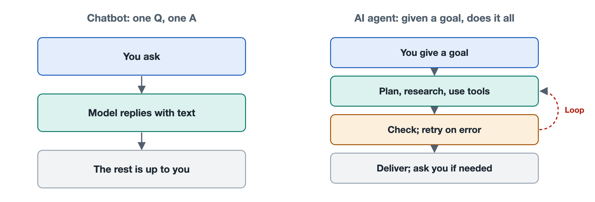

# 1.2 How Agents Differ from Chatbots and Automation Scripts

Suppose you have price quotes from thirty suppliers, scattered across email attachments and several web pages, and you want to organize them into a comparison table. There are three approaches you could try. First, you could open a chatbot and describe what you need. It will tell you, "You can follow these steps," and hand you a table template, but the copying, pasting, and checking are all left to you. Second, you could ask a colleague who knows how to program to write a script that automatically pulls attachments from a fixed email folder every day and fills them into the table. If the attachment format changes, the script will throw an error and stop. Third, you could hand the task to an agent. It will open the attachments and read the web pages on its own. When it notices that one supplier's quote uses a different currency, it will convert it. After filling in the table, it will go back and check for missing items, and whenever it is unsure about something, it will pause and ask you.

All three tools "use a computer," and two of them even "use AI," yet they are three different kinds of things. Telling them apart is the first step toward understanding agents.

## 1.2.1 Chatbots: They Can Talk, but They Don't Act

The basic way a chatbot works is question and answer: you type in some text, it generates a reply, and that round is over. Most chatbots today are built around a large language model (LLM). Their language abilities are strong. They can write copy, explain concepts, and offer advice. Their limitation is structural and has little to do with how smart they are:

- Their only output is text, and text does not turn into action by itself. When a chatbot says "Please open the attachment," the attachment does not open as a result.
- They usually do not push a task forward on their own. Every round of conversation waits for you to speak, and you decide what happens next.
- They cannot see the results of carrying out their own suggestions, so they cannot adjust based on those results.

To use an analogy, a chatbot is like a plumber guiding you over the phone through fixing a pipe. The plumber knows the trade and explains things clearly, but the wrench stays in your hand.

It is worth noting that, as of this writing, many chat products have added capabilities such as web search and code execution, and the line between "chatbot" and "agent" in these interfaces is blurring. This book distinguishes between two ways of working, not between specific products. When a product only answers questions, it is being used as a chatbot. When it calls tools on its own and keeps pushing a task forward, it is being used as an agent.

## 1.2.2 Automation Scripts: They Act, but They Don't Adapt

Automation scripts, and process automation tools more broadly such as Robotic Process Automation (RPA), go to the opposite extreme. They are very good at acting. They can read and write files, click buttons, and call APIs, finishing in a second repetitive work that would take a person half an hour. But every step they take is hard-coded in advance by a person:

- What to do first, what to do next, and which branch to take in which situation are all fixed when the script is written.
- When something unexpected happens, such as a redesigned web page, a missing column in a file, or a field name spelled differently, they can usually only throw an error or produce wrong results. They cannot figure out a solution on their own.
- They do not understand the goal. They only execute steps. A script will dutifully fill numbers into the third column without knowing that the column is supposed to hold the "price including tax."

A script is like an assembly line: fast and reliable, as long as the incoming materials stay to spec.

## 1.2.3 Agents: Deciding the Next Step Themselves, Driven by a Goal

An AI agent combines the strengths of the other two. It uses a large language model to understand goals and assess situations, and it uses tools to actually read files, search the web, write code, and edit spreadsheets. The key point is that the decision of "what to do next" is not written in advance by a person. The model makes it on the spot, during execution, based on the current situation.

Behind this is a loop: observe the current state, think about the next step, call a tool to carry it out, look at the result, and then decide the next step again, until it judges the task complete or decides it needs to stop and check with a person. Back in the price-quote example, noticing the currency mismatch and deciding to convert before filling in the table was not a step anyone wrote into a program. The agent added it after seeing the data. Chapter 6 takes this loop apart in detail. For now, just remember: **what defines an agent is that it pursues a goal autonomously, over multiple steps, with the help of tools.**

## 1.2.4 A Side-by-Side Comparison

| Dimension | Chatbot | Automation Script | AI Agent |
|---|---|---|---|
| Input | A sentence or a question | Data in a fixed format | A goal, which can be stated fairly loosely |
| Output | A text answer | A deterministic operational result | A series of actions and their results |
| Who decides the steps | The user | The author, in advance | The model, during execution |
| Can it act? | Usually not | Yes | Yes, through tools |
| When something unexpected happens | Has no way of knowing | Throws an error or gets it wrong | Tries to adjust, and asks for help when needed |
| Predictability of results | Moderate | High | Lower; requires supervision and checking |
| Typical risk | Saying the wrong thing | Rules going out of date | Doing the wrong thing, drifting off course, overstepping permissions |

The last two rows are easy to overlook, but they matter. An agent gains flexibility at the cost of predictability. Give it the same task twice and it may take different paths. Because it can act on its own, it can also make mistakes on its own, and the mistake may be more than a wrong sentence. It might be an email sent to the wrong person or a file deleted by mistake. That is why later parts of this book spend considerable space on permissions, human confirmation, sandboxes, and evaluation. These designs are not meant to dampen the agent's abilities. They are essential components for keeping that flexibility within controllable bounds.

## 1.2.5 How to Choose: More "Intelligent" Isn't Always Better

Telling the three apart has another very practical use: choosing the right tool.

- If all you need is ideas, an explanation, or a piece of writing, a chat interaction is enough. It is fast and cheap.
- For repetitive work with fixed steps, stable data formats, and very high accuracy requirements, such as exporting a report on a schedule every day, a script is often a better fit than an agent. It won't have any "bright ideas," and stability is exactly what such tasks need.
- Tasks whose steps are not fixed, that require judgment along the way, and that span multiple files or applications are where agents are most useful.

In real-world engineering, the three are also frequently combined: the agent handles understanding and decision-making, calls an existing script whenever it reaches a deterministic, repetitive step, and finally reports back to a person through conversation.

At this point, we know what an agent "is" and what it "is not." But where exactly does an agent end and the outside world begin? Which part belongs to the model, the program, the runtime environment, and the person? The next section draws that boundary.
