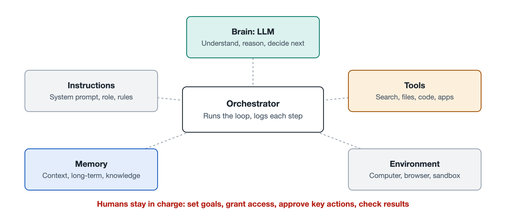

# 2.1 The Brain: The Large Language Model at the Core

Open a coding agent and tell it: "Find every place in this project that reads from a configuration file, and change them all to read from environment variables instead." What follows is a stream of records scrolling across the screen. First it lists the directory, then opens a few files, then writes a short note, "I found three places where configuration is read," then modifies them one by one, and finally runs the tests. It looks like a colleague working away at their desk. But if you take this "machine" apart, only one component is actually doing the "thinking": the large language model (LLM). Everything else, including the file-reading tool, the terminal that runs the tests, and the program that saves the records, carries out decisions the model has made. This section takes a close look at that "brain": what it can do, what it cannot do, and where it actually sits within an agent.

## 2.1.1 A Brain That Only Knows How to "Keep Writing"

A large language model works in a very simple way at its core. Give it a passage of text, and it predicts the content most likely to come next. It generates a small piece at a time, then appends that piece to the text and predicts again. These "small pieces" are called tokens. A token might be a single Chinese character, half an English word, or a punctuation mark. How the model uses a neural network to make these predictions is covered in detail in Volume 18, *Large Language Models*. For now, you only need to remember one thing: **everything the model outputs is text**.

This raises what seems like a contradiction: how can something that only writes text "take action"? The answer lies in a convention. The agent's orchestration program tells the model in advance: "If you want to read a file, write `read_file` and the file path in this format." The model then writes this formatted text in its output. The program recognizes it, actually reads the file on the model's behalf, and sends the file's contents back to the model as new text. So-called "taking action" really means the model "says" the action and the program "does" it. Section 6.3 of Chapter 6 explains in detail how a model "says" an action.

An analogy helps here. The model is like a consultant sitting in a sealed room. The consultant cannot see outside, cannot touch anything, and can only pass notes through a gap under the door. A note might read, "Please look up the third file for me." The assistant outside does as asked and slides the result back under the door. When an agent "does things on its own," the result comes from notes like these passing back and forth, one after another.

## 2.1.2 The Four Jobs the Brain Performs

Within an agent, the model is usually responsible for four things at once:

| Job | What it looks like in the "change configuration reading" task | Model capability it relies on |
|---|---|---|
| Understanding | Grasping what "change them all to environment variables" means | Language comprehension, common sense |
| Decision-making | Deciding to search the code first rather than editing right away | Reasoning, planning |
| Generation | Writing the modified code and the explanatory notes | Text and code generation |
| Evaluation | Reading test errors and judging whether its own change was wrong | Reading feedback, comparison |

In traditional software, these four jobs would each have to be written as separate modules. In an LLM-based agent, the same model handles all of them. Only the input changes from round to round. Agents can handle open-ended tasks with no rules written in advance because they have this kind of general-purpose "brain."

## 2.1.3 Some Innate Traits of This Brain

Knowing what the model can do is not enough. When designing and using agents, it matters even more to understand its limitations. Public sources and engineering practice broadly agree on the following traits, and they are unlikely to go out of date anytime soon:

- **Stateless**: The model itself does not remember the previous conversation. Each time it is called, all it sees is the text sent in for that call. An agent "remembers" what it did earlier only because the program feeds the history back in each time. This is the memory problem covered in Section 2.4.
- **Limited context**: The amount of text the model can read in at once has an upper limit, called the context window. At the time of writing, context windows for mainstream models are commonly described as ranging from tens of thousands to over a million tokens. No matter how large the window is, verbose logs, web pages, and files can still fill it up.
- **Confidently wrong**: The model may produce function names or facts that sound plausible but do not exist. This phenomenon is often called "hallucination." In a chat, it is just one wrong sentence. In an agent, it can turn into a wrong operation.
- **Randomness in output**: Given the same input, two runs may take different steps. This makes agents flexible, but it also makes their behavior harder to predict and reproduce.
- **Knowledge cutoff**: The model's knowledge comes from its training data, and it does not know about events that happened afterward. Tools such as search and retrieval have to fill that gap.

These traits lead to an important design principle: **the other components of an agent exist, to a large extent, to make up for the model's weaknesses.** Tools let it reach the outside world. Memory compensates for statelessness. Sandboxes and permissions keep mistaken operations from causing damage. Human confirmation acts as a checkpoint at critical steps.

## 2.1.4 What Happens When You Swap the Brain

The same agent program often performs noticeably differently when it runs on a different model. At the time of writing, many companies let developers switch between models of different vendors or sizes within the same framework. As a general rule, large models with strong reasoning are better at long chains of tasks and at correcting themselves, but each call is slower and more expensive. Small models respond quickly and cost less, which suits simple steps such as classification and summarization. For this reason, many systems use a "large-plus-small" approach. A strong model handles planning and key judgments, while lightweight models take care of large volumes of repetitive small jobs. Section 5.5 of Chapter 5 covers how costs accumulate with the number of calls.

Keep in mind, too, that a strong model does not automatically make a strong agent. If the instructions are vague, the tool interfaces are poorly designed, or the information fed in is disorganized, even the smartest model will frequently go off track. Engineers often say that an agent's effectiveness depends on "model capability × system design." Both are essential.

## 2.1.5 Summary: The Brain Matters, but It Is Not Everything

Return to the configuration task from the beginning. The large language model is what actually "thought up" the route of searching, modifying, and testing. But the whole system built around it is what let it see the code, change the files, and learn the test results. Calling the model the agent's brain is fair, but remember that this brain can only read and write. It cannot see, cannot touch, and cannot remember. What does it rely on to receive a task and learn its role and rules? The next section looks at the first material the brain receives: instructions.
