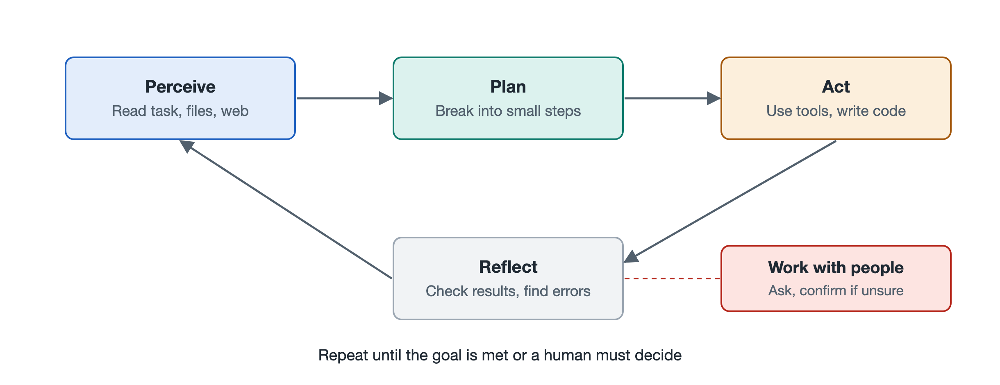

# 3.1 Perception: Understanding Tasks, Files, Web Pages, and Screens

Imagine telling an agent: "Summarize the sales spreadsheet in the attachment by region, then compare it against the store list published on the company website and find which stores have no data." This one sentence hides three completely different kinds of information: a task written in plain human language, a spreadsheet file, and a web page that has to be opened before it can be seen. To get the job right, the agent's first step is not to act but to "understand." This step is called perception.

In traditional robotics, perception refers to cameras and radar turning the outside world into signals a machine can process. For large-model agents, perception has a broader meaning: it means turning tasks, files, web pages, screens, and even the results returned by tools into information the model can read into its context. Once you grasp this, it becomes clear why many cases of "the agent got it wrong" actually stem from the agent "not seeing clearly."

## 3.1.1 The General Principle of Perception: Everything Must Become Input the Model Can Read

A large language model (LLM) itself accepts only one thing: an input sequence. Text-only models read only text; multimodal models (models that can process multiple kinds of information at once, such as text and images) can also read images, and some can read audio as well. Excel files, PDFs, web pages, and computer screens cannot be "stuffed" into a model as they are. They must first go through a conversion step.

So an agent's perception can be understood as having two layers:

- **The conversion layer**: Programs or tools turn external objects into text, table text, or images. For example, a parser reads spreadsheet cells, a web-fetching tool retrieves page content, and a screenshot function captures the screen.
- **The comprehension layer**: The model reads the converted content and judges what it says, how it relates to the task, and what to do next.

This division of labor matters. If the conversion layer loses information, no amount of model intelligence can recover it. If the conversion layer supplies too much, it crowds out the limited context space. For the inner workings of how models "read" text, see Volume 18 of this series, *Large Language Models*. Here we focus only on how agent systems organize these inputs.

## 3.1.2 Understanding the Task: Finding the Goal, Constraints, and Gaps in a Single Sentence

The first thing to be perceived is the task you write. People often leave things out when they speak: does "summarize by region" mean summing or counting? Which page does "the store list on the website" refer to? When reading a task, a good agent does three things:

1. **Identify the goal**: What is ultimately to be delivered—a summary table plus a list of stores with missing data.
2. **Identify the constraints**: What limits apply—use only the attached data, do not modify the original file, output the results in Chinese, and so on.
3. **Identify the gaps**: What information is unclear. If a gap is small, the agent can make a reasonable assumption based on common sense and state it; if a gap is large, it should ask you first (this is expanded on in Section 3.5).

This step is closely tied to the planning that follows: if the task is misread, no matter how well each later step is done, the agent will be heading in the wrong direction.

## 3.1.3 Understanding Files and Web Pages: Structure Matters More Than Text

The difficulty with files and web pages lies in their structure. The table below compares several common types of objects:

| Object perceived | Common conversion method | Common pitfalls |
|---|---|---|
| Plain text, code | Read the text directly | File too long; can only be read in chunks |
| Spreadsheets (e.g., Excel, CSV) | Read into rows and columns with a program, or compute an overview first | Merged cells, multiple worksheets, and hidden rows get overlooked |
| PDF | Extract the text layer; scanned documents require OCR (optical character recognition) | Two-column layouts read in the wrong order; tables broken into scattered words |
| Web pages | Fetch the page source and extract the main content, or read it after rendering in a browser | Ads and navigation get mixed in; content loaded dynamically by scripts comes back empty when fetched |

A practical rule of thumb: when facing a large spreadsheet, a mature agent usually won't read tens of thousands of rows into its context. Instead, it first reads the header and the first few rows to "get a feel for it," then writes a short piece of code to compute statistics and filter. This saves space and is more reliable than having the model "eyeball" calculations row by row. It is a clear example of tools and perception working together.

Web pages have another distinctive feature: their content comes from outside sources and may carry "instructions" aimed at the agent, such as a hidden line reading "ignore all previous requirements." Perceived content should be treated as material, not as commands. This kind of prompt injection risk is discussed specifically in Chapter 7.

## 3.1.4 Understanding the Screen: Letting Agents "Look and Operate" Like a Human

Some software provides no interface that programs can call, so the agent has to look at the screen and click the mouse just as a person would. At the time of writing, several companies have launched this kind of capability, such as Anthropic's Computer Use feature and OpenAI's browser-operating agents. Their general approach is similar:

1. Capture an image of the current screen;
2. A multimodal model identifies the buttons, input boxes, and text in the image;
3. The model decides where to click and what to type, and outputs a position or an action command;
4. After execution, it takes another screenshot to confirm whether the screen changed as expected.

Another approach is to read the interface's Accessibility Tree (the description of interface structure that the operating system provides for screen readers). It directly lists the name and position of each control and is often more accurate than looking at screenshots. Looking at the screen is highly general, but it is slow, prone to misclicks, and may break as soon as the interface is redesigned. That is why, in engineering practice, an interface is generally preferred when one exists, and "looking at the screen" is the fallback when there is none.

## 3.1.5 Perception Is Not a One-Time Event

Finally, it bears emphasizing that perception runs through the entire task rather than happening only at the beginning. Every time an agent takes an action, it must "look" at the result again—what error the code produced, whether the file was actually saved, whether the web page navigated successfully. In the reasoning–action loop discussed in Chapter 6, "looking at each step" is exactly this kind of continuous perception.

To sum up: perception answers the question "what is the current situation?" It converts tasks, files, web pages, and screens into information the model can read, and it updates this understanding after every action. Only after seeing the current state clearly can the agent move on to the next question—how many steps it should take to reach the goal. That is the subject of the next section, "Planning."
