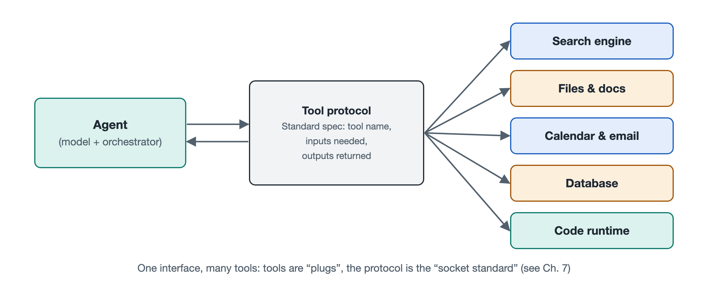

# 4.1 Agents and Tools: Function Calling and Tool Protocols

You ask an agent to "check tomorrow's weather in Shanghai, and if it's going to rain, add a reminder to my calendar to bring an umbrella." A few seconds later, it tells you: "Light rain is expected tomorrow. I've added a reminder for 7 a.m." Behind that sentence, the agent "reached out" at least twice: once to fetch data from a weather service, and once to write an entry into your calendar. Yet a large language model on its own can only read and write text. It has no hands. So how does it turn a sentence into a real query and a real write operation? The answer lies in the "wiring" between the agent and its tools. That wiring has two parts: **function calling** and **tool protocols**.

## 4.1.1 The Model Doesn't Act Directly. It "Writes an Order"

Consider an analogy from a restaurant. When a customer orders, the server doesn't go into the kitchen and cook. Instead, they write "one Kung Pao chicken, less spicy" on an order slip and hand it to the kitchen. The cook prepares the dish from the slip and sends it out.

The way an agent calls tools works much the same way:

- **The model is the server**: Based on what you said, it decides that it needs to check the weather. It then writes a "slip" in a fixed format, such as "call get_weather, parameters: city = Shanghai, date = tomorrow."
- **The orchestration program is the pass-through window**: It reads the slip, confirms that the format is correct and the action is permitted, and then actually calls the weather service.
- **The tool is the kitchen**: The weather service returns "light rain, 18–22°C."
- **The result goes back to the model**: The model reads the result, decides what to do next, and writes a second slip to update the calendar.

This mechanism is called **function calling** (also often called tool calling or tool use). The key point is that the model's output is still just text. That text simply follows a strict format, so a program can parse it reliably. A program outside the model always performs the actual action. This matters a great deal, because it means every action can be checked, blocked, or handed to a person for confirmation before it happens. Chapter 7's discussion of sandboxes and permissions builds on this "write the order first, execute later" structure.

## 4.1.2 Tool Manuals: How the Model Knows Which Tools Are Available

A server can only take orders if they have a menu. Likewise, a model can only call tools if it has received a "tool manual" in advance. In common practice, each tool comes with a structured description that tells the model three things:

| Manual content | Purpose | Weather tool example |
|---|---|---|
| Name | Lets the model refer to the tool precisely | get_weather |
| Description of purpose | Helps the model decide when to use it | Retrieves the weather forecast for a given city on a given date |
| Parameter format | Specifies what information is required and its type | City (text, required), date (date format, required) |

The parameter format is usually written in **JSON Schema**, a general-purpose specification for describing data structures. JSON stands for JavaScript Object Notation. A schema can state whether a parameter is a number or text, whether it is required, and which values are allowed.

How well this manual is written directly affects the agent's performance. If the description is vague, the model may fail to use the tool when it should, or use it when it shouldn't. If the parameters are poorly explained, the model may fill in "tomorrow" in a form the program can't understand. So in real-world engineering, **writing tool descriptions is itself a form of writing prompts for the model**. This links the "instructions" discussed in Chapter 2 with the agent's "hands."

Why can a model read these manuals and produce output in the required format? Mainstream models are specifically trained on this kind of task. For the internal mechanisms, see Volume 18, *Large Language Models*. For this book, the result is what counts: models can reliably produce "structured call requests," but not with 100 percent reliability, so the executing side still needs to validate them.

## 4.1.3 From Custom Wiring to a Universal Socket: The Rise of Tool Protocols

Function calling solves the problem of how a model can express an action, but it soon raises an engineering problem. Suppose you have 5 agent applications and want to connect them to 10 kinds of tools: email, calendar, cloud storage, databases, and so on. If each application needs its own integration code for each tool, that adds up to 5 × 10 = 50 separate integrations. On top of that, different vendors use different manual formats, so switching models might mean rewriting everything.

This resembles the early days of mobile phones, when every brand had its own incompatible charging port. The solution is the same here: **agree on a single standard interface**. Once both applications and tools follow the same conventions, the integration work goes from multiplication to addition. With 5 applications and 10 tools, each side only needs to adapt once.

This set of conventions is called a **tool protocol**. At the time of writing, one of the most prominent examples is the **Model Context Protocol** (MCP), which Anthropic released publicly in late 2024. It divides the two sides into:

- **Client**: the agent application side, which discovers what tools are available and sends call requests;
- **Server**: the tool provider side, which declares what capabilities it offers, executes requests, and returns results.

Under MCP's design, a server can offer more than executable "tools." It can also provide readable "resources," such as file contents, and prewritten "prompt templates." Since then, other companies and open-source communities have proposed or adopted various protocols, including ones designed for communication between agents. This field is still changing quickly, so for which protocols exist and who supports which, check the official sources available when you read this. The underlying structure is less likely to go out of date: **a unified "manual format + call format + return format" that decouples models from tools**. Section 7.2 in Chapter 7 covers the technical details of these protocols.

## 4.1.4 The Easier the Connection, the More Carefully You Should Check the Other End

The easier tools are to connect, the more an agent can do, and the more risk comes with it. Keep three points in mind:

1. **Content returned by tools isn't necessarily trustworthy**. Web pages and emails may contain hidden text such as "ignore all previous instructions." If the model treats it as a command, it can be led astray. This kind of attack is called prompt injection, and Section 7.5 is devoted to it.
2. **Reading and writing are two different things**. Checking the weather is only a read. Deleting files, sending emails, and making payments are writes, and write operations should usually require human confirmation.
3. **Connecting a third-party tool is like letting someone into your home**. Pay attention to whether the source is reliable and what permissions it requests, just as you would when installing a mobile app.

## 4.1.5 Summary

The connection between agents and tools comes down to one sentence: **the model writes the order, the program executes it, and the result comes back**. Function calling lets the model "state" an action in standardized text. Tool manuals tell the model what it can do and how to fill in the details. Tool protocols turn one-off private wiring into a public socket that anyone can plug into. Once you see this wiring clearly, you can understand how an agent "grows hands," and where to install its "brakes." Still, hands alone aren't enough for an agent to do good work. It also needs access to accurate information whenever it needs it. That is the subject of the next section: connecting agents to knowledge.
