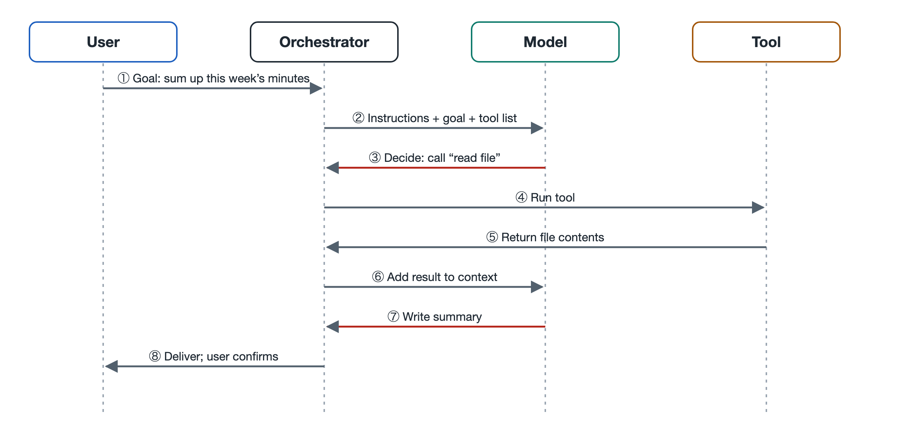

# 5.2 Message Flow: The Back-and-Forth Among Model, Tools, and User

You ask a coding agent to "fix the typos in this function, then run the tests again." The screen first shows a line reading "Reading file…", then a code diff, then "Running tests…", and finally it replies: "Fixed two spots; all tests pass." You said one sentence, and it replied with one sentence. The prompts that flashed by in between are traces left by a series of messages passing back and forth among the model, the tools, and the program.

The previous section covered task flow, which concerns "which steps need to happen." This section takes a different angle and looks at what carries each step from one place to another. The answer is messages. The components inside an agent cannot operate on one another directly. All communication between them happens through messages.

## 5.2.1 How Many Kinds of Messages Are in a Task

In today's mainstream large model APIs, a conversation is organized as a list of messages in chronological order. Each message carries a "role" label that says who produced it. Different companies' APIs use slightly different names, but at the time of writing the common structure looks roughly like this:

| Role | Produced by | Typical content |
|---|---|---|
| System | The developer or product team | Identity, rules, descriptions of available tools |
| User | You | Task goals, additional requirements, approvals or rejections |
| Assistant | The model | A text reply, or a request saying "I want to call a certain tool" |
| Tool result | Filled in by the orchestrator after running a tool | File contents, search results, error messages |

One fact here is easy to overlook: the model never runs a tool itself. It only outputs a structured request, such as "call read_file with the argument utils.py." The component that actually reads the file is the orchestrator, the driver program described in Chapter 2. After reading the file, the orchestrator wraps the result in a "tool result" message and puts it back on the list for the model.

## 5.2.2 How a Single Round Trip Works

Expanding the typo example from the opening, the messages flow roughly like this:

1. **User → Orchestrator**: You enter the task, and the program appends it as a user message.
2. **Orchestrator → Model**: The program sends the system message, the message history, and this new message to the model together.
3. **Model → Orchestrator**: The model returns an assistant message containing a call request to read utils.py.
4. **Orchestrator → Tool → Orchestrator**: The program checks permissions, performs the read, and gets the file contents.
5. **Orchestrator → Model**: The file contents are appended to the list as a tool result, and the entire list is sent to the model again.
6. The model issues a request to modify the file, then a request to run the tests. Each of these steps repeats the same round trip.
7. **Model → User**: Once the model judges the task complete, it outputs a plain text message instead of a call request. The orchestrator displays this message to you, and the loop ends.

Think of the orchestrator as a front desk. The model sits in a back room and only writes notes. The tools do their work outside, and the user conducts business at the service window. Every note passes through the front desk, where it is logged and forwarded, and sometimes stamped for approval. When you see "Reading file…", that is the front desk posting a summary of an internal note at the window.

## 5.2.3 Why the Whole List Is Resent Every Time

Many people are surprised to learn that the model itself does not remember what was said in the previous round. Mainstream large model APIs are designed to be stateless, so every call is an independent computation (see Volume 18 for why). An agent appears coherent because the orchestrator hands the complete message history back to the model every round.

This design has three consequences:

- **The message list is the agent's "workbench."** The model can refer only to what is on the list. If a tool result isn't written back to the list, then as far as the model is concerned, it never happened.
- **The list keeps growing.** In a task that reads a dozen or more files, the list may pile up tens of thousands of words of tool results. Context flow, covered in the next section, deals with what to do once the list gets long.
- **The number of round trips determines time and cost.** Every round sends the entire list and waits for the model to generate a response. Section 5.5 works out these costs.

## 5.2.4 Why Message Format Matters

Because all communication happens through messages, the message format becomes the shared language of every party involved. Tool call requests usually require a strict structured format. At the time of writing, most APIs use JSON (JavaScript Object Notation, a text format that describes data as keys and values) for the tool name and arguments. Each call request also usually carries an ID, and the tool result is filled back in under the same ID. That way, when the model issues several calls at once, no result gets matched to the wrong call.

When the format goes wrong, the round trip breaks. Common cases include the following. The model misspells an argument name, and the tool throws an error. A tool returns a large block of garbled text or an overly long web page that fills up the list. The orchestrator fails to return a result, so the model concludes the tool didn't respond and calls it again and again. So a reliable agent needs more than a smart model. It also needs a conscientious front desk that validates formats, truncates overly long results, and passes errors to the model verbatim so the model can adjust its next step accordingly.

There is also a security issue. A tool result enters the list under the "tool" role, but its content may come from a web page or an external file, and it may contain text disguised as instructions. If the model can't tell the difference, it may treat that text as a command and follow it. This is prompt injection, covered in Section 7.5, and the message flow is exactly how it gets in.

## 5.2.5 Summary: Understand the Messages and You Understand the Agent's Action Log

To you, an agent looks like a series of questions and answers. Inside the system, it is a constantly growing list of messages plus a loop that repeatedly sends the list to the model, carries out its requests, and writes back the results. Many agent products let you expand the tool call details or the run log. Next time you use one, open them up. Count how many round trips the task took, what the model asked for in each round, and what the tools returned.

As the message list grows, it will sooner or later hit the limit of what the model can read in. The next section turns to context flow: which information should stay, and which should be compressed or pushed out.
