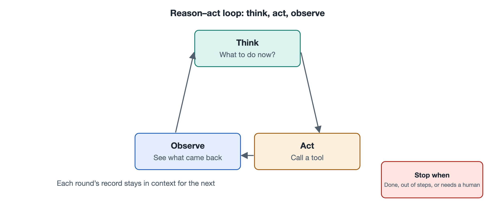

# 6.1 The Reason–Act Loop: Think a Step, Take a Step, Look a Step

Suppose you ask a coding agent to fix a small problem: "When the table is exported, the date column shows up as a string of numbers. Please fix it." As you watch the screen, its work log appears one line at a time. First it says, "I need to find the code related to exporting," and runs a file search. After reading the results, it says, "The problem is probably in the format conversion function," and opens that file. Once it has changed the code, it says, "Let me run the tests to confirm." A test fails. It reads the error message, changes one more thing, and the tests pass. Finally, it reports back to you.

The log looks fragmented, but the same rhythm repeats throughout: think a step, act a step, look a step. This rhythm is the beating heart of nearly every large-model agent, and it is usually called the reasoning–action loop. Chapter 5 described how tasks, messages, and context flow. This section answers a different question: how does the "engine" that keeps them flowing turn, one cycle after another?

## 6.1.1 One Loop, Three Beats

If we break the bug-fixing process above into parts, each cycle contains three stages:

| Beat | What the agent is doing | How it appears in the bug-fixing example |
|---|---|---|
| Think (Reasoning) | Decides what to do next, based on the goal and what it already knows | "The problem is probably in the format conversion function" |
| Act (Action) | Issues a concrete action, usually a tool call | Opens a file, edits code, runs tests |
| Look (Observation) | Reads the result of the action and adds it to what it knows | Reads the test error: "Date type mismatch" |

After the agent looks, the new information enters the context, so the next round of thinking rests on updated facts. The cycle repeats until the model decides the task is complete or reaches a point where it must stop and ask a human.

This idea has a widely cited name in the research literature: ReAct, a blend of the words Reasoning and Acting. It comes from a 2022 paper by researchers at Princeton University and Google. The paper's central finding is simple. If a model only thinks, it tends to make things up. If it only acts, it tends to flail through random attempts. When thinking and acting alternate, real-world feedback corrects each thought, and each action has a stated reason behind it. This combination usually works better than either approach alone. Today's agent products differ in how they implement it, but most of them show traces of this alternating structure.

## 6.1.2 Who Turns the Loop: Dividing Work Between the Model and the Orchestrator

A common misconception is that the large model is "looping" by itself. In fact, each time the model is called, it does exactly one thing: it reads in a passage of text and produces a passage of text (see Volume 18, *Large Language Models*). It has no hands, and it does not remember the previous round on its own. What actually turns the loop is the orchestrator introduced in Chapter 2. Within one cycle, the work is divided roughly as follows:

1. The orchestrator assembles the system prompt, the user's task, the list of available tools, and all prior records, then passes them to the model;
2. The model outputs some reasoning, along with a structured request of the form "I want to call this tool, with these parameters";
3. The orchestrator parses the request, checks permissions, asks the user for confirmation if needed, and then actually runs the tool;
4. The orchestrator writes the result back into the record and returns to step 1.

An analogy may help. The model is like a consultant who can only pass notes through a window, and the orchestrator is the assistant running errands outside. The consultant writes, "Fetch the third file from the archive room." The assistant fetches it and slips a photocopy back through the window, and the consultant writes the next note. The consultant appears to be "working continuously," but each note is actually a fresh answer based on all the material piled up inside the window. This point matters. The loop's memory depends on the context, and its safety gate depends on the orchestrator. The model handles only the "think" part of each cycle.

## 6.1.3 Why "Look a Step": Feedback Is the Source of Correction

Consider what happens without the observation stage. The model writes out every step at once, and the steps are then carried out exactly as listed. This is like memorizing an entire route and then walking it blindfolded. If the map is wrong at step two, everything after that goes wrong too.

The value of "looking" is that it brings in external facts. What a file really contains, what a command really returns, what a web page really shows: none of these come from the model's imagination. The environment supplies them. The model's reasoning may be wrong, but once an error shows up during observation, such as a failed test or an empty search result, the next cycle has a chance to correct it. The "reflection and error correction" described in Chapter 3 happens here at the level of mechanism. Without observation, there is nothing to reflect on.

This also explains a practical lesson. Giving an agent tools that can verify results often helps more than writing an ever more detailed prompt. A coding agent that can run tests, or an office agent that can read a spreadsheet's contents back, is far more reliable than one that simply hands in its work once it is written. Chapter 8 will show, from the perspective of cybernetics, that this follows the general rule of feedback loops.

## 6.1.4 When the Loop Stops

A loop that turns on its own must have brakes. Common stopping conditions include:

- **Task complete**: The model stops requesting tools and gives a final answer;
- **Human intervention needed**: When it runs into insufficient permissions, unclear information, or a high-risk operation, it pauses and asks the user;
- **Limit reached**: It uses up a maximum number of rounds, a time limit, or a cost cap set by the orchestrator;
- **Unrecoverable error**: A tool fails repeatedly, or the environment is unavailable.

Of these, "limit reached" may seem crude, but it is essential. A model can get stuck going in circles, searching for the same term again and again or editing the same line of code over and over. Without a limit, this kind of spinning keeps burning time and money (the cost flow from Chapter 5). Section 6.5 of this chapter covers failure modes such as getting stuck and drifting off course, along with ways to recover from them.

## 6.1.5 Summary: A Small Cycle That Sets the Rhythm for the Whole Machine

The reasoning–action loop connects the parts from earlier chapters into a moving whole. The model thinks, the tools act, the environment returns results to look at, and the orchestrator ties the three together and guards the gate. Once you understand this loop, an agent's work log stops looking like a jumble of messages. You can count its beats one cycle at a time and tell which stage it got stuck in.

Still, the loop only answers how each step is taken. It does not answer how the whole path is planned. Faced with a large task, should an agent draw up a complete plan first, or figure things out as it goes? That is the question the next section takes up.
