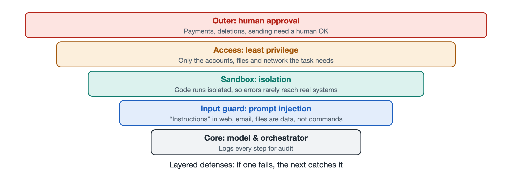

# 7.4 Evaluation Benchmarks: How to Measure Whether an Agent Is Any Good

Suppose your department is planning to adopt a coding agent, and the vendor brings you two documents. One says the agent "leads on such-and-such benchmark." The other is feedback from several colleagues who tried it for a week: some say it works well, while others say it broke a configuration file twice. Which one should you trust? And the more practical question: if you had to write the test yourself, how would you judge whether an agent is any good?

This section answers that question. "Grading" an agent is much harder than grading a chatbot, because what it produces is not a single reply but a sequence of actions and the consequences those actions leave behind.

## 7.4.1 From "Answering a Question Correctly" to "Getting a Job Done"

When evaluating large language models, a common approach is to prepare a set of questions and check whether the answers are correct. Such a test set is called a **benchmark**: a shared yardstick that makes side-by-side comparison possible.

Agent benchmarks call for a different way of setting the questions. What they test is whether the agent can carry a task through from start to finish, so each task usually contains three things:

| Component | Purpose | Example: "Fix a software bug" |
|---|---|---|
| Task description | Tells the agent what to do | A real bug report |
| Environment | The place the agent can observe and act in | A sandbox with the code repository set up |
| Verification method | Automatically checks whether the result meets the bar | Run pre-written tests and see whether they pass |

The third item is the key. An agent might take twenty steps or two hundred. Evaluation usually does not scrutinize every sentence it says; instead, it checks the **final state** of the environment: did the tests pass, were the files changed correctly, was the order actually created? It is much like a driving test: the examiner doesn't care what you were thinking, only whether the car ended up in the parking space without crossing the lines.

## 7.4.2 Common Types of Agent Benchmarks

At the time of writing, academia and industry already use quite a few public agent benchmarks. By the scenario they test, they fall roughly into several categories (specific names and versions change quickly; the following are just examples frequently cited in public sources):

- **Software engineering**: e.g., SWE-bench, which collects real bug reports and their corresponding fixes from open-source projects, has the agent modify code in the repository, and then uses the project's own tests to judge the result.
- **Web and software operation**: e.g., WebArena and OSWorld, which deploy web applications or real desktop systems in isolated environments and ask the agent to complete tasks such as "place an order on a shopping site" or "organize data in a spreadsheet."
- **General assistant**: e.g., GAIA, whose questions require a combination of abilities such as searching, reading files, and computing, with clear, verifiable answers.
- **Tools and dialogue**: e.g., τ-bench, which simulates customer service scenarios where the agent must converse with a "user" while calling tools according to business rules.

What they have in common: the tasks come from, or closely resemble, real work; the environment can be reset; and the results can be judged automatically. Being resettable lets different agents compete from the same starting point; automatic judging allows testing at scale, again and again.

## 7.4.3 Beyond "Success Rate," What Else to Look At

The most prominent number in a benchmark report is usually the **task success rate**, the proportion of tasks completed successfully out of all tasks. But looking at this number alone can be misleading. When evaluating an agent, you should care about at least the following dimensions:

1. **Consistency**: If the same task is run multiple times, does it succeed every time? Agent outputs are random to some degree, and succeeding once in a while is very different from succeeding every time when it comes to real use. Some benchmarks specifically report the proportion of tasks that succeed on several consecutive runs.
2. **Cost**: How much time did the task take, how many **tokens** (the basic unit of text a model processes) were consumed, and how many tool calls were made? A slightly higher success rate at several times the cost may not be worth it. This corresponds directly to the "cost flow" discussed in Chapter 5.
3. **Safety**: During the process, did the agent delete files it shouldn't have, access addresses it shouldn't have, or perform high-risk operations without confirmation? A correct result reached by overstepping permissions is unacceptable in a production environment.
4. **Process quality**: Were there redundant steps? Could the agent notice and recover from its own errors? When information was insufficient, did it ask instead of guessing?

So when looking at an agent, ask at least four questions: Did it get it done? Can it get it done every time? What did it cost? Did it cause any trouble?

## 7.4.4 The Limits of Benchmark Scores

Back to those two documents from the beginning. Benchmark scores are valuable, but you should be aware of several inherent limitations:

- **Leaked questions**: If benchmark tasks and their answers appear in a model's training data, scores may be inflated, measuring "memorized" rather than "can do." This problem is called **data contamination**, and researchers mitigate it by regularly refreshing the task pool and using newer tasks.
- **Incomplete verification**: Automated tests can only check the conditions written into them. An agent might "game the system," for example by modifying the tests themselves so they pass, or the result might go wrong outside the tests' coverage.
- **Environmental differences**: Benchmark environments are clean and standardized, but your company's code repositories, internal systems, and work habits are all different.
- **Configuration differences**: The same model, paired with different prompts, tools, and orchestration code, can score very differently. So the score in a report often measures "the model plus this scaffolding" as a whole, not just the model itself.

This is not to say benchmarks are useless. Rather, they are good for answering "roughly what level is it at," not for directly answering "will it work well for me."

## 7.4.5 Building Your Own Small Yardstick

For teams planning to adopt an agent, a safer approach is to build a small evaluation set of their own alongside public benchmarks:

1. Select 20–50 representative real tasks from daily work, including easy ones, hard ones, and ones where things tend to go wrong;
2. For each task, spell out "what counts as done," and automate the checks wherever possible;
3. Run them in an isolated test environment and keep complete execution logs;
4. Run each task several times, recording success rate, time taken, cost, and any permission violations;
5. Rerun the whole set every time you switch models, modify prompts, or add tools, to see whether anything has regressed.

The last point is especially important. In software engineering this is called a **regression test**: when you improve one thing, you confirm you haven't broken something else. Agent systems have many components, and even a small change to a prompt can cause something that used to work to stop working well.

Evaluation answers "how well does it do," but there is one question evaluation scores cannot reveal: what if someone deliberately misleads it or lures it into overstepping its permissions, and who is responsible when something goes wrong? That is the topic of the next section: security risks and governance.
