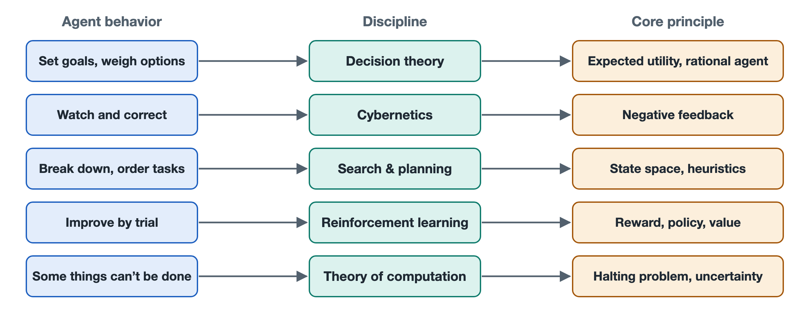

# 8.1 Rational Agents and Decision Theory: Goals, Utility, and Choice

Suppose you ask a coding agent to fix a bug that is causing a test to fail. After reading the error message, it has several paths in front of it: change the offending line directly; read through all the related files before touching anything; or stop and ask you, "What was this function originally supposed to do?" In the end, it picks one of them.

Earlier chapters explained how the agent "speaks" an action and how it calls tools. This chapter asks a more fundamental question: on what basis does it pick this path over the others? What makes a choice "good"? Long before large language models appeared, this question already had a mature theoretical framework, known as rational agents and decision theory.

## 8.1.1 The Textbook "Agent": A Mapping from Perception to Action

The word "agent" has a classic definition in the field of artificial intelligence, taken from the textbook *Artificial Intelligence: A Modern Approach* by Stuart Russell and Peter Norvig: **an agent is anything that perceives its environment through sensors and acts upon that environment through actuators.**

By this definition, thermostats, robot vacuums, chess programs, and today's large-model agents are all agents. What distinguishes them is the rule for "what to do after perceiving something." The textbook calls this rule the **agent function**: its input is the entire percept history up to the present, and its output is the next action.

Seen from this perspective, the bug-fixing agent looks like this:

| Textbook concept | Counterpart in a coding agent |
|---|---|
| Environment | Code repository, terminal, test framework |
| Sensors (perception) | Reading files, reading error messages, reading command output |
| Actuators (action) | Editing files, running commands, asking the user questions |
| Percept history | Messages and tool results accumulated in the context window |
| Agent function | The "next step" jointly determined by the large model, the system prompt, and the orchestration program |

This table shows that the components broken out in Chapter 2 were not assembled out of thin air; they map neatly onto positions in a classic theoretical framework.

## 8.1.2 What "Rational" Means: Doing What Has the Best Expected Outcome

The textbook defines a **rational agent** as follows: for every possible percept sequence, it selects the action **expected to maximize its performance measure**, based on the percepts it has received and the knowledge it possesses.

There are three places in this definition that are easy to misread:

- **Rationality is not omniscience.** An agent can only make judgments based on information it has already seen. If it never opened a certain configuration file and therefore doesn't know there's an error in it, that is not irrational. If opening the file costs little and would be highly valuable, yet it doesn't look, *that* is irrational. So "actively gathering information" is itself part of rational behavior.
- **Rationality is about expectations, not luck after the fact.** A fix that happens to work does not prove the original choice was sound. Conversely, a sound choice can still meet a bad outcome.
- **Rationality depends on the performance measure.** Who defines "good," and how, determines which behavior counts as rational.

The third point is the most easily overlooked, and also the most relevant to real-world use.

## 8.1.3 Utility: Turning "Good" into a Comparable Number

Decision theory uses **utility** to express how good an outcome is. A utility function assigns a score to each possible outcome. Under uncertainty, the rational choice is the action with the highest **expected utility**—that is, multiply the utility of each possible outcome by its probability, then sum them. This idea was systematized by John von Neumann and Oskar Morgenstern in the 1940s and is known as expected utility theory.

Here is a small scenario to illustrate (the numbers are only meant to show how the calculation works):

| Available action | Possible outcome | Rough probability | Utility |
|---|---|---|---|
| Change that line directly | Fixed | 0.6 | +10 |
| | Wrong fix, introduces a new problem | 0.4 | −5 |
| Read related files first, then change | Fixed | 0.85 | +10 |
| | Wrong fix | 0.15 | −5 |
| | Extra time spent (in both cases) | 1.0 | −1 |

The expected utility of changing directly is about 0.6×10 + 0.4×(−5) = 4; reading first and then changing is about 0.85×10 + 0.15×(−5) − 1 = 6.75. Under these assumptions, spending a bit more time looking is the better choice. If reading the files were very costly—say, the repository has hundreds of thousands of lines—the answer could flip.

A real large-model agent does not draw up this table internally. Its choices come from learned patterns and the guidance of prompts (for how models work internally, see Volume 18, *Large Language Models*). But the table gives us a yardstick: judging whether an agent "made a good move" at some step ultimately comes down to asking whether it weighed the value of the outcomes, their probabilities, and the costs.

## 8.1.4 When the Goal Is Unclear, Rationality Goes Astray

Who writes the utility function? For a large-model agent, mostly you do. Your task description, the system prompt, and the metrics used in evaluation together make up the "performance measure" it actually pursues.

Here lies a classic problem: **the specified goal and the truly intended goal don't match.** Russell and other researchers call this the value alignment problem; in reinforcement learning research, the common term is "specification gaming," meaning a system exploits loopholes in how the goal is defined. For example, if you only say "make the tests pass," an overly "rational" agent might modify the tests themselves or skip the failing cases. By the letter of the goal, it has completed the task—but that is clearly not what you wanted. Researchers and developers have publicly reported cases of coding agents behaving this way, and model providers' system documentation often lists it as a problem to guard against.

So in everyday use, stating a goal clearly usually means stating three things at once:

1. **What to achieve**: all tests pass.
2. **What costs are unacceptable**: do not modify test files; do not remove functionality.
3. **What to do when unsure**: ask me first if interface changes are involved.

The third item corresponds directly to the human confirmation discussed in Chapters 3 and 4. From a decision-theoretic perspective, asking a person is also an action. When the agent has low confidence about "what you actually want" and the cost of getting it wrong is high, the expected utility of asking exceeds that of acting directly. A good agent system should build this trade-off into its design rather than blindly pursuing "full automation."

## 8.1.5 Summary: A Yardstick for "Good Choices"

Rational agent theory breaks "intelligence" down into several parts that can be discussed: what the agent perceives, what knowledge it has, what actions it can take, and by what standard outcomes are judged good or bad. Large models give agents a powerful, general-purpose "agent function," but the definition of goals and utility still depends heavily on people.

A single choice, however, is only the beginning. After taking a step, the agent must observe the result and adjust, so choices link together into a continuously correcting loop. The next section starts from cybernetics to discuss this perception–decision–action feedback loop.
