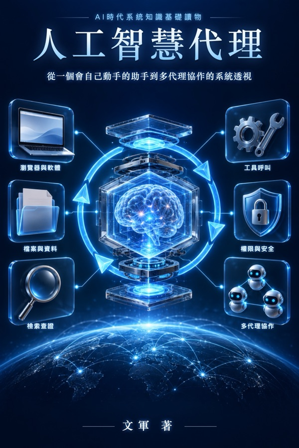

# 關於本書

**《人工智慧代理》**——從一個會自己動手的助手到多代理協作的系統透視

《AI時代系統知識基礎讀物》叢書，作者：文軍。

## 怎樣讀這本書

本書採用「書 + 實物 + AI」的學習方式：書給出一張穩定的知識骨架，你手邊的實物就是教具，遇到想深入的地方，可以把書中的問題直接拿去問 AI，讓它繼續往下展開。

全書按九層認知階梯組織：對象 → 結構 → 功能 → 關係 → 流動 → 機制 → 關鍵技術 → 原理 → AI 協同。

## 留言

每頁底部的留言區由 Giscus 提供，留言保存在本書 GitHub 儲存庫的 Discussions 中，需要用 GitHub 帳號登入後留言。

## 版權

© 文軍。保留所有權利。
