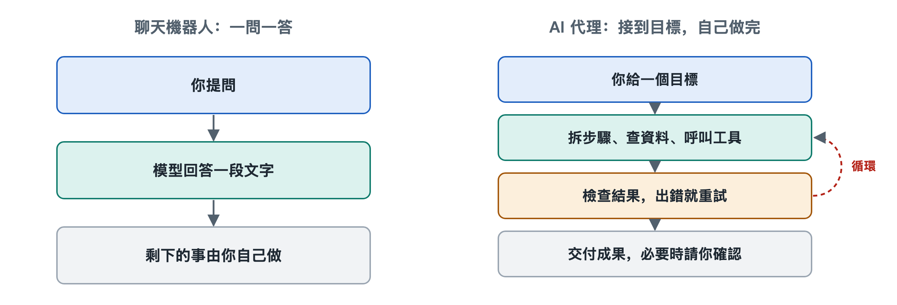

# 1.2 AI 代理與聊天機器人、自動化腳本的區別

假設你手頭有一份三十家供應商的報價單，散落在郵件附件和幾個網頁裡，你想把它們整理成一張對比表。你有三種辦法可以試。第一種，打開一個聊天機器人，把需求說一遍，它會告訴你「可以按以下步驟操作」，再給出一份表格模板，剩下的複製、貼上、核對都要你自己做。第二種，請懂程式設計的同事寫一段腳本，讓它每天自動從固定的郵箱資料夾裡取附件、填進表格。只要附件格式一變，腳本就會報錯停下來。第三種，把任務交給一個 AI 代理，它會自己打開附件、讀網頁、發現某家報價單幣種不同就去換算，填完表再回頭檢查有沒有漏項，遇到拿不准的地方停下來問你。

三種工具都「用了電腦」，有兩種還「用了 AI」，可它們是三類不同的東西。把這三者分清楚，是認識 AI 代理的第一步。

## 1.2.1 聊天機器人：會說，但不動手

聊天機器人（Chatbot）的基本工作方式是一問一答：你輸入一段文字，它生成一段回覆，這一輪就結束了。如今的聊天機器人大多以大語言模型（Large Language Model，LLM）為核心，語言能力很強，能寫文案、解釋概念、給出建議。它的局限出在結構上，跟聰明程度關係不大：

- 它的輸出只有文字，文字不會自己變成動作。它說「請打開附件」，附件不會因此被打開。
- 它通常不會主動推進任務。每一輪對話都要等你開口，下一步做什麼由你決定。
- 它看不到自己建議的執行結果，所以無法根據結果調整。

打個比方，聊天機器人像一位隔著電話指導你修水管的師傅，懂行，也說得清楚，可扳手始終在你手裡。

需要說明的是，寫作時不少聊天產品已經加入了聯網搜尋、執行程式碼等能力，介面裡的「聊天機器人」和「AI 代理」之間的界線正在變模糊。本書區分的是兩種工作方式，不是某個具體產品。同一個產品，在只回答問題時是聊天機器人的用法，在自己呼叫工具、連續推進任務時就成了 AI 代理的用法。

## 1.2.2 自動化腳本：會動手，但不變通

自動化腳本（Script）以及更廣義的流程自動化工具，比如機器人流程自動化（Robotic Process Automation，RPA），走的是另一個極端。它們動手能力很強，能讀寫檔案、點擊按鈕、呼叫介面，一秒鐘能完成人要做半小時的重復勞動。但它們的每一步都是人事先寫死的：

- 先做什麼、後做什麼、遇到哪種情況走哪條分支，全部在編寫時確定。
- 遇到沒預料到的情況，比如網頁改版、檔案少了一列、字段名換了寫法，它通常只能報錯或者出錯，自己想不出辦法。
- 它不理解目標，只執行步驟。它照指令把數字填進第三列，卻不知道這一列應當是「含稅價」。

腳本像一條裝配流水線，又快又穩，前提是來料規格不變。

## 1.2.3 AI 代理：在目標驅動下自己決定下一步

AI 代理（AI Agent）把前兩者的長處接在了一起。它用大語言模型理解目標、判斷局面，又通過工具真正去讀檔案、查網頁、寫程式碼、改表格。關鍵在於「下一步做什麼」這個決定不是人預先寫好的，是模型在執行中根據當前情況現場做出的。

這背後是一個循環：觀察當前狀態，想下一步，呼叫工具執行，看執行結果，再決定下一步，直到判斷任務完成，或者需要停下來請示人。回到報價單的例子，發現幣種不一致、決定先換算再填表，這一步沒有人寫進程式，是 AI 代理看到資料後自己加上的。這個循環在第六章會詳細拆開講，這裡只需記住：**AI 代理的特徵是自主地、多步地、借助工具推進一個目標。**

## 1.2.4 一張對照表看清三者

| 對比維度 | 聊天機器人 | 自動化腳本 | AI 代理 |
|---|---|---|---|
| 輸入 | 一句話或一個問題 | 固定格式的資料 | 一個目標，可以說得比較模糊 |
| 輸出 | 文字回答 | 確定的操作結果 | 一串操作及其結果 |
| 誰決定步驟 | 使用者 | 編寫者事先寫定 | 模型在執行中決定 |
| 能否動手 | 通常不能 | 能 | 能，通過工具 |
| 遇到意外 | 無從知曉 | 報錯或出錯 | 嘗試調整，必要時求助 |
| 結果可預測性 | 中等 | 高 | 較低，需要監督與檢查 |
| 典型風險 | 說錯話 | 規則過時 | 做錯事、走偏、越權 |

最後兩行容易被忽略，卻很重要。AI 代理換來了靈活，代價是可預測性降低。同一個任務交給它兩次，走的路徑可能不一樣；它能自己做事，也就可能自己做錯事，而且做錯的不只是一句話，可能是一封發錯的郵件或一個刪錯的檔案。所以本書後面會花不少篇幅講權限、人工確認、沙箱和評測。這些設計不是給 AI 代理潑冷水，是把這份靈活關進可控範圍的必要部件。

## 1.2.5 怎樣選：不是越「智慧」越好

分清三者，還有一個很實際的用處：選對工具。

- 只需要想法、解釋或一段文字，聊天方式就夠了，又快又便宜。
- 步驟固定、資料格式穩定、對準確性要求極高的重復工作，比如每天定時導出報表，腳本往往比 AI 代理更合適：它不會「靈機一動」，而穩定正是這類任務要的。
- 步驟不固定、需要邊看邊判斷、要跨多個檔案或軟體完成的任務，才是 AI 代理最有用的地方。

在實際工程中，三者也常常組合使用：AI 代理負責理解和決策，遇到確定的重復環節就呼叫一段現成的腳本來執行，最後用對話的方式向人彙報。

到這裡，我們知道了 AI 代理「是什麼」以及「不是什麼」。但一個 AI 代理到底在哪裡結束、外部世界從哪裡開始？模型、程式、執行環境和人，各自佔據哪一塊？下一節就來畫出這條邊界。
