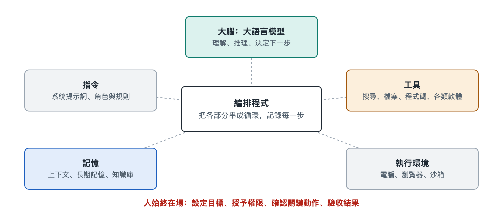

# 2.1 大腦：作為核心的大型語言模型

打開一個程式設計代理，對它說：「幫我把這個專案裡所有讀取設定檔的地方找出來，統一改成從環境變數讀取。」接下來螢幕上會滾動出一串記錄：它先列出目錄，再打開幾個檔案，接著寫下一段說明，「我發現有三處用到了設定讀取」，然後逐個修改，最後執行測試。看起來像一位同事在埋頭幹活。可是，如果把這台「機器」拆開，真正在「想」的部分只有一個：大型語言模型（Large Language Model，LLM）。其餘的部件，包括讀檔案的工具、執行測試的終端和保存記錄的程式，都在執行模型做出的決定。這一節先看清這顆「大腦」：它能做什麼，不能做什麼，以及它在 AI 代理裡實際處在什麼位置。

## 2.1.1 一個只會「接著往下寫」的大腦

大型語言模型的基本工作方式很樸素：給它一段文字，它預測接下來最可能出現的內容，一次生成一小段，再把生成的內容接回去繼續預測。這些「一小段」叫作令牌（token），可以是一個漢字、半個英文單字或一個標點。模型內部怎樣用神經網路完成這種預測，第十八冊《大型語言模型》有專門講解，這裡只需要記住一點：**模型的全部輸出都是文字**。

這帶來一個看似矛盾的問題：只會寫字的東西，怎麼能「動手」？答案在於約定。AI 代理的編排程式事先告訴模型：「如果你想讀檔案，就按這個格式寫出 `read_file` 和檔案路徑。」模型於是在輸出裡寫下這樣一段格式化的文字，程式辨識出來，替它真正去讀檔案，再把檔案內容作為新的文字送回給模型。所謂「動手」，其實是模型「說出」動作，程式去「做」出動作。具體怎樣「說出」一個動作，第六章 6.3 節會細講。

可以用一個類比來理解：模型像一位坐在密室裡的顧問，看不見外面，也碰不到任何東西，只能透過門縫遞紙條。紙條上寫「請幫我查一下第三份檔案」，門外的助手照辦，再把結果塞回門縫。AI 代理的「自己動手」，就是這樣一張張紙條來回傳遞的結果。

## 2.1.2 大腦承擔的四種工作

在一個 AI 代理裡，模型通常同時負責四件事：

| 工作 | 在「改設定讀取」任務中的表現 | 依賴模型的哪種能力 |
|---|---|---|
| 理解 | 讀懂「統一改成環境變數」是什麼意思 | 語言理解、常識 |
| 決策 | 決定先搜尋程式碼，而不是直接改 | 推理、規劃 |
| 生成 | 寫出修改後的程式碼和說明 | 文字與程式碼生成 |
| 評判 | 看測試報錯，判斷是不是自己改錯了 | 閱讀回饋、比較 |

這四件事在傳統軟體裡要由不同的模組分別編寫，在大模型代理裡卻由同一個模型完成，只是每一輪面對的輸入不同。AI 代理之所以能處理開放、事先沒有寫好規則的任務，就是因為有這樣一個通用的「大腦」。

## 2.1.3 這顆大腦的幾個先天特點

只看到模型能做什麼還不夠，設計和使用 AI 代理時，更要清楚它的局限。下面幾個特點在公開資料和工程實踐中都有共識，而且短期內不容易過時：

- **無狀態**：模型本身不記得上一次對話。每一次呼叫，它看到的只是這一次送進來的全部文字。AI 代理之所以「記得」前面做過什麼，是程式把歷史記錄一次次重新塞給它。這就是第 2.4 節要講的記憶問題。
- **上下文有限**：一次能讀入的文字量有上限，稱為上下文視窗（context window）。寫作時主流模型的視窗常見說法在數萬到上百萬令牌之間，但視窗再大也會被冗長的日誌、網頁和檔案填滿。
- **會「一本正經地出錯」**：模型可能寫出看似合理、實則不存在的函式名或事實，這種現象常被稱為「幻覺」（hallucination）。在聊天中這只是一句錯話，在 AI 代理裡卻可能變成一次錯誤操作。
- **輸出有隨機性**：同樣的輸入，兩次執行可能走出不同的步驟。這讓 AI 代理靈活，也讓它的行為更難預測和重現。
- **知識有截止時間**：模型的知識來自訓練資料，之後發生的事它並不知道，需要靠搜尋、檢索等工具補上。

這些特點決定了一個重要的設計思路：**AI 代理裡的其他部件，很大程度上是為了彌補模型的短板而存在的。**工具讓它接觸外部世界，記憶彌補無狀態，沙箱和權限防止錯誤操作造成破壞，人工確認在關鍵步驟把關。

## 2.1.4 換一個大腦，AI 代理會怎樣

同一套 AI 代理程式，換用不同的模型，表現往往差別明顯。寫作時，多家公司都允許開發者在同一個框架裡切換不同廠商或不同規模的模型。一般規律是：規模大、推理能力強的模型更擅長長鏈條任務和自我糾錯，但每次呼叫更慢、更貴；小模型回應快、成本低，適合分類、摘要這類簡單步驟。因此不少系統採用「大小搭配」的做法，讓強模型負責規劃和關鍵判斷，讓輕量模型處理大量重複的小活。成本怎樣隨呼叫次數累積，第五章 5.5 節會展開。

還要注意，模型強，不等於 AI 代理強。指令寫得含糊、工具介面設計混亂、送進去的資訊雜亂無章，再聰明的模型也會頻繁跑偏。工程上常說，AI 代理的效果取決於「模型能力 × 系統設計」，兩者缺一不可。

## 2.1.5 小結：大腦重要，但不是全部

回到開頭那個修改設定的任務。真正「想」出搜尋、修改、測試這條路線的，是大型語言模型；但讓它看到程式碼、改動檔案、得知測試結果的，是圍繞它搭建的一整套系統。把模型看成 AI 代理的大腦是恰當的，同時也要記住，這顆大腦只會讀和寫，看不見、碰不到，也記不住。它要靠什麼來接收任務、明確身分和規矩？下一節先看大腦接收的第一份材料：指令。
