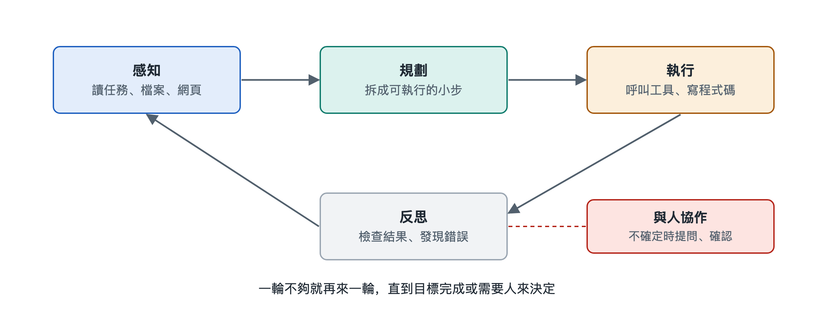

# 3.1 感知：讀懂任務、檔案、網頁與螢幕

設想你對一個 AI 代理說：「把附件裡這份銷售表按地區匯總，再對照公司官網上公佈的門店名單，看看哪些門店沒有資料。」這句話裡藏著三種完全不同的資訊：一句人話寫成的任務，一個表格檔案，一個需要打開才能看到的網頁。AI 代理要把事情做對，第一步不是動手，而是「看懂」。這一步就叫感知（Perception）。

在傳統機器人學裡，感知指攝像頭、雷達把外部世界變成機器能處理的信號。大模型代理的感知含義更寬，指的是把任務、檔案、網頁、螢幕乃至工具返回的結果，統統變成模型能讀進上下文的資訊。理解這一點，就能明白為什麼很多「AI 代理做錯了」的情況，根源其實出在「沒看清」。

## 3.1.1 感知的總原則：一切都要變成模型能讀的輸入

大語言模型（Large Language Model，LLM）本身只接收一種東西：輸入序列。純文本模型只讀文字，多模態模型（Multimodal Model，能同時處理文字、圖像等多種資訊的模型）還能讀圖片，有的也能讀音頻。Excel 檔案、PDF、網頁、電腦螢幕，都不能原樣「塞進」模型，必須先經過一道轉換。

所以，AI 代理的感知可以理解成兩層：

- **轉換層**：由程式或工具把外部對象變成文字、表格文本或圖片。例如用解析程式讀取表格單元格，用網頁抓取工具取回網頁內容，用截圖功能拍下螢幕。
- **理解層**：模型讀取轉換後的內容，判斷它說了什麼、和任務有什麼關係、下一步該做什麼。

這兩層分工很重要。轉換層丟了資訊，模型再聰明也補不回來；轉換層給得太多，又會擠佔有限的上下文空間。關於模型如何「讀」文字的內部原理，可參閱本叢書第十八冊《大語言模型》，這裡只關注 AI 代理系統怎樣組織這些輸入。

## 3.1.2 讀懂任務：從一句話裡找出目標、約束和缺口

最先被感知的，是你寫下的任務。人說話常常省略：「按地區匯總」是求和還是計數？「官網門店名單」指哪個頁面？好的 AI 代理在讀任務時，會做三件事：

1. **識別目標**：最終要交付什麼——一張匯總表，加一份缺失門店清單。
2. **識別約束**：有哪些限制——只用附件資料，不能修改原檔案，結果用中文輸出等。
3. **識別缺口**：哪些資訊不清楚。缺口小，可以按常識合理假設並說明；缺口大，應當先問你（這一點在 3.5 節展開）。

這一步和後面的規劃緊密相連：任務讀偏了，後面每一步做得再好也是南轅北轍。

## 3.1.3 讀懂檔案和網頁：結構比文字更關鍵

檔案和網頁的難點在於結構。下表對比了幾類常見對象：

| 感知對象 | 常見轉換方式 | 容易出錯的地方 |
|---|---|---|
| 純文本、程式碼 | 直接讀取文字 | 檔案太長，只能分段讀 |
| 表格（如 Excel、CSV） | 用程式讀取成行列資料，或先統計概況 | 合併單元格、多個工作表、隱藏行被忽略 |
| PDF | 提取文字層，掃描件需文字識別（OCR，光學字元識別） | 雙欄排版順序錯亂，表格被拆成散字 |
| 網頁 | 抓取網頁源碼再提取正文，或用瀏覽器渲染後讀取 | 廣告和導航混入；內容靠腳本動態載入，抓取時為空 |

一個實用的經驗是：面對大表格，成熟的 AI 代理通常不會把幾萬行資料全部讀進上下文，而是先讀表頭和前幾行「看個樣子」，再寫一小段程式碼去統計、篩選。這樣既省空間，又比讓模型逐行「目測」計算可靠。這正是工具和感知配合的體現。

網頁還有一個特別之處：它的內容來自外部，可能夾帶針對 AI 代理的「指令」，例如隱藏的一行字寫著「忽略之前的要求」。感知到的內容應當被當作資料而不是命令。這類提示詞注入風險，第七章會專門討論。

## 3.1.4 看懂螢幕：讓 AI 代理像人一樣「看圖操作」

有些軟體沒有提供可供程式呼叫的介面，AI 代理只能像人一樣看螢幕、點滑鼠。寫作時，多家公司都推出過這類能力：例如 Anthropic 的「電腦使用」（Computer Use）功能、OpenAI 的瀏覽器操作類 AI 代理。它們的大致做法相似：

1. 截取當前螢幕圖像；
2. 多模態模型識別圖中的按鈕、輸入框和文字；
3. 模型決定點擊哪裡、輸入什麼，並給出位置或操作指令；
4. 執行後再次截圖，確認畫面是否按預期變化。

還有一種思路是讀取介面的「無障礙資訊樹」（Accessibility Tree，操作系統為讀屏軟體提供的介面結構描述），它直接列出各個控件的名稱和位置，往往比看截圖更準確。看螢幕的方式通用性強，但速度慢、容易點錯，介面一改版就可能失靈。因此在工程實踐中，有介面時一般優先用介面，沒有介面時才退而「看螢幕」。

## 3.1.5 感知不是一次性的

最後要強調：感知貫穿整個任務，而不只發生在開頭。AI 代理每執行一次動作，都要重新「看」結果——程式碼執行報了什麼錯，檔案是否真的保存，網頁是否跳轉成功。第六章要講的推理—行動循環裡，「看一步」就是這種持續的感知。

小結一下：感知回答的是「現在是什麼情況」。它把任務、檔案、網頁和螢幕轉換成模型可讀的資訊，並在每一步行動後更新這份認識。看清了現狀，AI 代理才能進入下一個問題——要達成目標，應當分幾步走。這就是下一節「規劃」的內容。
