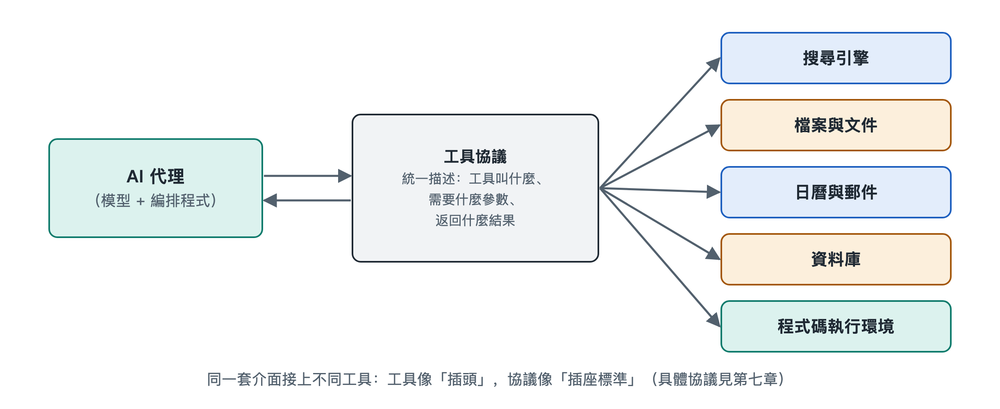

# 4.1 AI 代理與工具：函式呼叫和工具協議

你讓 AI 代理「查一下明天上海的天氣，如果下雨就在日曆裡提醒我帶傘」。幾秒鐘後，它告訴你：「明天有小雨，已在早上七點添加提醒。」這句話背後至少發生了兩次「伸手」：一次去天氣服務取資料，一次往你的日曆裡寫一條記錄。可大語言模型本身只會讀文字、寫文字，它並沒有手。它是怎樣把一句話變成一次真實的查詢和寫入的？答案藏在 AI 代理與工具之間的那根「連線」裡。這根連線由兩部分組成：一是**函式呼叫**，二是**工具協議**。

## 4.1.1 模型不直接動手，而是「開單子」

先看一個餐廳裡的類比。顧客點菜，服務員並不進廚房炒菜，而是在點選單上寫下「宮保雞丁一份，少辣」，交給後廚。廚師照單做菜，再把菜端出來。

AI 代理呼叫工具的方式與此十分相似：

- **模型像服務員**：它根據你的話判斷「現在需要查天氣」，於是寫出一張格式固定的「單子」，例如「呼叫 get_weather，參數：城市=上海，日期=明天」。
- **編排程式像傳菜口**：它讀到這張單子，確認格式正確、權限允許，然後真正去呼叫天氣服務。
- **工具像後廚**：天氣服務返回「小雨，18—22℃」。
- **結果再送回模型**：模型讀到結果，決定下一步，再開第二張單子去寫日曆。

這種機制叫作**函式呼叫**（Function Calling，也常稱工具呼叫，Tool Use）。關鍵在於，模型輸出的仍然只是文字，只不過這段文字格式嚴格，能被程式準確解析。真正執行動作的，始終是模型之外的程式。這一點很重要：它意味著每一個動作在發生之前，都有機會被檢查、攔截或交給人確認。第七章講沙箱與權限時，就建立在這個「先開單、後執行」的結構之上。

## 4.1.2 工具說明書：模型怎樣知道有哪些工具可用

服務員能開單，前提是手裡有選單。模型能呼叫工具，前提是事先拿到一份「工具說明書」。在常見做法中，每個工具都會用一段結構化描述告訴模型三件事：

| 說明書內容 | 作用 | 天氣工具的例子 |
|---|---|---|
| 名稱 | 讓模型能準確「點名」 | get_weather |
| 用途描述 | 讓模型判斷什麼時候該用 | 查詢某城市某日的天氣預報 |
| 參數格式 | 規定要填哪些資訊、什麼類型 | 城市（文字，必填）、日期（日期格式，必填） |

參數格式通常用 **JSON Schema**（一種描述資料結構的通用規範，JSON 是 JavaScript Object Notation，即「JavaScript 對象表示法」）來寫，它能說明某個參數是數字還是文字、是否必填、可選值有哪些。

這份說明書寫得好不好，直接影響 AI 代理的表現。用途描述含糊，模型可能該用時不用、不該用時亂用；參數說明不清，模型可能把「明天」填成一個程式看不懂的寫法。所以在實際工程中，**給工具寫說明，本身就是在給模型寫提示詞**。這把第二章講的「指令」與「雙手」連在了一起。

至於模型為什麼能讀懂說明書並按格式輸出，是因為主流模型在訓練中專門學習過這類任務。其內部原理可參閱第十八冊《大語言模型》，本書只需記住結果：模型能穩定地產出「結構化的呼叫請求」，但並非百分之百可靠，因此執行端需要校驗。

## 4.1.3 從各自接線到統一插座：工具協議的出現

函式呼叫解決了「模型怎樣說出一個動作」，但很快又冒出一個工程難題。設想你有 5 個 AI 代理應用，想接入 10 種工具（郵箱、日曆、網盤、資料庫……）。如果每個應用都要為每種工具單獨寫一套對接程式碼，就是 5×10＝50 份接線工作；不同廠商的說明書格式還各不相同，換個模型可能就得重寫。

這就像早年各家手機充電口互不兼容的局面。解決思路也一樣：**定一個統一介面**。只要應用和工具都遵守同一套約定，接線工作就從「乘法」變成「加法」，5 個應用加 10 種工具，各自適配一次就行。

這套約定就是**工具協議**。寫作時最受關注的例子之一，是 Anthropic 公司於 2024 年底公開發布的**模型上下文協議**（Model Context Protocol，MCP）。它把雙方分為：

- **客戶端**：AI 代理應用一側，負責發現有哪些工具、發出呼叫請求；
- **服務端**：工具提供方一側，負責聲明自己提供哪些能力，並執行請求、返回結果。

按照 MCP 的設計，服務端不僅能提供可執行的「工具」，還能提供可讀取的「資源」（如檔案內容）和預先寫好的「提示模板」。此後又有其他公司和開源社區提出或支援各類協議，例如面向 AI 代理之間通信的協議。這一領域仍在快速變化，具體有哪些協議、誰支援誰，請以讀者閱讀時的官方資料為準。不容易過時的是背後的結構：**用統一的「說明書格式 + 呼叫格式 + 返回格式」，把模型和工具解耦**。第七章 7.2 節會進一步展開協議的技術細節。

## 4.1.4 連線越方便，越要看清連線的另一端

工具接得越容易，AI 代理能做的事就越多，風險也隨之進入視野。值得讀者記住三點：

1. **工具返回的內容不一定可信**。網頁、郵件裡可能藏著「請忽略之前的指令」之類的文字，模型若把它當成命令，就會被帶偏。這類攻擊叫提示詞注入，7.5 節專門討論。
2. **能讀和能寫是兩回事**。查天氣只是讀，刪檔案、發郵件、付款則是寫，寫操作通常應當設定人工確認。
3. **接入的第三方工具相當於請人進門**。來源是否可靠、要了哪些權限，都應當像安裝手機應用時一樣留意。

## 4.1.5 小結

AI 代理與工具的連接可以概括為一句話：**模型開單，程式執行，結果回傳**。函式呼叫讓模型能用規範的文字「說出」一個動作；工具說明書讓模型知道能做什麼、該怎麼填；工具協議則把一對一的私人接線變成人人可插的公共插座。看清這條連線，你就能理解 AI 代理的「手」是怎麼長出來的，也知道該在哪裡給它裝上「剎車」。不過，AI 代理要做好事情，光有手還不夠，它還需要隨時能查到準確的資料，這正是下一節要講的：AI 代理與知識的連接。
