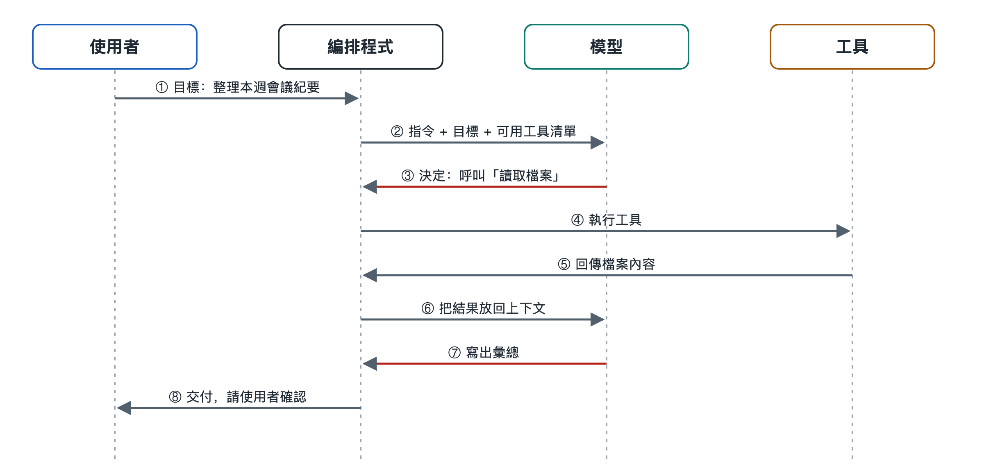

# 5.2 訊息流：模型、工具與使用者之間的往返

你讓程式設計代理「把這個函式裡的拼字錯誤改掉，再跑一遍測試」。螢幕上先出現一行「正在讀取檔案……」，接著是一段程式碼差異，然後是「執行測試中……」，最後它回覆：「已修改兩處，測試全部通過。」你只說了一句話，它也只回了一句話。中間那幾行閃過的提示，其實是一串訊息在模型、工具和程式之間來回傳遞留下的痕跡。

上一節講任務流，關心的是「要做哪幾步」。這一節換一個角度，看每一步是靠什麼傳過去的。答案是訊息（message）。AI 代理內部的各個部件不能直接互相操作，它們之間的交流全靠訊息完成。

## 5.2.1 一次任務裡有幾種訊息

在目前主流的大模型介面裡，對話被組織成一個按時間排列的訊息列表。每條訊息都帶一個「角色」標籤，用來說明它是誰說的。不同公司的介面叫法略有不同，但寫作時常見的結構大體如下：

| 角色 | 誰產生 | 典型內容 |
|---|---|---|
| 系統（system） | 開發者或產品方 | 身份設定、規則、可用工具說明 |
| 使用者（user） | 你 | 任務目標、補充要求、確認或否決 |
| 助手（assistant） | 模型 | 文字回覆，或一條「我要呼叫某工具」的請求 |
| 工具結果（tool result） | 編排程式執行工具後填入 | 檔案內容、搜尋結果、錯誤訊息 |

這裡有一個容易被忽視的事實：模型從不親手執行工具。它只會輸出一條結構化的請求，比如「呼叫 read_file，參數是 utils.py」。真正去讀檔案的是編排程式（orchestrator，即第二章講的驅動程式）。編排程式讀完檔案，把結果包裝成一條「工具結果」訊息，再放回列表交給模型。

## 5.2.2 一輪往返是怎樣走的

把開頭改拼字的例子展開，訊息大致這樣流動：

1. **使用者 → 編排程式**：你輸入任務，程式把它追加為一條使用者訊息。
2. **編排程式 → 模型**：程式把系統訊息、歷史訊息和這條新訊息一起發給模型。
3. **模型 → 編排程式**：模型回傳一條助手訊息，內容是呼叫請求：讀取 utils.py。
4. **編排程式 → 工具 → 編排程式**：程式檢查權限，執行讀取，拿到檔案內容。
5. **編排程式 → 模型**：檔案內容作為工具結果追加進列表，整份列表再次發給模型。
6. 模型發出修改檔案的請求，接著發出執行測試的請求，這幾步重複同樣的往返。
7. **模型 → 使用者**：當模型判斷已經完成，它輸出一條普通文字訊息而不是呼叫請求，編排程式就把這條訊息顯示給你，迴圈結束。

可以把編排程式想成一個傳達室。模型坐在裡屋只寫紙條，工具們在外面幹活，使用者在窗口辦事。所有紙條都要經過傳達室登記、轉遞，有時還要蓋章放行。你看到的「正在讀取檔案……」，就是傳達室把內部紙條摘要後貼到窗口的公告。

## 5.2.3 為什麼每次都要整份重發

許多人第一次知道這一點會覺得意外：模型本身不記得上一輪說過什麼。主流的大模型介面在設計上是「無狀態」（stateless）的，每次呼叫都是獨立的計算（原因見第十八冊）。AI 代理之所以顯得連貫，是因為編排程式每一輪都把完整的訊息歷史重新交給模型。

這個設計帶來三個後果：

- **訊息列表就是 AI 代理的「工作台」**。模型能參考的只有列表裡的東西，工具結果如果沒有寫回列表，對模型來說就等於沒發生。
- **列表會越來越長**。一個讀了十幾個檔案的任務，列表裡可能堆著上萬字的工具結果。下一節講的上下文流，就是在處理列表變長以後怎麼辦。
- **往返次數決定耗時和花費**。每一輪都要把整份列表發出去、等模型生成，第 5.5 節講成本時還會算這筆帳。

## 5.2.4 訊息格式為什麼要講究

既然全靠訊息交流，訊息的格式就成了各方的「共同語言」。工具呼叫請求通常要求嚴格的結構化格式，寫作時多數介面採用 JSON（JavaScript 物件表示法，一種用鍵和值描述資料的文字格式）來寫工具名和參數。每條呼叫請求往往還帶一個編號，工具結果用同一個編號回填。這樣，模型一次發出好幾個呼叫時，結果就不會對錯號。

格式出問題，往返就會斷。常見的情況有：模型寫錯了參數名，工具執行報錯；工具回傳一大段亂碼或過長的網頁，把列表撐滿；編排程式漏回填了某個結果，模型以為工具沒反應，於是反覆呼叫。所以一個可靠的 AI 代理，除了模型要聰明，還得有一個認真的傳達室，負責校驗格式、截斷過長結果，並把報錯原樣告訴模型，讓模型據此調整下一步。

還有一點和安全有關。工具結果雖然以「工具」的身份進入列表，內容卻可能來自網頁或外部檔案，裡面可能夾著偽裝成指令的文字。模型分辨不清時，就可能把它當成命令照做。這就是第 7.5 節要講的提示詞注入，它的入口正是訊息流。

## 5.2.5 小結：看懂訊息，就看懂了 AI 代理的動作記錄

在你眼裡，AI 代理是一問一答；在系統內部，它是一份不斷變長的訊息列表，加上一個反覆「發給模型、執行請求、寫回結果」的迴圈。許多代理產品允許展開查看工具呼叫詳情或執行日誌。下次使用時，不妨點開看看，數一數這次任務往返了幾輪，每一輪模型要了什麼，工具回了什麼。

訊息列表越來越長，遲早會碰到模型能讀入的上限。哪些資訊該留下，哪些該壓縮或擠出，下一節討論上下文流。
