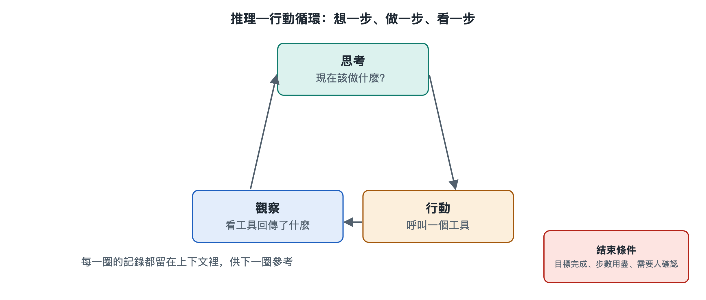

# 6.1 推理—行動循環：想一步、做一步、看一步

假設你讓程式設計代理修一個小問題：「表格匯出時日期欄顯示成了一串數字，幫我改好。」你盯著螢幕，會看到它的工作記錄一條條冒出來：先說「我需要找到匯出相關的程式碼」，接著執行了一次檔案搜尋；讀到結果後說「問題可能在格式轉換函式裡」，於是打開那個檔案；改完程式碼，它又說「執行一下測試確認」，測試報錯，它讀了錯誤訊息，再改一處，測試通過，最後向你彙報。

這串記錄看上去零碎，其實反覆出現同一個節拍：想一步，做一步，看一步。這個節拍就是絕大多數大模型代理的運作心臟，通常稱為推理—行動循環。第五章講了任務、訊息和上下文怎樣流動，本節要回答的是：讓它們流起來的那台「發動機」，是怎樣一圈一圈轉動的。

## 6.1.1 一個循環，三個節拍

把上面的修 bug 過程拆開，每一圈都包含三個環節：

| 節拍 | AI 代理在做什麼 | 修 bug 例子中的表現 |
|---|---|---|
| 想（推理，Reasoning） | 根據目標和已知資訊，判斷下一步該幹什麼 | 「問題可能在格式轉換函式裡」 |
| 做（行動，Action） | 發出一個具體動作，通常是呼叫工具 | 打開檔案、修改程式碼、執行測試 |
| 看（觀察，Observation） | 讀取動作的結果，併入已知資訊 | 讀到測試報錯：「日期類型不匹配」 |

看完之後，新資訊進入上下文，下一圈的「想」就站在更新過的事實上。如此循環，直到模型判斷任務完成，或者遇到需要停下來問人的情況。

這個思路在學術上有一個廣為引用的名字：ReAct，即 Reasoning（推理）與 Acting（行動）兩個詞的合寫，出自 2022 年普林斯頓大學與 Google 研究人員的論文。論文的核心發現很樸素：只讓模型「想」，它容易憑空編造；只讓模型「做」，它容易亂試一氣。讓思考和行動交替進行，每次思考都能被真實世界的回饋校正，每次行動都有理由可循，效果往往比兩者單獨使用更好。今天各家 AI 代理產品的具體實作各不相同，但大都能看到這個交替結構的影子。

## 6.1.2 循環由誰來轉：模型與編排程式的分工

一個容易產生的誤解是：大模型自己在「循環」。實際上，模型每次被呼叫只做一件事——讀入一段文字，產出一段文字（詳見第十八冊《大型語言模型》）。它沒有手，也不會自己記得上一輪。真正讓循環轉起來的，是第二章介紹過的編排程式。一圈的分工大致如下：

1. 編排程式把系統提示詞、使用者任務、可用工具清單和此前所有記錄拼在一起，交給模型；
2. 模型輸出一段思考，以及一個結構化的「我要呼叫某工具、參數是什麼」的請求；
3. 編排程式解析這個請求，檢查權限，必要時請使用者確認，然後真正執行工具；
4. 編排程式把執行結果寫回記錄，回到第 1 步。

打個比方：模型像一位只能隔著窗口遞紙條的顧問，編排程式是窗外跑腿的助理。顧問寫下「去檔案室拿第三份文件」，助理去拿，把文件影本塞回窗口，顧問再寫下一張紙條。顧問看起來在「連續工作」，其實每一張紙條都是基於窗口裡堆著的全部材料重新作答。理解這一點很重要：循環的記憶靠上下文，循環的安全閘門靠編排程式，模型只負責每一圈中「想」的那部分。

## 6.1.3 為什麼要「看一步」：回饋是糾錯的來源

對比一下沒有觀察環節的做法：讓模型一次性寫出全部步驟，然後照單執行。這就像蒙著眼睛把一整套路線背下來再走，只要第二步的地圖和實際不符，後面全盤皆錯。

「看」的價值在於引入外部事實。檔案裡真實寫了什麼、命令真實傳回了什麼、網頁上真實顯示了什麼，這些都不是模型「想」出來的，而是環境給出的。模型的推理可能出錯，但錯誤一旦在觀察中暴露——比如測試失敗、搜尋結果為空——下一圈就有機會修正。第三章講的「反思與糾錯」，在機制層面就落在這裡：沒有觀察，就無從反思。

這也解釋了一個實用經驗：給 AI 代理配備「能驗證結果」的工具，往往比把提示詞寫得再細更有效。能跑測試的程式設計代理、能讀回表格內容的辦公 AI 代理，比只會「寫完就交」的版本可靠得多。第八章將從控制論的角度說明，這正是回饋迴路的一般規律。

## 6.1.4 循環何時停下

一個會自己轉的循環，必須有剎車。常見的停止條件包括：

- **任務完成**：模型不再請求工具，而是輸出最終答覆；
- **需要人介入**：遇到權限不足、資訊不明或高風險操作，暫停並向使用者提問；
- **觸達上限**：編排程式預設的最大輪數、最長時間或費用上限被用盡；
- **無法恢復的錯誤**：工具反覆失敗，或環境不可用。

其中「觸達上限」看似生硬，卻不可或缺。模型可能陷入原地打轉——反覆搜尋同一個詞、反覆改同一行程式碼。沒有上限，這類空轉會持續消耗時間和費用（第五章的成本流）。卡死、跑偏等失敗形態及其恢復辦法，會在本章 6.5 節專門討論。

## 6.1.5 小結：一圈雖小，卻是整台機器的節拍器

推理—行動循環把前幾章的零件串成了一個會動的整體：模型負責想，工具負責做，環境負責給出可看的結果，編排程式負責把三者接起來並把住閘門。讀懂這個循環，你再看 AI 代理的工作記錄，就不會只看到一堆雜亂的日誌，而能一圈一圈數出它的節拍，判斷它卡在了哪個環節。

不過，循環只回答了「每一步怎樣走」，沒有回答「整條路怎樣規劃」：面對一個大任務，AI 代理是該先列好完整計畫，還是邊走邊想？這正是下一節要討論的問題。
