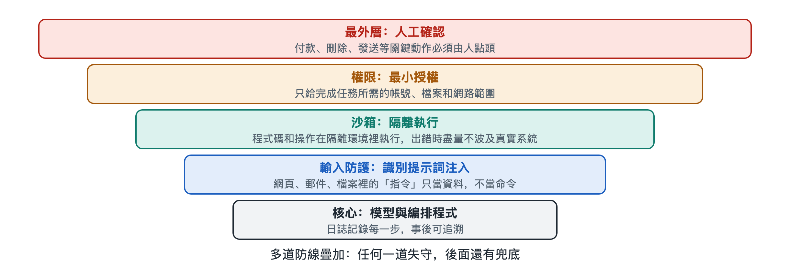

# 7.4 評測基準：怎樣衡量一個智能體好不好

假設你所在的部門打算引入一個程式設計智能體，供應商拿來兩份材料：一份說它「在某某基準上領先」，另一份是幾位同事試用一周後的回饋，有人說好用，有人說它改壞過兩次配置檔案。到底該信哪一份？更實際的問題是：如果讓你自己出題，你會怎樣判斷一個智能體好不好？

這一節就來回答這個問題。給智能體「打分」，比給一個聊天機器人打分難得多，因為它交出的不是一句話，而是一連串動作和這些動作留下的後果。

## 7.4.1 從「答對一道題」到「辦成一件事」

評價大語言模型時，常見做法是出一套問答題，比對答案是否正確。這類測試集叫作**基準**（Benchmark），意思是大家共用的一把尺子，便於橫向比較。

智能體的基準需要換一種出題方式。它考的是能不能把一件事從頭到尾辦成，所以每道題通常包含三樣東西：

| 組成部分 | 作用 | 以「修一個程式缺陷」為例 |
|---|---|---|
| 任務描述 | 告訴智能體要做什麼 | 一段真實的問題報告 |
| 環境 | 智能體可以觀察和操作的地方 | 一個裝好程式碼倉庫的沙箱 |
| 判定方法 | 自動檢查結果是否達標 | 執行預先寫好的測試，看是否通過 |

關鍵在第三項。智能體可能走二十步，也可能走兩百步，評測通常不逐句審查它說了什麼，而是檢查環境的**最終狀態**：測試過沒過，檔案改對沒有，訂單是否真的生成了。這和考駕照差不多，考官不在乎你心裡怎麼想，只看車有沒有停進庫裡、有沒有壓線。

## 7.4.2 幾類常見的智能體基準

寫作時，學術界和產業界公開使用的智能體基準已經有不少，按考查場景大致可分幾類（具體名稱和版本更新很快，下面只舉公開資料中常被提到的例子）：

- **軟體工程類**：如 SWE-bench，從開源專案裡收集真實的問題報告和對應修復，讓智能體在程式碼倉庫裡改程式碼，再用專案自帶的測試來判定。
- **網頁與軟體操作類**：如 WebArena、OSWorld，在隔離環境中部署網站應用或真實的桌面系統，讓智能體完成「在購物網站下單」「在表格裡整理資料」這類操作。
- **通用助手類**：如 GAIA，題目需要綜合搜尋、讀檔案、計算等多種能力，答案明確可核對。
- **工具與對話類**：如 τ-bench，模擬客服場景，智能體要一邊和「使用者」對話，一邊按業務規則呼叫工具。

它們的共同點是：任務來自或接近真實工作，環境可以重置，結果可以自動判定。能重置，才能讓不同智能體在同一起點上比賽；能自動判定，才能大規模、反覆地測。

## 7.4.3 除了「成功率」，還要看什麼

基準報告裡最顯眼的數字通常是**任務成功率**，即成功完成的任務佔全部任務的比例。但單看這一個數，容易被誤導。評價一個智能體，至少還應關心下面幾個維度：

1. **穩定性**：同一道題跑多次，是否每次都成功？智能體的輸出帶有隨機性，偶爾成功一次和每次都成功，對實際使用來說差別很大。一些基準會專門報告「連續多次都成功」的比例。
2. **成本**：完成任務花了多少時間、消耗多少**令牌**（Token，模型處理文本的基本單位）、呼叫了多少次工具。成功率高一點、成本卻翻幾倍，未必划算。這與第五章講的「成本流」直接對應。
3. **安全性**：過程中有沒有刪不該刪的檔案、訪問不該訪問的地址、在沒有確認的情況下執行高風險操作。結果對了但過程越權，在生產環境裡是不能接受的。
4. **過程品質**：步驟是否冗餘，出錯後能否自己發現並恢復，遇到資訊不足時是否會主動提問而不是瞎猜。

所以看一個智能體，至少要問四個問題：做成了嗎？每次都能做成嗎？花了多少？有沒有闖禍？

## 7.4.4 基準分數的局限

回到開頭那兩份材料。基準分數有價值，但要知道它的幾個先天局限：

- **題目洩露**：如果基準題目及答案出現在模型的訓練資料裡，分數就可能偏高，測到的是「記住了」而不是「會做」。這個問題叫**資料污染**（Data Contamination），研究者會通過定期更新題庫、使用較新的任務來緩解。
- **判定不完備**：自動測試只能檢查寫進去的條件。智能體可能「鑽空子」，比如改動測試本身讓它通過，或者結果在測試覆蓋範圍外出了錯。
- **環境差異**：基準環境乾淨、規範，你公司的程式碼倉庫、內部系統和工作習慣卻各不相同。
- **配置差異**：同一個模型，搭配不同的提示詞、工具和編排程式，分數可能差很多。所以報告裡的分數，衡量的往往是「模型加上這套腳手架」的整體，而不只是模型本身。

這並不是說基準沒用，而是說它適合回答「大致處在什麼水平」，不適合直接回答「在我這裡好不好用」。

## 7.4.5 給自己搭一把小尺子

對打算引入智能體的團隊，比較穩妥的做法是在公開基準之外，建一套自己的小型評測集：

1. 從日常工作中挑出 20～50 個有代表性的真實任務，包括容易的、難的和容易出事的；
2. 為每個任務寫清「怎樣算完成」，能自動檢查的盡量自動檢查；
3. 在隔離的測試環境裡執行，保留完整的執行記錄；
4. 每個任務多跑幾次，同時記錄成功率、耗時、成本和越權行為；
5. 每次更換模型、修改提示詞或增加工具後重新跑一遍，看有沒有退步。

最後一條尤其重要。在軟體工程中這叫**回歸測試**（Regression Test）：改進了一處，要確認沒有弄壞別處。智能體系統的組成部分多，一個提示詞的小改動就可能讓原來能做的事做不好了。

評測回答的是「它做得怎麼樣」，但還有一個問題評測分數裡看不出來：如果有人故意誤導它、誘使它越權，出了事又該誰負責？這就是下一節要討論的安全風險與治理。
