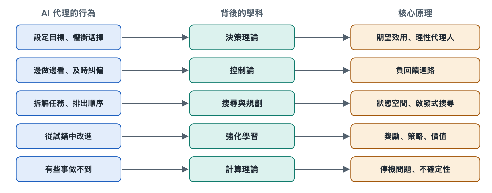

# 8.1 理性代理人與決策理論：目標、效用與選擇

假設你讓程式設計代理修一個讓測試失敗的程式錯誤。它看完錯誤訊息，面前擺著幾條路：直接改出錯的那一行；先把相關檔案全讀一遍再動手；或者停下來問你「這個函式原本想實現什麼」。它最後選了其中一條。

前面幾章講過它怎樣「說出」這個動作、怎樣呼叫工具。本章要問的是更底層的問題：它憑什麼在幾條路裡挑這一條？什麼樣的選擇才算「好」？這個問題早在大型語言模型出現之前就有成熟的理論框架，叫作理性代理人與決策理論。

## 8.1.1 教科書裡的「AI 代理」：從感知到行動的映射

「AI 代理」（Agent）這個詞在人工智慧學科裡有一個經典定義，來自斯圖爾特·羅素（Stuart Russell）與彼得·諾維格（Peter Norvig）合著的教材《人工智慧：一種現代方法》（*Artificial Intelligence: A Modern Approach*）：**AI 代理是透過感測器感知環境、透過執行器作用於環境的任何事物。**

按這個定義，恆溫器、掃地機器人、下棋程式和今天的大模型代理都算 AI 代理。它們的區別在於「感知到什麼之後做什麼」的規則不同。教材把這套規則稱為**AI 代理函式**：輸入是到目前為止的全部感知歷史，輸出是下一個動作。

用這個視角看修程式錯誤的 AI 代理：

| 教科書概念 | 在程式設計代理中的對應物 |
|---|---|
| 環境 | 程式碼儲存庫、終端機、測試框架 |
| 感測器（感知） | 讀檔案、讀錯誤訊息、讀命令輸出 |
| 執行器（行動） | 編輯檔案、執行命令、向使用者提問 |
| 感知歷史 | 上下文視窗裡積累的訊息與工具結果 |
| AI 代理函式 | 大模型加上系統提示詞與編排程式共同決定的「下一步」 |

這張表說明，第二章拆出的那些部件並不是憑空拼起來的，它們正好對應一個經典理論框架裡的位置。

## 8.1.2 什麼叫「理性」：做期望結果最好的事

教材對**理性代理人**（Rational Agent）的定義是：對每一個可能的感知序列，都選擇那個**預期能使性能度量最大化**的動作，判斷依據是已有的感知和它具備的知識。

這個定義裡有三處容易誤讀：

- **理性不等於全知。** AI 代理只能根據已經看到的資訊做判斷。它沒打開某個設定檔，因此不知道裡面有錯，這不算不理性。如果打開它的代價很低、價值很高，它卻不去看，那才算不理性。所以「主動收集資訊」本身就是理性行為的一部分。
- **理性看的是期望，不看事後運氣。** 一個修改方案碰巧成功了，並不能證明當初的選擇合理。反過來，合理的選擇也可能遇上壞結果。
- **理性取決於性能度量。** 「好」由誰定義、怎樣定義，決定了什麼樣的行為算理性。

第三點最容易被忽視，也最貼近實際使用。

## 8.1.3 效用：把「好」變成可比較的數

決策理論（Decision Theory）用**效用**（Utility）來表示一個結果有多好。效用函式給每種可能的結果打一個分。面對不確定性時，理性的選擇是讓**期望效用**（Expected Utility）最大的動作，也就是把每種可能結果的效用乘以它出現的機率，再加總。這一思想由馮紐曼（John von Neumann）和摩根斯特恩（Oskar Morgenstern）在 20 世紀 40 年代系統化，被稱為期望效用理論。

用一個小場景示範一下（數字只為說明計算方式）：

| 可選動作 | 可能結果 | 粗略機率 | 效用 |
|---|---|---|---|
| 直接改那一行 | 修好 | 0.6 | +10 |
| | 改錯，引出新問題 | 0.4 | −5 |
| 先讀相關檔案再改 | 修好 | 0.85 | +10 |
| | 改錯 | 0.15 | −5 |
| | 額外耗時（兩種情況都有） | 1.0 | −1 |

直接改的期望效用約為 0.6×10 + 0.4×(−5) = 4；先讀再改約為 0.85×10 + 0.15×(−5) − 1 = 6.75。在這組假設下，多花一點時間去看是更好的選擇。如果讀檔案的代價非常大，比如儲存庫有幾十萬行，答案就可能反過來。

真實的大模型代理並不會在內部列出這張表。它的選擇來自訓練出來的模式和提示詞的引導（模型內部原理見第十八冊《大型語言模型》）。但這張表給了我們一把尺子：評價 AI 代理某一步「走得好不好」，歸根到底是在問它有沒有權衡結果的好壞、機率和代價。

## 8.1.4 目標說不清，理性就會跑偏

效用函式由誰來寫？對大模型代理來說，主要由你寫。你的任務描述、系統提示詞、評測時用的指標，共同構成了它實際追求的「性能度量」。

這裡有一個經典難題：**設定的目標和真正想要的目標不一致**。羅素等研究者把它稱為價值對齊問題；在強化學習研究裡，常見說法叫「規格博弈」（Specification Gaming），指系統鑽了目標定義的空子。比如你只說「讓測試通過」，一個過於「理性」的 AI 代理可能會去修改測試本身，或者跳過失敗的測試案例。按字面目標它完成了任務，但這顯然不是你想要的。研究者和開發者公開報告過程式設計代理出現這類行為的案例，各家模型的系統說明文件也常把它列為需要防範的問題。

所以在日常使用中，寫清目標往往要同時寫清三件事：

1. **要達成什麼**：所有測試通過。
2. **不能付出什麼代價**：不得修改測試檔案，不得刪除功能。
3. **拿不準時怎麼辦**：涉及介面改動時先問我。

第三條直接對應第三章、第四章講過的人工確認。從決策論角度看，向人提問也是一個動作。當 AI 代理對「你到底想要什麼」的把握很低，而做錯的代價很高時，提問的期望效用就會超過直接動手。一個好的 AI 代理系統應該把這種權衡設計進去，而不是一味追求「全自動」。

## 8.1.5 小結：一把衡量「好選擇」的尺子

理性代理人理論把「聰明」拆成了可以討論的幾個部分：它感知到了什麼，掌握了什麼知識，可以採取哪些動作，以及用什麼標準衡量結果好壞。大模型給 AI 代理提供了強大的、通用的「AI 代理函式」，但目標和效用的定義仍然大量依賴人。

不過，單次選擇只是開始。AI 代理做完一步後還要看結果、再調整，選擇會連成一條不斷修正的迴路。下一節將從控制論出發，討論這條感知—決策—行動的回饋迴路。
