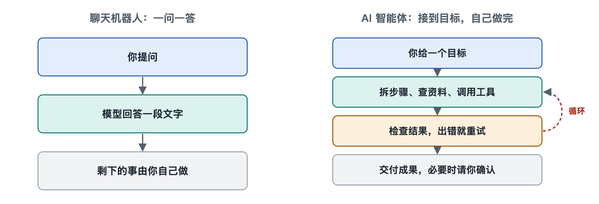

# 1.2 智能体与聊天机器人、自动化脚本的区别

假设你手头有一份三十家供应商的报价单，散落在邮件附件和几个网页里，你想把它们整理成一张对比表。你有三种办法可以试。第一种，打开一个聊天机器人，把需求说一遍，它会告诉你“可以按以下步骤操作”，再给出一份表格模板，剩下的复制、粘贴、核对都要你自己做。第二种，请懂编程的同事写一段脚本，让它每天自动从固定的邮箱文件夹里取附件、填进表格。只要附件格式一变，脚本就会报错停下来。第三种，把任务交给一个智能体，它会自己打开附件、读网页、发现某家报价单币种不同就去换算，填完表再回头检查有没有漏项，遇到拿不准的地方停下来问你。

三种工具都“用了电脑”，有两种还“用了 AI”，可它们是三类不同的东西。把这三者分清楚，是认识智能体的第一步。

## 1.2.1 聊天机器人：会说，但不动手

聊天机器人（Chatbot）的基本工作方式是一问一答：你输入一段文字，它生成一段回复，这一轮就结束了。如今的聊天机器人大多以大语言模型（Large Language Model，LLM）为核心，语言能力很强，能写文案、解释概念、给出建议。它的局限出在结构上，跟聪明程度关系不大：

- 它的输出只有文字，文字不会自己变成动作。它说“请打开附件”，附件不会因此被打开。
- 它通常不会主动推进任务。每一轮对话都要等你开口，下一步做什么由你决定。
- 它看不到自己建议的执行结果，所以无法根据结果调整。

打个比方，聊天机器人像一位隔着电话指导你修水管的师傅，懂行，也说得清楚，可扳手始终在你手里。

需要说明的是，写作时不少聊天产品已经加入了联网搜索、运行代码等能力，界面里的“聊天机器人”和“智能体”之间的界线正在变模糊。本书区分的是两种工作方式，不是某个具体产品。同一个产品，在只回答问题时是聊天机器人的用法，在自己调用工具、连续推进任务时就成了智能体的用法。

## 1.2.2 自动化脚本：会动手，但不变通

自动化脚本（Script）以及更广义的流程自动化工具，比如机器人流程自动化（Robotic Process Automation，RPA），走的是另一个极端。它们动手能力很强，能读写文件、点击按钮、调用接口，一秒钟能完成人要做半小时的重复劳动。但它们的每一步都是人事先写死的：

- 先做什么、后做什么、遇到哪种情况走哪条分支，全部在编写时确定。
- 遇到没预料到的情况，比如网页改版、文件少了一列、字段名换了写法，它通常只能报错或者出错，自己想不出办法。
- 它不理解目标，只执行步骤。它照指令把数字填进第三列，却不知道这一列应当是“含税价”。

脚本像一条装配流水线，又快又稳，前提是来料规格不变。

## 1.2.3 智能体：在目标驱动下自己决定下一步

AI 智能体（AI Agent）把前两者的长处接在了一起。它用大语言模型理解目标、判断局面，又通过工具真正去读文件、查网页、写代码、改表格。关键在于“下一步做什么”这个决定不是人预先写好的，是模型在运行中根据当前情况现场做出的。

这背后是一个循环：观察当前状态，想下一步，调用工具执行，看执行结果，再决定下一步，直到判断任务完成，或者需要停下来请示人。回到报价单的例子，发现币种不一致、决定先换算再填表，这一步没有人写进程序，是智能体看到数据后自己加上的。这个循环在第六章会详细拆开讲，这里只需记住：**智能体的特征是自主地、多步地、借助工具推进一个目标。**

## 1.2.4 一张对照表看清三者

| 对比维度 | 聊天机器人 | 自动化脚本 | AI 智能体 |
|---|---|---|---|
| 输入 | 一句话或一个问题 | 固定格式的数据 | 一个目标，可以说得比较模糊 |
| 输出 | 文字回答 | 确定的操作结果 | 一串操作及其结果 |
| 谁决定步骤 | 用户 | 编写者事先写定 | 模型在运行中决定 |
| 能否动手 | 通常不能 | 能 | 能，通过工具 |
| 遇到意外 | 无从知晓 | 报错或出错 | 尝试调整，必要时求助 |
| 结果可预测性 | 中等 | 高 | 较低，需要监督与检查 |
| 典型风险 | 说错话 | 规则过时 | 做错事、走偏、越权 |

最后两行容易被忽略，却很重要。智能体换来了灵活，代价是可预测性降低。同一个任务交给它两次，走的路径可能不一样；它能自己做事，也就可能自己做错事，而且做错的不只是一句话，可能是一封发错的邮件或一个删错的文件。所以本书后面会花不少篇幅讲权限、人工确认、沙箱和评测。这些设计不是给智能体泼冷水，是把这份灵活关进可控范围的必要部件。

## 1.2.5 怎样选：不是越“智能”越好

分清三者，还有一个很实际的用处：选对工具。

- 只需要想法、解释或一段文字，聊天方式就够了，又快又便宜。
- 步骤固定、数据格式稳定、对准确性要求极高的重复工作，比如每天定时导出报表，脚本往往比智能体更合适：它不会“灵机一动”，而稳定正是这类任务要的。
- 步骤不固定、需要边看边判断、要跨多个文件或软件完成的任务，才是智能体最有用的地方。

在实际工程中，三者也常常组合使用：智能体负责理解和决策，遇到确定的重复环节就调用一段现成的脚本来执行，最后用对话的方式向人汇报。

到这里，我们知道了智能体“是什么”以及“不是什么”。但一个智能体到底在哪里结束、外部世界从哪里开始？模型、程序、运行环境和人，各自占据哪一块？下一节就来画出这条边界。
