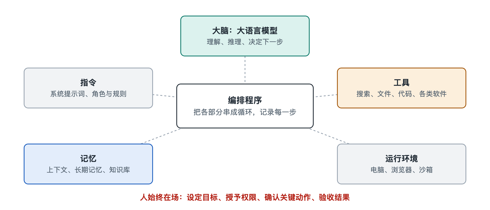

# 2.1 大脑：作为核心的大语言模型

打开一个编程智能体，对它说：“帮我把这个项目里所有读取配置文件的地方找出来，统一改成从环境变量读取。”接下来屏幕上会滚动出一串记录：它先列出目录，再打开几个文件，接着写下一段说明，“我发现有三处用到了配置读取”，然后逐个修改，最后运行测试。看起来像一位同事在埋头干活。可是，如果把这台“机器”拆开，真正在“想”的部分只有一个：大语言模型（Large Language Model，LLM）。其余的部件，包括读文件的工具、运行测试的终端和保存记录的程序，都在执行模型做出的决定。这一节先看清这颗“大脑”：它能做什么，不能做什么，以及它在智能体里实际处在什么位置。

## 2.1.1 一个只会“接着往下写”的大脑

大语言模型的基本工作方式很朴素：给它一段文字，它预测接下来最可能出现的内容，一次生成一小段，再把生成的内容接回去继续预测。这些“一小段”叫作令牌（token），可以是一个汉字、半个英文单词或一个标点。模型内部怎样用神经网络完成这种预测，第十八册《大语言模型》有专门讲解，这里只需要记住一点：**模型的全部输出都是文字**。

这带来一个看似矛盾的问题：只会写字的东西，怎么能“动手”？答案在于约定。智能体的编排程序事先告诉模型：“如果你想读文件，就按这个格式写出 `read_file` 和文件路径。”模型于是在输出里写下这样一段格式化的文字，程序识别出来，替它真正去读文件，再把文件内容作为新的文字送回给模型。所谓“动手”，其实是模型“说出”动作，程序去“做”出动作。具体怎样“说出”一个动作，第六章 6.3 节会细讲。

可以用一个类比来理解：模型像一位坐在密室里的顾问，看不见外面，也碰不到任何东西，只能通过门缝递纸条。纸条上写“请帮我查一下第三份文件”，门外的助手照办，再把结果塞回门缝。智能体的“自己动手”，就是这样一张张纸条来回传递的结果。

## 2.1.2 大脑承担的四种工作

在一个智能体里，模型通常同时负责四件事：

| 工作 | 在“改配置读取”任务中的表现 | 依赖模型的哪种能力 |
|---|---|---|
| 理解 | 读懂“统一改成环境变量”是什么意思 | 语言理解、常识 |
| 决策 | 决定先搜索代码，而不是直接改 | 推理、规划 |
| 生成 | 写出修改后的代码和说明 | 文本与代码生成 |
| 评判 | 看测试报错，判断是不是自己改错了 | 阅读反馈、比较 |

这四件事在传统软件里要由不同的模块分别编写，在大模型智能体里却由同一个模型完成，只是每一轮面对的输入不同。智能体之所以能处理开放、事先没有写好规则的任务，就是因为有这样一个通用的“大脑”。

## 2.1.3 这颗大脑的几个先天特点

只看到模型能做什么还不够，设计和使用智能体时，更要清楚它的局限。下面几个特点在公开资料和工程实践中都有共识，而且短期内不容易过时：

- **无状态**：模型本身不记得上一次对话。每一次调用，它看到的只是这一次送进来的全部文字。智能体之所以“记得”前面做过什么，是程序把历史记录一次次重新塞给它。这就是第 2.4 节要讲的记忆问题。
- **上下文有限**：一次能读入的文字量有上限，称为上下文窗口（context window）。写作时主流模型的窗口常见说法在数万到上百万令牌之间，但窗口再大也会被冗长的日志、网页和文件填满。
- **会“一本正经地出错”**：模型可能写出看似合理、实则不存在的函数名或事实，这种现象常被称为“幻觉”（hallucination）。在聊天中这只是一句错话，在智能体里却可能变成一次错误操作。
- **输出有随机性**：同样的输入，两次运行可能走出不同的步骤。这让智能体灵活，也让它的行为更难预测和复现。
- **知识有截止时间**：模型的知识来自训练数据，之后发生的事它并不知道，需要靠搜索、检索等工具补上。

这些特点决定了一个重要的设计思路：**智能体里的其他部件，很大程度上是为了弥补模型的短板而存在的。**工具让它接触外部世界，记忆弥补无状态，沙箱和权限防止错误操作造成破坏，人工确认在关键步骤把关。

## 2.1.4 换一个大脑，智能体会怎样

同一套智能体程序，换用不同的模型，表现往往差别明显。写作时，多家公司都允许开发者在同一个框架里切换不同厂商或不同规模的模型。一般规律是：规模大、推理能力强的模型更擅长长链条任务和自我纠错，但每次调用更慢、更贵；小模型响应快、成本低，适合分类、摘要这类简单步骤。因此不少系统采用“大小搭配”的做法，让强模型负责规划和关键判断，让轻量模型处理大量重复的小活。成本怎样随调用次数累积，第五章 5.5 节会展开。

还要注意，模型强，不等于智能体强。指令写得含糊、工具接口设计混乱、送进去的信息杂乱无章，再聪明的模型也会频繁跑偏。工程上常说，智能体的效果取决于“模型能力 × 系统设计”，两者缺一不可。

## 2.1.5 小结：大脑重要，但不是全部

回到开头那个修改配置的任务。真正“想”出搜索、修改、测试这条路线的，是大语言模型；但让它看到代码、改动文件、得知测试结果的，是围绕它搭建的一整套系统。把模型看成智能体的大脑是恰当的，同时也要记住，这颗大脑只会读和写，看不见、碰不到，也记不住。它要靠什么来接收任务、明确身份和规矩？下一节先看大脑接收的第一份材料：指令。
