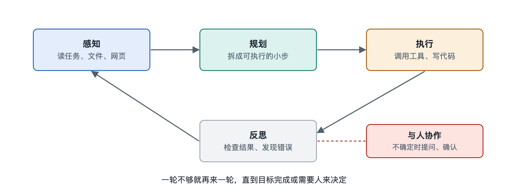

# 3.1 感知：读懂任务、文件、网页与屏幕

设想你对一个智能体说：“把附件里这份销售表按地区汇总，再对照公司官网上公布的门店名单，看看哪些门店没有数据。”这句话里藏着三种完全不同的信息：一句人话写成的任务，一个表格文件，一个需要打开才能看到的网页。智能体要把事情做对，第一步不是动手，而是“看懂”。这一步就叫感知（Perception）。

在传统机器人学里，感知指摄像头、雷达把外部世界变成机器能处理的信号。大模型智能体的感知含义更宽，指的是把任务、文件、网页、屏幕乃至工具返回的结果，统统变成模型能读进上下文的信息。理解这一点，就能明白为什么很多“智能体做错了”的情况，根源其实出在“没看清”。

## 3.1.1 感知的总原则：一切都要变成模型能读的输入

大语言模型（Large Language Model，LLM）本身只接收一种东西：输入序列。纯文本模型只读文字，多模态模型（Multimodal Model，能同时处理文字、图像等多种信息的模型）还能读图片，有的也能读音频。Excel 文件、PDF、网页、电脑屏幕，都不能原样“塞进”模型，必须先经过一道转换。

所以，智能体的感知可以理解成两层：

- **转换层**：由程序或工具把外部对象变成文字、表格文本或图片。例如用解析程序读取表格单元格，用网页抓取工具取回网页内容，用截图功能拍下屏幕。
- **理解层**：模型读取转换后的内容，判断它说了什么、和任务有什么关系、下一步该做什么。

这两层分工很重要。转换层丢了信息，模型再聪明也补不回来；转换层给得太多，又会挤占有限的上下文空间。关于模型如何“读”文字的内部原理，可参阅本丛书第十八册《大语言模型》，这里只关注智能体系统怎样组织这些输入。

## 3.1.2 读懂任务：从一句话里找出目标、约束和缺口

最先被感知的，是你写下的任务。人说话常常省略：“按地区汇总”是求和还是计数？“官网门店名单”指哪个页面？好的智能体在读任务时，会做三件事：

1. **识别目标**：最终要交付什么——一张汇总表，加一份缺失门店清单。
2. **识别约束**：有哪些限制——只用附件数据，不能修改原文件，结果用中文输出等。
3. **识别缺口**：哪些信息不清楚。缺口小，可以按常识合理假设并说明；缺口大，应当先问你（这一点在 3.5 节展开）。

这一步和后面的规划紧密相连：任务读偏了，后面每一步做得再好也是南辕北辙。

## 3.1.3 读懂文件和网页：结构比文字更关键

文件和网页的难点在于结构。下表对比了几类常见对象：

| 感知对象 | 常见转换方式 | 容易出错的地方 |
|---|---|---|
| 纯文本、代码 | 直接读取文字 | 文件太长，只能分段读 |
| 表格（如 Excel、CSV） | 用程序读取成行列数据，或先统计概况 | 合并单元格、多个工作表、隐藏行被忽略 |
| PDF | 提取文字层，扫描件需文字识别（OCR，光学字符识别） | 双栏排版顺序错乱，表格被拆成散字 |
| 网页 | 抓取网页源码再提取正文，或用浏览器渲染后读取 | 广告和导航混入；内容靠脚本动态加载，抓取时为空 |

一个实用的经验是：面对大表格，成熟的智能体通常不会把几万行数据全部读进上下文，而是先读表头和前几行“看个样子”，再写一小段代码去统计、筛选。这样既省空间，又比让模型逐行“目测”计算可靠。这正是工具和感知配合的体现。

网页还有一个特别之处：它的内容来自外部，可能夹带针对智能体的“指令”，例如隐藏的一行字写着“忽略之前的要求”。感知到的内容应当被当作资料而不是命令。这类提示词注入风险，第七章会专门讨论。

## 3.1.4 看懂屏幕：让智能体像人一样“看图操作”

有些软件没有提供可供程序调用的接口，智能体只能像人一样看屏幕、点鼠标。写作时，多家公司都推出过这类能力：例如 Anthropic 的“计算机使用”（Computer Use）功能、OpenAI 的浏览器操作类智能体。它们的大致做法相似：

1. 截取当前屏幕图像；
2. 多模态模型识别图中的按钮、输入框和文字；
3. 模型决定点击哪里、输入什么，并给出位置或操作指令；
4. 执行后再次截图，确认画面是否按预期变化。

还有一种思路是读取界面的“无障碍信息树”（Accessibility Tree，操作系统为读屏软件提供的界面结构描述），它直接列出各个控件的名称和位置，往往比看截图更准确。看屏幕的方式通用性强，但速度慢、容易点错，界面一改版就可能失灵。因此在工程实践中，有接口时一般优先用接口，没有接口时才退而“看屏幕”。

## 3.1.5 感知不是一次性的

最后要强调：感知贯穿整个任务，而不只发生在开头。智能体每执行一次动作，都要重新“看”结果——代码运行报了什么错，文件是否真的保存，网页是否跳转成功。第六章要讲的推理—行动循环里，“看一步”就是这种持续的感知。

小结一下：感知回答的是“现在是什么情况”。它把任务、文件、网页和屏幕转换成模型可读的信息，并在每一步行动后更新这份认识。看清了现状，智能体才能进入下一个问题——要达成目标，应当分几步走。这就是下一节“规划”的内容。
