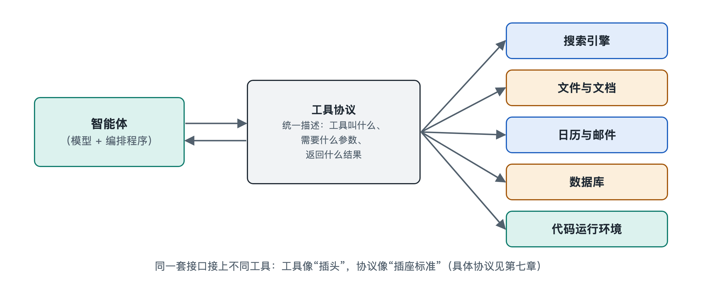

# 4.1 智能体与工具：函数调用和工具协议

你让智能体“查一下明天上海的天气，如果下雨就在日历里提醒我带伞”。几秒钟后，它告诉你：“明天有小雨，已在早上七点添加提醒。”这句话背后至少发生了两次“伸手”：一次去天气服务取数据，一次往你的日历里写一条记录。可大语言模型本身只会读文字、写文字，它并没有手。它是怎样把一句话变成一次真实的查询和写入的？答案藏在智能体与工具之间的那根“连线”里。这根连线由两部分组成：一是**函数调用**，二是**工具协议**。

## 4.1.1 模型不直接动手，而是“开单子”

先看一个餐厅里的类比。顾客点菜，服务员并不进厨房炒菜，而是在点菜单上写下“宫保鸡丁一份，少辣”，交给后厨。厨师照单做菜，再把菜端出来。

智能体调用工具的方式与此十分相似：

- **模型像服务员**：它根据你的话判断“现在需要查天气”，于是写出一张格式固定的“单子”，例如“调用 get_weather，参数：城市=上海，日期=明天”。
- **编排程序像传菜口**：它读到这张单子，确认格式正确、权限允许，然后真正去调用天气服务。
- **工具像后厨**：天气服务返回“小雨，18—22℃”。
- **结果再送回模型**：模型读到结果，决定下一步，再开第二张单子去写日历。

这种机制叫作**函数调用**（Function Calling，也常称工具调用，Tool Use）。关键在于，模型输出的仍然只是文字，只不过这段文字格式严格，能被程序准确解析。真正执行动作的，始终是模型之外的程序。这一点很重要：它意味着每一个动作在发生之前，都有机会被检查、拦截或交给人确认。第七章讲沙箱与权限时，就建立在这个“先开单、后执行”的结构之上。

## 4.1.2 工具说明书：模型怎样知道有哪些工具可用

服务员能开单，前提是手里有菜单。模型能调用工具，前提是事先拿到一份“工具说明书”。在常见做法中，每个工具都会用一段结构化描述告诉模型三件事：

| 说明书内容 | 作用 | 天气工具的例子 |
|---|---|---|
| 名称 | 让模型能准确“点名” | get_weather |
| 用途描述 | 让模型判断什么时候该用 | 查询某城市某日的天气预报 |
| 参数格式 | 规定要填哪些信息、什么类型 | 城市（文字，必填）、日期（日期格式，必填） |

参数格式通常用 **JSON Schema**（一种描述数据结构的通用规范，JSON 是 JavaScript Object Notation，即“JavaScript 对象表示法”）来写，它能说明某个参数是数字还是文字、是否必填、可选值有哪些。

这份说明书写得好不好，直接影响智能体的表现。用途描述含糊，模型可能该用时不用、不该用时乱用；参数说明不清，模型可能把“明天”填成一个程序看不懂的写法。所以在实际工程中，**给工具写说明，本身就是在给模型写提示词**。这把第二章讲的“指令”与“双手”连在了一起。

至于模型为什么能读懂说明书并按格式输出，是因为主流模型在训练中专门学习过这类任务。其内部原理可参阅第十八册《大语言模型》，本书只需记住结果：模型能稳定地产出“结构化的调用请求”，但并非百分之百可靠，因此执行端需要校验。

## 4.1.3 从各自接线到统一插座：工具协议的出现

函数调用解决了“模型怎样说出一个动作”，但很快又冒出一个工程难题。设想你有 5 个智能体应用，想接入 10 种工具（邮箱、日历、网盘、数据库……）。如果每个应用都要为每种工具单独写一套对接代码，就是 5×10＝50 份接线工作；不同厂商的说明书格式还各不相同，换个模型可能就得重写。

这就像早年各家手机充电口互不兼容的局面。解决思路也一样：**定一个统一接口**。只要应用和工具都遵守同一套约定，接线工作就从“乘法”变成“加法”，5 个应用加 10 种工具，各自适配一次就行。

这套约定就是**工具协议**。写作时最受关注的例子之一，是 Anthropic 公司于 2024 年底公开发布的**模型上下文协议**（Model Context Protocol，MCP）。它把双方分为：

- **客户端**：智能体应用一侧，负责发现有哪些工具、发出调用请求；
- **服务端**：工具提供方一侧，负责声明自己提供哪些能力，并执行请求、返回结果。

按照 MCP 的设计，服务端不仅能提供可执行的“工具”，还能提供可读取的“资源”（如文件内容）和预先写好的“提示模板”。此后又有其他公司和开源社区提出或支持各类协议，例如面向智能体之间通信的协议。这一领域仍在快速变化，具体有哪些协议、谁支持谁，请以读者阅读时的官方资料为准。不容易过时的是背后的结构：**用统一的“说明书格式 + 调用格式 + 返回格式”，把模型和工具解耦**。第七章 7.2 节会进一步展开协议的技术细节。

## 4.1.4 连线越方便，越要看清连线的另一端

工具接得越容易，智能体能做的事就越多，风险也随之进入视野。值得读者记住三点：

1. **工具返回的内容不一定可信**。网页、邮件里可能藏着“请忽略之前的指令”之类的文字，模型若把它当成命令，就会被带偏。这类攻击叫提示词注入，7.5 节专门讨论。
2. **能读和能写是两回事**。查天气只是读，删文件、发邮件、付款则是写，写操作通常应当设置人工确认。
3. **接入的第三方工具相当于请人进门**。来源是否可靠、要了哪些权限，都应当像安装手机应用时一样留意。

## 4.1.5 小结

智能体与工具的连接可以概括为一句话：**模型开单，程序执行，结果回传**。函数调用让模型能用规范的文字“说出”一个动作；工具说明书让模型知道能做什么、该怎么填；工具协议则把一对一的私人接线变成人人可插的公共插座。看清这条连线，你就能理解智能体的“手”是怎么长出来的，也知道该在哪里给它装上“刹车”。不过，智能体要做好事情，光有手还不够，它还需要随时能查到准确的资料，这正是下一节要讲的：智能体与知识的连接。
