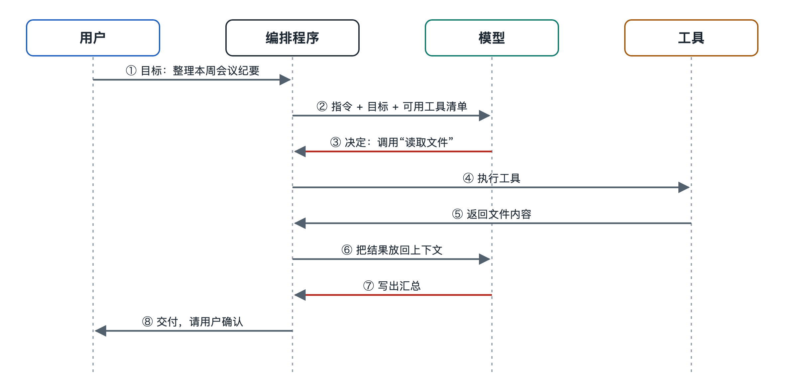

# 5.2 消息流：模型、工具与用户之间的往返

你让编程智能体“把这个函数里的拼写错误改掉，再跑一遍测试”。屏幕上先出现一行“正在读取文件……”，接着是一段代码差异，然后是“运行测试中……”，最后它回复：“已修改两处，测试全部通过。”你只说了一句话，它也只回了一句话。中间那几行闪过的提示，其实是一串消息在模型、工具和程序之间来回传递留下的痕迹。

上一节讲任务流，关心的是“要做哪几步”。这一节换一个角度，看每一步是靠什么传过去的。答案是消息（message）。智能体内部的各个部件不能直接互相操作，它们之间的交流全靠消息完成。

## 5.2.1 一次任务里有几种消息

在目前主流的大模型接口里，对话被组织成一个按时间排列的消息列表。每条消息都带一个“角色”标签，用来说明它是谁说的。不同公司的接口叫法略有不同，但写作时常见的结构大体如下：

| 角色 | 谁产生 | 典型内容 |
|---|---|---|
| 系统（system） | 开发者或产品方 | 身份设定、规则、可用工具说明 |
| 用户（user） | 你 | 任务目标、补充要求、确认或否决 |
| 助手（assistant） | 模型 | 文字回复，或一条“我要调用某工具”的请求 |
| 工具结果（tool result） | 编排程序执行工具后填入 | 文件内容、搜索结果、报错信息 |

这里有一个容易被忽视的事实：模型从不亲手执行工具。它只会输出一条结构化的请求，比如“调用 read_file，参数是 utils.py”。真正去读文件的是编排程序（orchestrator，即第二章讲的驱动程序）。编排程序读完文件，把结果包装成一条“工具结果”消息，再放回列表交给模型。

## 5.2.2 一轮往返是怎样走的

把开头改拼写的例子展开，消息大致这样流动：

1. **用户 → 编排程序**：你输入任务，程序把它追加为一条用户消息。
2. **编排程序 → 模型**：程序把系统消息、历史消息和这条新消息一起发给模型。
3. **模型 → 编排程序**：模型返回一条助手消息，内容是调用请求：读取 utils.py。
4. **编排程序 → 工具 → 编排程序**：程序检查权限，执行读取，拿到文件内容。
5. **编排程序 → 模型**：文件内容作为工具结果追加进列表，整份列表再次发给模型。
6. 模型发出修改文件的请求，接着发出运行测试的请求，这几步重复同样的往返。
7. **模型 → 用户**：当模型判断已经完成，它输出一条普通文字消息而不是调用请求，编排程序就把这条消息显示给你，循环结束。

可以把编排程序想成一个传达室。模型坐在里屋只写纸条，工具们在外面干活，用户在窗口办事。所有纸条都要经过传达室登记、转递，有时还要盖章放行。你看到的“正在读取文件……”，就是传达室把内部纸条摘要后贴到窗口的公告。

## 5.2.3 为什么每次都要整份重发

许多人第一次知道这一点会觉得意外：模型本身不记得上一轮说过什么。主流的大模型接口在设计上是“无状态”（stateless）的，每次调用都是独立的计算（原因见第十八册）。智能体之所以显得连贯，是因为编排程序每一轮都把完整的消息历史重新交给模型。

这个设计带来三个后果：

- **消息列表就是智能体的“工作台”**。模型能参考的只有列表里的东西，工具结果如果没有写回列表，对模型来说就等于没发生。
- **列表会越来越长**。一个读了十几个文件的任务，列表里可能堆着上万字的工具结果。下一节讲的上下文流，就是在处理列表变长以后怎么办。
- **往返次数决定耗时和花费**。每一轮都要把整份列表发出去、等模型生成，第 5.5 节讲成本时还会算这笔账。

## 5.2.4 消息格式为什么要讲究

既然全靠消息交流，消息的格式就成了各方的“共同语言”。工具调用请求通常要求严格的结构化格式，写作时多数接口采用 JSON（JavaScript 对象表示法，一种用键和值描述数据的文本格式）来写工具名和参数。每条调用请求往往还带一个编号，工具结果用同一个编号回填。这样，模型一次发出好几个调用时，结果就不会对错号。

格式出问题，往返就会断。常见的情况有：模型写错了参数名，工具执行报错；工具返回一大段乱码或过长的网页，把列表撑满；编排程序漏回填了某个结果，模型以为工具没反应，于是反复调用。所以一个可靠的智能体，除了模型要聪明，还得有一个认真的传达室，负责校验格式、截断过长结果，并把报错原样告诉模型，让模型据此调整下一步。

还有一点和安全有关。工具结果虽然以“工具”的身份进入列表，内容却可能来自网页或外部文件，里面可能夹着伪装成指令的文字。模型分辨不清时，就可能把它当成命令照做。这就是第 7.5 节要讲的提示词注入，它的入口正是消息流。

## 5.2.5 小结：看懂消息，就看懂了智能体的动作记录

在你眼里，智能体是一问一答；在系统内部，它是一份不断变长的消息列表，加上一个反复“发给模型、执行请求、写回结果”的循环。许多智能体产品允许展开查看工具调用详情或运行日志。下次使用时，不妨点开看看，数一数这次任务往返了几轮，每一轮模型要了什么，工具回了什么。

消息列表越来越长，迟早会碰到模型能读入的上限。哪些信息该留下，哪些该压缩或挤出，下一节讨论上下文流。
