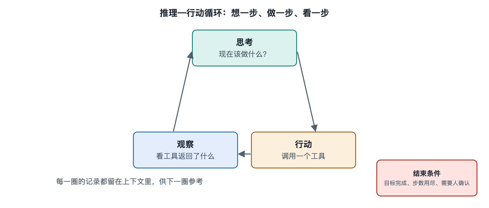

# 6.1 推理—行动循环：想一步、做一步、看一步

假设你让编程智能体修一个小问题：“表格导出时日期列显示成了一串数字，帮我改好。”你盯着屏幕，会看到它的工作记录一条条冒出来：先说“我需要找到导出相关的代码”，接着执行了一次文件搜索；读到结果后说“问题可能在格式转换函数里”，于是打开那个文件；改完代码，它又说“运行一下测试确认”，测试报错，它读了报错信息，再改一处，测试通过，最后向你汇报。

这串记录看上去零碎，其实反复出现同一个节拍：想一步，做一步，看一步。这个节拍就是绝大多数大模型智能体的运行心脏，通常称为推理—行动循环。第五章讲了任务、消息和上下文怎样流动，本节要回答的是：让它们流起来的那台“发动机”，是怎样一圈一圈转动的。

## 6.1.1 一个循环，三个节拍

把上面的修 bug 过程拆开，每一圈都包含三个环节：

| 节拍 | 智能体在做什么 | 修 bug 例子中的表现 |
|---|---|---|
| 想（推理，Reasoning） | 根据目标和已知信息，判断下一步该干什么 | “问题可能在格式转换函数里” |
| 做（行动，Action） | 发出一个具体动作，通常是调用工具 | 打开文件、修改代码、运行测试 |
| 看（观察，Observation） | 读取动作的结果，并入已知信息 | 读到测试报错：“日期类型不匹配” |

看完之后，新信息进入上下文，下一圈的“想”就站在更新过的事实上。如此循环，直到模型判断任务完成，或者遇到需要停下来问人的情况。

这个思路在学术上有一个广为引用的名字：ReAct，即 Reasoning（推理）与 Acting（行动）两个词的合写，出自 2022 年普林斯顿大学与谷歌研究人员的论文。论文的核心发现很朴素：只让模型“想”，它容易凭空编造；只让模型“做”，它容易乱试一气。让思考和行动交替进行，每次思考都能被真实世界的反馈校正，每次行动都有理由可循，效果往往比两者单独使用更好。今天各家智能体产品的具体实现各不相同，但大都能看到这个交替结构的影子。

## 6.1.2 循环由谁来转：模型与编排程序的分工

一个容易产生的误解是：大模型自己在“循环”。实际上，模型每次被调用只做一件事——读入一段文字，产出一段文字（详见第十八册《大语言模型》）。它没有手，也不会自己记得上一轮。真正让循环转起来的，是第二章介绍过的编排程序。一圈的分工大致如下：

1. 编排程序把系统提示词、用户任务、可用工具清单和此前所有记录拼在一起，交给模型；
2. 模型输出一段思考，以及一个结构化的“我要调用某工具、参数是什么”的请求；
3. 编排程序解析这个请求，检查权限，必要时请用户确认，然后真正执行工具；
4. 编排程序把执行结果写回记录，回到第 1 步。

打个比方：模型像一位只能隔着窗口递纸条的顾问，编排程序是窗外跑腿的助理。顾问写下“去档案室拿第三份文件”，助理去拿，把文件复印件塞回窗口，顾问再写下一张纸条。顾问看起来在“连续工作”，其实每一张纸条都是基于窗口里堆着的全部材料重新作答。理解这一点很重要：循环的记忆靠上下文，循环的安全闸门靠编排程序，模型只负责每一圈中“想”的那部分。

## 6.1.3 为什么要“看一步”：反馈是纠错的来源

对比一下没有观察环节的做法：让模型一次性写出全部步骤，然后照单执行。这就像蒙着眼睛把一整套路线背下来再走，只要第二步的地图和实际不符，后面全盘皆错。

“看”的价值在于引入外部事实。文件里真实写了什么、命令真实返回了什么、网页上真实显示了什么，这些都不是模型“想”出来的，而是环境给出的。模型的推理可能出错，但错误一旦在观察中暴露——比如测试失败、搜索结果为空——下一圈就有机会修正。第三章讲的“反思与纠错”，在机制层面就落在这里：没有观察，就无从反思。

这也解释了一个实用经验：给智能体配备“能验证结果”的工具，往往比把提示词写得再细更有效。能跑测试的编程智能体、能读回表格内容的办公智能体，比只会“写完就交”的版本可靠得多。第八章将从控制论的角度说明，这正是反馈回路的一般规律。

## 6.1.4 循环何时停下

一个会自己转的循环，必须有刹车。常见的停止条件包括：

- **任务完成**：模型不再请求工具，而是输出最终答复；
- **需要人介入**：遇到权限不足、信息不明或高风险操作，暂停并向用户提问；
- **触达上限**：编排程序预设的最大轮数、最长时间或费用上限被用尽；
- **无法恢复的错误**：工具反复失败，或环境不可用。

其中“触达上限”看似生硬，却不可或缺。模型可能陷入原地打转——反复搜索同一个词、反复改同一行代码。没有上限，这类空转会持续消耗时间和费用（第五章的成本流）。卡死、跑偏等失败形态及其恢复办法，会在本章 6.5 节专门讨论。

## 6.1.5 小结：一圈虽小，却是整台机器的节拍器

推理—行动循环把前几章的零件串成了一个会动的整体：模型负责想，工具负责做，环境负责给出可看的结果，编排程序负责把三者接起来并把住闸门。读懂这个循环，你再看智能体的工作记录，就不会只看到一堆杂乱的日志，而能一圈一圈数出它的节拍，判断它卡在了哪个环节。

不过，循环只回答了“每一步怎样走”，没有回答“整条路怎样规划”：面对一个大任务，智能体是该先列好完整计划，还是边走边想？这正是下一节要讨论的问题。
