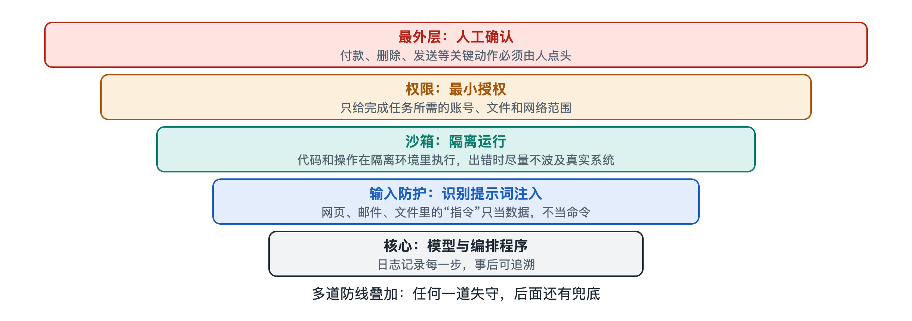

# 7.4 评测基准：怎样衡量一个智能体好不好

假设你所在的部门打算引入一个编程智能体，供应商拿来两份材料：一份说它“在某某基准上领先”，另一份是几位同事试用一周后的反馈，有人说好用，有人说它改坏过两次配置文件。到底该信哪一份？更实际的问题是：如果让你自己出题，你会怎样判断一个智能体好不好？

这一节就来回答这个问题。给智能体“打分”，比给一个聊天机器人打分难得多，因为它交出的不是一句话，而是一连串动作和这些动作留下的后果。

## 7.4.1 从“答对一道题”到“办成一件事”

评价大语言模型时，常见做法是出一套问答题，比对答案是否正确。这类测试集叫作**基准**（Benchmark），意思是大家共用的一把尺子，便于横向比较。

智能体的基准需要换一种出题方式。它考的是能不能把一件事从头到尾办成，所以每道题通常包含三样东西：

| 组成部分 | 作用 | 以“修一个程序缺陷”为例 |
|---|---|---|
| 任务描述 | 告诉智能体要做什么 | 一段真实的问题报告 |
| 环境 | 智能体可以观察和操作的地方 | 一个装好代码仓库的沙箱 |
| 判定方法 | 自动检查结果是否达标 | 运行预先写好的测试，看是否通过 |

关键在第三项。智能体可能走二十步，也可能走两百步，评测通常不逐句审查它说了什么，而是检查环境的**最终状态**：测试过没过，文件改对没有，订单是否真的生成了。这和考驾照差不多，考官不在乎你心里怎么想，只看车有没有停进库里、有没有压线。

## 7.4.2 几类常见的智能体基准

写作时，学术界和产业界公开使用的智能体基准已经有不少，按考查场景大致可分几类（具体名称和版本更新很快，下面只举公开资料中常被提到的例子）：

- **软件工程类**：如 SWE-bench，从开源项目里收集真实的问题报告和对应修复，让智能体在代码仓库里改代码，再用项目自带的测试来判定。
- **网页与软件操作类**：如 WebArena、OSWorld，在隔离环境中部署网站应用或真实的桌面系统，让智能体完成“在购物网站下单”“在表格里整理数据”这类操作。
- **通用助手类**：如 GAIA，题目需要综合搜索、读文件、计算等多种能力，答案明确可核对。
- **工具与对话类**：如 τ-bench，模拟客服场景，智能体要一边和“用户”对话，一边按业务规则调用工具。

它们的共同点是：任务来自或接近真实工作，环境可以重置，结果可以自动判定。能重置，才能让不同智能体在同一起点上比赛；能自动判定，才能大规模、反复地测。

## 7.4.3 除了“成功率”，还要看什么

基准报告里最显眼的数字通常是**任务成功率**，即成功完成的任务占全部任务的比例。但单看这一个数，容易被误导。评价一个智能体，至少还应关心下面几个维度：

1. **稳定性**：同一道题跑多次，是否每次都成功？智能体的输出带有随机性，偶尔成功一次和每次都成功，对实际使用来说差别很大。一些基准会专门报告“连续多次都成功”的比例。
2. **成本**：完成任务花了多少时间、消耗多少**令牌**（Token，模型处理文本的基本单位）、调用了多少次工具。成功率高一点、成本却翻几倍，未必划算。这与第五章讲的“成本流”直接对应。
3. **安全性**：过程中有没有删不该删的文件、访问不该访问的地址、在没有确认的情况下执行高风险操作。结果对了但过程越权，在生产环境里是不能接受的。
4. **过程质量**：步骤是否冗余，出错后能否自己发现并恢复，遇到信息不足时是否会主动提问而不是瞎猜。

所以看一个智能体，至少要问四个问题：做成了吗？每次都能做成吗？花了多少？有没有闯祸？

## 7.4.4 基准分数的局限

回到开头那两份材料。基准分数有价值，但要知道它的几个先天局限：

- **题目泄露**：如果基准题目及答案出现在模型的训练数据里，分数就可能偏高，测到的是“记住了”而不是“会做”。这个问题叫**数据污染**（Data Contamination），研究者会通过定期更新题库、使用较新的任务来缓解。
- **判定不完备**：自动测试只能检查写进去的条件。智能体可能“钻空子”，比如改动测试本身让它通过，或者结果在测试覆盖范围外出了错。
- **环境差异**：基准环境干净、规范，你公司的代码仓库、内部系统和工作习惯却各不相同。
- **配置差异**：同一个模型，搭配不同的提示词、工具和编排程序，分数可能差很多。所以报告里的分数，衡量的往往是“模型加上这套脚手架”的整体，而不只是模型本身。

这并不是说基准没用，而是说它适合回答“大致处在什么水平”，不适合直接回答“在我这里好不好用”。

## 7.4.5 给自己搭一把小尺子

对打算引入智能体的团队，比较稳妥的做法是在公开基准之外，建一套自己的小型评测集：

1. 从日常工作中挑出 20～50 个有代表性的真实任务，包括容易的、难的和容易出事的；
2. 为每个任务写清“怎样算完成”，能自动检查的尽量自动检查；
3. 在隔离的测试环境里运行，保留完整的执行记录；
4. 每个任务多跑几次，同时记录成功率、耗时、成本和越权行为；
5. 每次更换模型、修改提示词或增加工具后重新跑一遍，看有没有退步。

最后一条尤其重要。在软件工程中这叫**回归测试**（Regression Test）：改进了一处，要确认没有弄坏别处。智能体系统的组成部分多，一个提示词的小改动就可能让原来能做的事做不好了。

评测回答的是“它做得怎么样”，但还有一个问题评测分数里看不出来：如果有人故意误导它、诱使它越权，出了事又该谁负责？这就是下一节要讨论的安全风险与治理。
