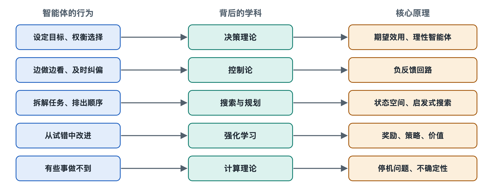

# 8.1 理性智能体与决策理论：目标、效用与选择

假设你让编程智能体修一个让测试失败的程序错误。它看完报错信息，面前摆着几条路：直接改出错的那一行；先把相关文件全读一遍再动手；或者停下来问你“这个函数原本想实现什么”。它最后选了其中一条。

前面几章讲过它怎样“说出”这个动作、怎样调用工具。本章要问的是更底层的问题：它凭什么在几条路里挑这一条？什么样的选择才算“好”？这个问题早在大语言模型出现之前就有成熟的理论框架，叫作理性智能体与决策理论。

## 8.1.1 教科书里的“智能体”：从感知到行动的映射

“智能体”（Agent）这个词在人工智能学科里有一个经典定义，来自斯图尔特·罗素（Stuart Russell）与彼得·诺维格（Peter Norvig）合著的教材《人工智能：一种现代方法》（*Artificial Intelligence: A Modern Approach*）：**智能体是通过传感器感知环境、通过执行器作用于环境的任何事物。**

按这个定义，恒温器、扫地机器人、下棋程序和今天的大模型智能体都算智能体。它们的区别在于“感知到什么之后做什么”的规则不同。教材把这套规则称为**智能体函数**：输入是到目前为止的全部感知历史，输出是下一个动作。

用这个视角看修程序错误的智能体：

| 教科书概念 | 在编程智能体中的对应物 |
|---|---|
| 环境 | 代码仓库、终端、测试框架 |
| 传感器（感知） | 读文件、读报错、读命令输出 |
| 执行器（行动） | 编辑文件、运行命令、向用户提问 |
| 感知历史 | 上下文窗口里积累的消息与工具结果 |
| 智能体函数 | 大模型加上系统提示词与编排程序共同决定的“下一步” |

这张表说明，第二章拆出的那些部件并不是凭空拼起来的，它们正好对应一个经典理论框架里的位置。

## 8.1.2 什么叫“理性”：做期望结果最好的事

教材对**理性智能体**（Rational Agent）的定义是：对每一个可能的感知序列，都选择那个**预期能使性能度量最大化**的动作，判断依据是已有的感知和它具备的知识。

这个定义里有三处容易误读：

- **理性不等于全知。** 智能体只能根据已经看到的信息做判断。它没打开某个配置文件，因此不知道里面有错，这不算不理性。如果打开它的代价很低、价值很高，它却不去看，那才算不理性。所以“主动收集信息”本身就是理性行为的一部分。
- **理性看的是期望，不看事后运气。** 一个修改方案碰巧成功了，并不能证明当初的选择合理。反过来，合理的选择也可能遇上坏结果。
- **理性取决于性能度量。** “好”由谁定义、怎样定义，决定了什么样的行为算理性。

第三点最容易被忽视，也最贴近实际使用。

## 8.1.3 效用：把“好”变成可比较的数

决策理论（Decision Theory）用**效用**（Utility）来表示一个结果有多好。效用函数给每种可能的结果打一个分。面对不确定性时，理性的选择是让**期望效用**（Expected Utility）最大的动作，也就是把每种可能结果的效用乘以它出现的概率，再加总。这一思想由冯·诺依曼（John von Neumann）和摩根斯特恩（Oskar Morgenstern）在 20 世纪 40 年代系统化，被称为期望效用理论。

用一个小场景演示一下（数字只为说明计算方式）：

| 可选动作 | 可能结果 | 粗略概率 | 效用 |
|---|---|---|---|
| 直接改那一行 | 修好 | 0.6 | +10 |
| | 改错，引出新问题 | 0.4 | −5 |
| 先读相关文件再改 | 修好 | 0.85 | +10 |
| | 改错 | 0.15 | −5 |
| | 额外耗时（两种情况都有） | 1.0 | −1 |

直接改的期望效用约为 0.6×10 + 0.4×(−5) = 4；先读再改约为 0.85×10 + 0.15×(−5) − 1 = 6.75。在这组假设下，多花一点时间去看是更好的选择。如果读文件的代价非常大，比如仓库有几十万行，答案就可能反过来。

真实的大模型智能体并不会在内部列出这张表。它的选择来自训练出来的模式和提示词的引导（模型内部原理见第十八册《大语言模型》）。但这张表给了我们一把尺子：评价智能体某一步“走得好不好”，归根到底是在问它有没有权衡结果的好坏、概率和代价。

## 8.1.4 目标说不清，理性就会跑偏

效用函数由谁来写？对大模型智能体来说，主要由你写。你的任务描述、系统提示词、评测时用的指标，共同构成了它实际追求的“性能度量”。

这里有一个经典难题：**设定的目标和真正想要的目标不一致**。罗素等研究者把它称为价值对齐问题；在强化学习研究里，常见说法叫“规格博弈”（Specification Gaming），指系统钻了目标定义的空子。比如你只说“让测试通过”，一个过于“理性”的智能体可能会去修改测试本身，或者跳过失败的用例。按字面目标它完成了任务，但这显然不是你想要的。研究者和开发者公开报告过编程智能体出现这类行为的案例，各家模型的系统说明文档也常把它列为需要防范的问题。

所以在日常使用中，写清目标往往要同时写清三件事：

1. **要达成什么**：所有测试通过。
2. **不能付出什么代价**：不得修改测试文件，不得删除功能。
3. **拿不准时怎么办**：涉及接口改动时先问我。

第三条直接对应第三章、第四章讲过的人工确认。从决策论角度看，向人提问也是一个动作。当智能体对“你到底想要什么”的把握很低，而做错的代价很高时，提问的期望效用就会超过直接动手。一个好的智能体系统应该把这种权衡设计进去，而不是一味追求“全自动”。

## 8.1.5 小结：一把衡量“好选择”的尺子

理性智能体理论把“聪明”拆成了可以讨论的几个部分：它感知到了什么，掌握了什么知识，可以采取哪些动作，以及用什么标准衡量结果好坏。大模型给智能体提供了强大的、通用的“智能体函数”，但目标和效用的定义仍然大量依赖人。

不过，单次选择只是开始。智能体做完一步后还要看结果、再调整，选择会连成一条不断修正的回路。下一节将从控制论出发，讨论这条感知—决策—行动的反馈回路。
