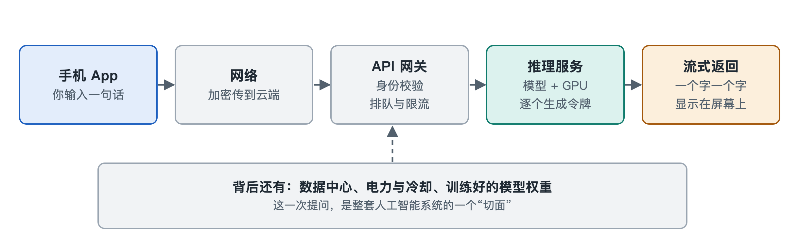

# 1.1 从一次提问开始：屏幕背后发生了什么

晚上十点，你在手机上打开一个 AI 助手，输入一句话：“明天去爬山，帮我列一份装备清单。”按下发送键，屏幕上先出现一个闪烁的光标，不到一两秒，文字一个词一个词地“流”出来：登山鞋、雨衣、头灯、能量棒……整个过程顺滑得像在和朋友发消息。

这几秒钟里，你的问题离开手机，穿过无线网络和光纤，进入某座数据中心，在一块或几块专用芯片上完成数以千亿计的数学运算，再变成文字一路送回你的屏幕。本节把这段旅程拆成五站来走一遍。后面九章会分别展开每一站，这里只画一张粗略的路线图。

## 1.1.1 第一站：手机——把你的话打包上路

在大多数聊天类 AI 产品里（以写作时的主流做法为准），手机本身并不“思考”。App 主要做三件事：

1. **收集输入**：读取你打的字、说的话或拍的照片。语音通常要先转成文字，或者编码成模型能接收的格式。
2. **附上上下文**：把这次对话前面几轮的内容、你选的模式、可能还有系统预设的说明，一起整理成一个请求。
3. **加密发送**：通过 HTTPS 这类加密协议，把请求经 Wi-Fi 或移动网络发往服务商的服务器。

也有例外。部分手机厂商已经在设备上运行较小的模型，用来做文字摘要、离线翻译等任务，由手机里的神经网络处理器（Neural Processing Unit，NPU）完成计算。复杂的长对话目前大多仍交给云端。哪些任务留在本地、哪些送上云端，不同厂商的划分方式不同，第七章讲端侧部署时会再谈。

## 1.1.2 第二站：网络与网关——找到对的门

请求离开手机后，要经过基站、运营商网络和互联网骨干，最后到达服务商的入口。入口处一般有一层 **API 网关**（API 指应用程序编程接口，Application Programming Interface，是程序之间约定好的“对话格式”）。它像一座大楼的前台，负责：

- 核对身份：你是不是已登录的用户，有没有额度；
- 限流：同一时间涌进来的请求太多时，让一部分排队；
- 分发：把请求转给某个机房里空闲的推理服务器。

前台本身不回答问题，它的任务是把每位“访客”送到合适的房间。

## 1.1.3 第三站：推理服务器——把文字变成数字

请求到达推理服务器后，第一步是**分词**（tokenization）。模型不直接认识汉字或单词，它处理的单位叫**令牌**（token）。一个令牌可能是一个常见汉字、半个英文单词，或者一个标点。你那句“帮我列一份装备清单”会被切成若干令牌，每个令牌再查表换成一个编号，然后变成一串数字向量。

到这一步，你的问题已经完全变成数字。后面发生的一切，本质上都是对这些数字做运算。

## 1.1.4 第四站：模型与芯片——一个词一个词地“算”出回答

这一站计算量最大。服务器里装着若干块 GPU（图形处理器，Graphics Processing Unit）或其他 AI 加速芯片，芯片旁的高速内存里存放着模型的**权重**，也就是训练时学到的海量参数。按公开资料中的常见说法，主流大模型的参数规模在数十亿到数千亿之间，量级以上的细节各家通常不公开。

模型做的事情可以用一句话概括：**根据已有的全部文字，预测下一个最可能的令牌。**

- 读完你的问题，模型算出第一个令牌，比如“好”；
- 把“好”接到末尾，再算下一个，比如“的”；
- 如此循环，直到算出一个表示“结束”的特殊令牌。

这就是屏幕上文字一个一个冒出来的原因。这种逐个生成的方式叫**自回归生成**。服务器不必等整段写完，每算出几个令牌就推送给你，这种做法叫“流式输出”。每生成一个令牌，芯片都要对模型的大部分参数执行一轮矩阵乘法，所以一次普通回答背后的运算次数，按数量级估算可以达到万亿次甚至更多。

在这一站，服务商通常还会叠加**安全过滤**和**对齐**相关的处理，尽量让回答符合人类意图、避开有害内容。如果产品带联网搜索功能，模型还可能先去检索网页再作答。这些模块放在哪里、怎样组合，各家系统的设计并不一样。

## 1.1.5 第五站：返程——数字变回文字

生成的令牌编号再查表变回文字，沿原路经网关、互联网和基站回到你的手机，由 App 渲染成带格式的清单。从你按下发送到读完回答，整趟往返通常在几秒到十几秒之间。

把五站连起来看：

| 站点 | 发生地点 | 主要动作 | 本书展开处 |
|---|---|---|---|
| 手机 | 你的设备 | 收集输入、打包、加密发送 | 第二、七章 |
| 网络与网关 | 运营商网络、服务商入口 | 传输、鉴权、限流、分发 | 第四章 |
| 推理服务器 | 数据中心 | 分词、组织请求 | 第五章 |
| 模型与芯片 | GPU/加速器 | 逐令牌预测、安全处理 | 第六、七、八章 |
| 返程 | 原路返回 | 解码、流式显示 | 第五章 |

## 1.1.6 一次提问照见整个系统

这张表还漏掉了一些东西。你提问的那一刻，看不见的部分早已就位：

- 模型的能力来自**训练**。它在数月里、在成千上万块芯片组成的集群上，从海量文本中学到这些参数；
- 机房里的芯片在持续耗电、发热，冷却系统昼夜不停；
- 每一次调用都有成本，最后体现在订阅费、广告或企业账单里。

所以一句“帮我列清单”，同时牵动着数据、模型、芯片、软件、网络、电力和商业模式。人工智能系统不是手机里的一个 App，也不是某个神秘的“大脑”。它是一条从你指尖延伸到电网的完整链条。

下一节要回答一个问题：在这条长链上，哪些部分算作“人工智能系统”，边界该划在哪里。
