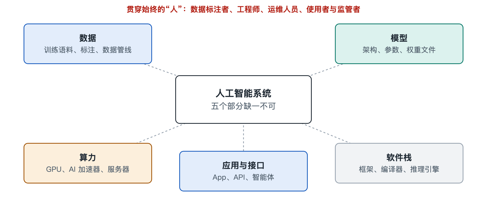

# 2.1 数据：训练语料、标注与数据管线

打开手机相册，你可能会发现它能自动把照片归成“猫”“海边”“美食”。在这项功能背后，有成千上万张被人标好“这是猫”的图片，模型正是从这些例子里学会了认猫。聊天助手能写出通顺的中文，靠的也是它读过的海量文字。人工智能系统的第一个组成部分就是数据。模型的能力从数据中学来，所以有一句工程界的老话：“输入的是垃圾，输出的也是垃圾。”

这一节把“数据”拆成三层来看：数据从哪里来（训练语料），人怎样给数据加上答案（标注），以及数据怎样被加工成模型能吃的形式（数据管线）。

## 2.1.1 训练语料：模型的“课本”

**训练语料**（training corpus）指用来训练模型的文本、图像、音频等原始材料的总和。以大语言模型（Large Language Model，LLM）为例，公开技术报告中常见的语料来源大致有以下几类：

| 来源类别 | 典型内容 | 主要作用 |
|---|---|---|
| 网页抓取 | 公开网页、论坛、百科 | 提供广泛的语言和常识 |
| 书籍与论文 | 出版物、学术文献 | 提供长篇、严谨的表达 |
| 代码 | 开源代码仓库 | 培养编程和逻辑能力 |
| 对话与问答 | 问答社区、人工编写的对话 | 学习交流方式 |
| 合成数据 | 由已有模型生成、再经筛选的数据 | 补足稀缺类型的样本 |

规模上，公开资料中主流大模型的训练语料常以“万亿个令牌”计。令牌（token）是模型切分文字的基本单位，一个汉字大约对应一到两个令牌，第五章会细讲。这个数量级大约相当于几千万到上亿本书。

语料的量很重要，质也很重要。同样规模的数据，重复多、错误多、广告多，训练出的模型就会差。各家机构在语料配方上的取舍，比如代码占多少、中文占多少、要不要合成数据，通常属于核心经验，多数只公开大致思路，不公开细节。

## 2.1.2 标注：给数据配上“标准答案”

原始语料只是材料。很多任务还需要人告诉模型“什么是对的”，这一步叫**数据标注**（data annotation）。

- **分类标注**：给图片标“猫”或“狗”，给邮件标“垃圾”或“正常”。
- **框选与分割**：在自动驾驶图像中框出行人、车辆和车道线。
- **示范回答**：由人写出高质量的问题和回答，教模型怎样按指令办事，第六章会讲到的“指令微调”就靠它。
- **偏好排序**：让人比较模型给出的两个回答哪个更好。这类数据用于“基于人类反馈的强化学习”，帮助模型的回答更符合人类期望。

大语言模型的预训练阶段并不依赖人工标注。它用的方法叫**自监督学习**（self-supervised learning），把一句话的后半截遮住，让模型猜下一个词，答案就藏在原文里，不需要人去标。所以模型可以直接使用海量的无标注文本。人工标注主要用在后期的“调教”阶段，数量少得多，但单条成本高，对专业性要求也高。比如医学、法律类的示范回答，往往需要相应领域的专业人员来写。

标注是一个真实存在的行业。公开报道显示，世界各地有大量标注员从事这项工作，劳动报酬、标注质量和标准一致性都是业内常被讨论的问题。

## 2.1.3 数据管线：从原料到“训练批次”的流水线

把互联网上的原始文字直接喂给模型是行不通的。数据要经过一条**数据管线**（data pipeline），也就是一串自动化的处理步骤，很像自来水厂把河水变成自来水：

1. **采集**：抓取网页、获取授权书籍、收集代码等。
2. **清洗**：去掉网页里的导航栏、广告、乱码和格式标记。
3. **过滤**：用规则或小模型剔除低质量、有害、含个人隐私的内容。
4. **去重**：删除重复或高度相似的文档。重复内容过多，模型容易死记硬背。
5. **混合配比**：按设定比例搭配不同来源和语言的数据。
6. **分词与打包**：把文字切成令牌，排成固定长度的序列，组成一个个**训练批次**（batch），送进计算集群。

这条流水线本身就是一个大规模计算系统，往往要动用成百上千台服务器处理数据，数据存储量常以“拍字节”（PB，约一百万 GB）计。在工程实践中，数据团队花在清洗和过滤上的精力，常常不比训练模型少。

## 2.1.4 数据带来的系统性问题

数据决定能力，也会带来风险。下面几个问题是公认的：

- **偏见**：语料中某些群体被描述得少或者带有刻板印象，模型就可能复制这些偏差。
- **版权与授权**：用受版权保护的作品训练模型是否合规，写作时多个国家和地区仍有诉讼和立法讨论在进行，尚无全球统一结论。
- **隐私**：网页里可能夹带个人信息，需要在管线中识别和删除。
- **时效**：模型的知识停在语料收集的截止时间，即“知识截止日期”。这就是为什么很多助手要再联网检索（第三章会讲）。
- **评测污染**：考试题如果混进训练数据，模型的跑分就会虚高。

## 2.1.5 小结

回到相册里那只被认出来的猫，以及聊天框里那段通顺的回答。它们背后是一条看不见的数据链：海量语料提供原材料，人工标注提供方向，数据管线把原材料加工成整齐的训练批次。数据是模型能力的来源，也是偏见、版权和隐私风险的来源。

有了这些加工好的数据，下一步就要看它们被“炼”成了什么：一个由数十亿乃至更多参数组成的模型，以及存放这些参数的权重文件。这是下一节的主题。
