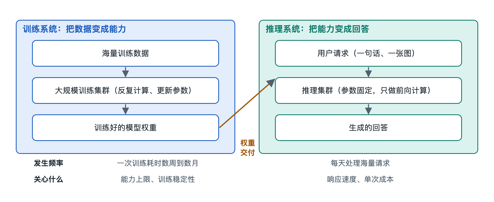

# 3.1 训练系统：把数据变成能力

你在手机上问 AI 助手“明天去爬山要带什么”，它几秒钟就给出一份清单。这份回答不是临时“想”出来的，它所依赖的能力，早在几个月前就已经在某个数据中心里被“炼”好了。那段炼制过程，就是本节要讲的**训练**（Training）。如果说推理系统是餐厅前台按单上菜，训练系统就是后厨里那段漫长的备料、试菜与定方子。它不直接面对用户，却决定了用户最终能吃到什么。

## 3.1.1 训练系统要完成的任务：把“经验”压进参数

先给训练下一个朴素的定义：**训练就是反复调整模型参数，让模型在大量样例上的表现越来越好的过程。**

第二章讲过，模型本质上是一个由海量数字（参数，Parameter）组成的函数。训练开始前，这些数字基本是随机的，模型输出的只是乱码。训练系统做的事情，可以拆成一个不断重复的小循环：

1. **取一批数据**：从语料库中拿出一小批样本（称为一个批次，Batch）。
2. **让模型做题**：例如给出一段文字的前半部分，让模型预测下一个词。
3. **对答案打分**：用**损失函数**（Loss Function）计算模型的预测离正确答案有多远。
4. **找改进方向**：用**反向传播**（Backpropagation）算出每个参数应该往哪个方向、调多少。
5. **更新参数**：由**优化器**（Optimizer）按这个方向把参数挪动一小步。

这个循环在大模型训练中通常要重复数十万甚至上百万次。每一次只改进一点点，但累积起来，语法、常识、推理模式这些“经验”就逐渐被压进了参数里。损失函数和梯度下降的具体原理留到第六章和第八章细讲，这里只需记住：**训练系统的产出物，就是一个调好了参数的权重文件。**

## 3.1.2 训练不是一步完成的：三个阶段各有分工

今天的大语言模型，通常不是“一次训练”得到的，而是分阶段加工。下表是公开资料中常见的划分方式，不同公司的具体做法会有差异：

| 阶段 | 常见名称 | 用什么数据 | 主要目标 | 打个比方 |
|---|---|---|---|---|
| 第一阶段 | 预训练（Pre-training） | 海量公开文本、代码等，规模常以万亿个令牌计 | 学会语言规律和广泛知识 | 读完一座图书馆 |
| 第二阶段 | 监督微调（Supervised Fine-Tuning，SFT） | 人工编写或筛选的“问题—优质回答”对 | 学会按指令作答 | 跟着老师做例题 |
| 第三阶段 | 偏好对齐（如 RLHF 等方法） | 人类或模型对多个回答的好坏比较 | 回答更有帮助、更安全 | 根据评语反复修改作文 |

三个阶段消耗的资源差距很大。预训练通常占据绝大部分算力和时间，可能需要成千上万块加速器连续运行数周到数月；后两个阶段数据量小得多，但对数据质量要求极高。可以这样理解：**预训练决定模型“知道多少”，微调和对齐决定模型“怎么说出来”。** 第三章下一节之后讲到的对齐与安全模块，正是建立在第三阶段之上。

## 3.1.3 一个训练系统由哪些部件组成

把训练当成一项工程，它远不止“一个模型加一堆数据”。一个能实际运转的大规模训练系统，至少包括这样几个功能模块：

- **数据管线**：负责清洗、去重、过滤、分词，并把数据源源不断地送进计算设备。它若跟不上，再贵的芯片也只能空转等待。
- **计算集群**：由大量 GPU 或其他 AI 加速器组成，承担几乎全部的数学运算。
- **并行与通信调度**：一个大模型往往装不进单块芯片，需要把数据、模型层或计算步骤切分到许多芯片上同时执行，再通过高速网络交换中间结果。具体切分方法在第四章展开。
- **检查点（Checkpoint）存储**：定期把当前参数完整保存下来。成千上万块芯片长时间运行，硬件故障几乎不可避免，有了检查点，出故障后可以从最近的存档继续，而不必从头再来。
- **监控与评测**：实时记录损失曲线、硬件利用率等指标，并定期在测试题上考一考模型，判断训练是否走在正轨上。

这几个模块像一条流水线，任何一环出问题，都会拖慢甚至打断整个训练。公开的技术报告中，工程团队花大量篇幅讨论的往往不是模型结构，而是如何让这条流水线稳定、高效地连续运行数月。

## 3.1.4 训练和推理：同一个模型，两种截然不同的工作

为了把训练系统的特点看得更清楚，不妨与下一节要讲的推理系统做个对照：

| 对比项 | 训练系统 | 推理系统 |
|---|---|---|
| 参数是否改变 | 不断更新 | 固定不变，只读取 |
| 计算方向 | 前向计算 + 反向传播 | 只有前向计算 |
| 发生频率 | 一个版本通常只做一次（或少数几次） | 每个用户请求都要做一次 |
| 关注重点 | 总吞吐量、稳定性、能否按期完成 | 响应速度、并发量、单次成本 |
| 所需内存 | 除参数外还要存梯度、优化器状态等，通常远大于参数本身 | 主要存参数和对话上下文 |

最后一行值得多说一句：训练时，每个参数不仅要存自己，还要存对应的梯度和优化器记录的历史信息。因此在常见配置下，训练所需的显存往往是参数本身占用量的数倍。这也是为什么能在笔记本电脑上“跑”起来的模型，未必能在同一台电脑上“训”起来——第九章的动手实验会让你亲身体会这一点。

## 3.1.5 小结：能力是“训”出来的，也有它的边界

回到开头那份爬山清单。模型之所以知道要带水、防晒和护膝，是因为预训练时它见过大量类似的文字；之所以能整理成条理清楚的列表，是因为微调时学过这种回答格式；之所以会提醒你“注意天气预报”，可能来自对齐阶段对“有帮助”的偏好。

同时也要看到训练的边界：模型的知识停留在训练数据截止的那一刻；数据中没有或很少出现的内容，它就容易答错甚至编造。训练系统把数据变成了能力，但这份能力是凝固在参数里的。如何让凝固的能力在每一次提问时被高效地调用出来，就是下一节推理系统要解决的问题。
