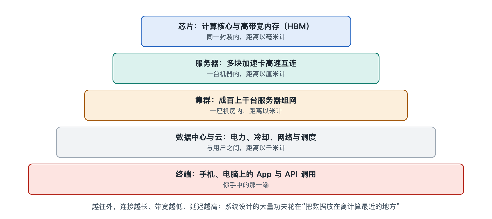

# 4.1 芯片之内：张量核心、高带宽内存与片上互连

拿起你的手机，背面某处藏着一块比指甲盖还小的芯片。新闻里那些动辄标价数万美元的 AI 加速卡，体积大不了多少，核心部分同样只是一片硅。你在手机上问出一个问题，回答在远方数据中心里生成，承担计算的也正是这样一片片芯片。前三章我们把人工智能系统拆成了数据、模型、算力和软件，又看清了训练、推理各自负责什么。从这一章开始换一个角度，问一个更“工程”的问题：这些部分是怎样连接起来的？连接要从最小的尺度看起，也就是一块芯片的内部。

## 4.1.1 一座“城市”的比喻：计算、存储与道路

可以把一块 AI 芯片想象成一座城市，城里有三类设施：

- **工厂**：负责计算的单元，把输入的数字加工成输出的数字；
- **仓库**：负责存储的单元，存放模型参数和中间结果；
- **道路**：负责连接的单元，把原料从仓库运到工厂，再把成品运回去。

城市运转得好不好，不只取决于工厂多大，还要看仓库够不够近、道路堵不堵。AI 芯片也一样。工程师常说，今天的大模型计算受限于“内存墙”（Memory Wall）：计算单元算得很快，数据却运不过来，工厂只好停工等料。理解这一点，是看懂芯片设计取舍的钥匙。

## 4.1.2 工厂：为矩阵乘法而生的张量核心

第八章会详细讲到，大模型绝大部分的计算量都可以归结为矩阵乘法：一大张数字表格乘以另一大张表格。普通的中央处理器（CPU）擅长处理复杂多变的逻辑，每个核心都配有精巧的控制电路，但同时做的乘法数量有限。图形处理器（GPU）则把芯片面积大量分给简单而众多的计算单元，适合同时做成千上万次相同的运算。

在此基础上，英伟达从 2017 年发布的 Volta 架构开始，在 GPU 中加入了专门的**张量核心**（Tensor Core）。所谓“张量”，可以先理解为多维的数字表格。普通计算单元一次做一对数字的乘加，张量核心则一次完成一小块矩阵（例如 4×4 规模）的乘加，相当于把一道道单独的乘法题，换成了一整张乘法表的批量处理。其他厂商也有类似设计，名称各不相同：谷歌 TPU 中的核心计算部件叫“脉动阵列”（Systolic Array），数据像心脏泵血一样有节奏地流过一排排乘法器；手机芯片里的神经网络处理器（NPU）同样以矩阵运算阵列为主体。具体结构各家不同，但思路一致：**为矩阵乘法定制硬件，牺牲通用性，换取效率**。

张量核心的另一个特点是支持低精度数字。用 16 位、8 位甚至更少的二进制位表示一个数，精度下降，但同样的电路面积能做更多运算，搬运的数据量也成倍减少。这与第七章要讲的模型量化相互配合。

## 4.1.3 仓库：从片上缓存到高带宽内存

工厂再快，也得有料可用。芯片内部的存储是分层次的，越靠近计算单元越快、越贵、容量越小：

| 层级 | 位置 | 容量量级 | 速度特点 | 城市类比 |
|---|---|---|---|---|
| 寄存器 | 紧挨计算单元 | 每个计算单元附近很小 | 最快 | 工人手边的工具台 |
| 片上缓存（SRAM） | 同一片硅上 | 数十到数百 MB 量级 | 很快 | 车间旁的小库房 |
| 高带宽内存（HBM） | 封装在芯片旁 | 数十到上百 GB 量级 | 较快、带宽极大 | 城郊的大仓库 |
| 主机内存与硬盘 | 芯片之外 | TB 级及以上 | 慢 | 外地的物流中心 |

（表中为写作时公开资料中的典型数量级，不同产品差异很大。）

一个大模型的参数往往需要几十到几百 GB 来存放，片上缓存装不下，只能放在**高带宽内存**（High Bandwidth Memory，HBM）里。HBM 的做法是把多层内存芯片垂直堆叠起来，用穿过硅片的细微导线（硅通孔，TSV）上下连通，再紧挨着计算芯片封装在同一块基板上。普通显存像一条单车道公路，HBM 则像一条上千车道并行的高速路，每秒可搬运的数据量在写作时的高端产品上已达每秒数 TB 量级。即便如此，推理时每生成一个字，往往都要把大量参数从 HBM 读一遍，所以 HBM 的带宽常常比计算速度更直接地决定了回答“吐字”的快慢。HBM 本身的制造与封装技术，留到第七章细说。

## 4.1.4 道路：片上互连把一切连起来

一块高端 AI 芯片里有上百个计算模块，它们要共享缓存、访问 HBM、彼此交换结果，这就需要**片上互连**（On-chip Interconnect）。早期芯片常用“总线”，像一条主干道，所有车辆轮流通行；模块一多就会拥堵。如今大型芯片多采用“片上网络”（Network on Chip，NoC），把芯片划成网格，每个路口设有小型路由器，数据像快递包裹一样按地址分段转发，多条路径可以同时通行。

近几年还出现了一个新趋势：单片硅的面积受制造工艺限制，做不到无限大，于是厂商把几块较小的芯片（称为“小芯片”，Chiplet）放在同一封装里，用高密度连线拼接起来，让它们像一块芯片那样工作。这时“片上互连”就延伸成了“封装内互连”。哪些产品采用这种设计、采用到什么程度，各家做法不一，读新闻时值得留意。

## 4.1.5 小结：一块芯片就是一个微缩的系统

回头看，一块 AI 芯片内部已经具备完整的系统特征：张量核心负责计算，多级存储负责供料，片上互连负责调度交通，三者必须匹配。只堆计算单元而带宽跟不上，就像修了大工厂却只有一条乡间小路。这也解释了为什么芯片发布会上，厂商除了强调算力，总要同时报出内存容量和带宽。

不过，一块芯片的 HBM 再大，也装不下最大的模型；一块芯片算得再快，也撑不起成千上万用户的同时提问。于是多块芯片必须被装进同一台服务器、彼此高速相连。下一节，我们就走出芯片，进入服务器的机箱内部。
