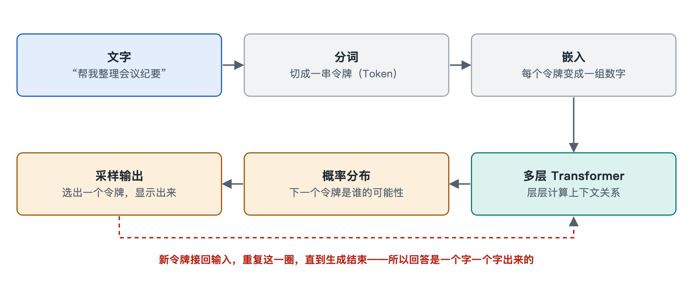

# 5.3 令牌流：一次对话请求的完整旅程

你在手机上的 AI 助手里输入一句话：“帮我把这段会议记录整理成三条要点。”按下发送后，屏幕上先是短暂停顿，接着文字一个词一个词地“蹦”出来，像有人在另一端打字。这种逐字出现的效果并不是界面特效，它如实反映了系统内部的工作方式：回答本来就是一小块一小块生成出来的。这一小块，在工程上叫作**令牌**（Token，也常译作“令牌”）。上一节讲的是训练时数据怎样流动，这一节换个角度，跟着一次对话请求，看令牌从你的手机出发、进入数据中心、再回到屏幕上的完整旅程。

## 5.3.1 第一站：从文字到令牌编号

模型不直接认识汉字或英文字母，它只处理数字。所以请求发出后，第一道工序是**分词**（Tokenization）：由一个叫**分词器**（Tokenizer）的程序把文字切成令牌，再把每个令牌换成词表里的编号。

令牌不等于“字”，也不等于“词”。常见的做法是字节对编码（Byte Pair Encoding，BPE）一类的方法：在训练前统计大量文本，把经常一起出现的字符片段合并成一个令牌。于是常见的英文单词往往是一个令牌，生僻词会被拆成几段；中文的情况因模型而异，有的词表里一个汉字约等于一个令牌，有的会把常见词合成一个令牌。公开资料中的常见说法是，英文里一个令牌平均约合四分之三个单词，中文则各家差别较大。

这就是为什么 AI 服务的计费和上下文长度通常按“令牌数”而不是“字数”来算：令牌才是系统内部真正的流通单位。

| 你看到的 | 系统内部处理的 |
|---|---|
| 一句中文提问 | 一串令牌编号，例如几十个整数 |
| 聊天里的历史对话 | 同样被转成令牌，和新问题拼在一起 |
| 逐字出现的回答 | 一个接一个生成的令牌，再还原成文字 |

需要注意，你看到的输入往往不是模型收到的全部。应用通常还会在前面加上一段**系统提示**（System Prompt），告诉模型扮演什么角色、遵守哪些规则；多轮对话中，之前的问答也会被一并带上。这些合在一起才构成本次请求的**上下文**（Context）。

## 5.3.2 第二站：穿过网关，排队进入 GPU

令牌化可能在手机端完成，也可能在服务端完成，取决于具体系统的设计。无论哪种，请求都要经过第四章讲过的路径：经由互联网到达云服务的 **API 网关**（API Gateway），在这里完成身份验证、限流检查和内容安全过滤，然后被分发到某一组负责推理的服务器上。

到了推理服务器，请求不会独占一块 GPU。同一时刻可能有成百上千个用户的请求在等待，推理引擎会把它们编成批次一起计算，以提高芯片利用率。很多推理系统采用**连续批处理**（Continuous Batching）：某个请求生成完毕就立刻退出，新请求随时补进来，像一辆不停站的环线公交。批处理和调度的具体机制，会在第六章 6.3 节展开。

## 5.3.3 第三站：预填充与逐个解码

请求进入 GPU 后，计算分成两个阶段，它们的“节奏”很不一样。

**预填充**（Prefill）阶段：模型把上下文里所有令牌一次性读进去，并行计算，为每个令牌算出一组中间结果并存起来，这组被缓存的中间结果叫 **KV 缓存**（Key-Value Cache）。这一阶段计算量大，但能充分并行，相当于先把整份材料通读一遍。你在发送后感受到的那一下停顿，很大一部分就花在这里。业内常用“首令牌延迟”（Time To First Token，TTFT）来衡量它。

**解码**（Decode）阶段：模型开始写回答，基本上每次只产出一个令牌。它根据已有的全部上下文，算出“下一个令牌是词表中每个候选的概率”，按一定规则选出一个，把它接到末尾，再去算下一个。这种“写一个、看一眼、再写下一个”的方式叫**自回归生成**（Autoregressive Generation）。每一步只新增一个令牌，所以要靠 KV 缓存避免把前面的内容从头重算。

两个阶段的瓶颈不同：

| 阶段 | 处理方式 | 主要瓶颈 | 用户感受 |
|---|---|---|---|
| 预填充 | 所有输入令牌并行处理 | 计算能力 | 发送后的等待时间 |
| 解码 | 每次生成一个令牌 | 内存带宽（反复读取权重和缓存） | 文字“蹦”出来的速度 |

解码阶段每生成一个令牌，都要把模型的大量权重从高带宽内存中读一遍，而实际计算量相对较小，所以它常常受限于“搬数据”的速度而不是“算数据”的速度。这正呼应了第四章：高带宽内存为什么对推理如此关键。

## 5.3.4 第四站：流式返回与停止

每生成一个令牌，服务端就可以立刻把它还原成文字片段，通过**流式传输**（Streaming）推回你的手机，而不必等整段回答写完。许多聊天应用采用这种方式，所以你看到的是逐字出现。

生成什么时候结束？通常有几种情况：模型生成了一个特殊的“结束令牌”；回答达到了应用设定的最大长度；或者你主动点了“停止”。在返回途中，不少服务还会对输出做安全检查。结束后，系统会统计这次请求的输入令牌数和输出令牌数，作为计费和监控的依据。公开定价中，输出令牌的单价往往高于输入令牌，原因之一就在于解码阶段逐个生成、占用硬件时间更长。

如果对话还要继续，下一轮提问时，前面所有的问答又会被重新组成上下文送入模型。对话越长，每轮要处理的令牌越多，这也是长对话会变慢、上下文长度有上限的直接原因。

## 5.3.5 小结：一条令牌流水线

把整段旅程串起来，可以得到一条清晰的流水线：

1. 文字 → 分词器 → 令牌编号（加上系统提示和历史对话）
2. 网络 → API 网关 → 推理服务器的调度队列
3. 预填充：一次读完上下文，建立 KV 缓存
4. 解码：一个令牌接一个令牌地生成
5. 流式返回 → 还原成文字 → 计量计费

令牌是贯穿这条流水线的“货币”：上下文窗口用它来量，延迟用它来算，账单也用它来记。理解了令牌流，就能读懂诸如“每秒多少令牌”“百万令牌多少钱”这类新闻里的说法。而每一个令牌的诞生，都要消耗 GPU 的电能并产生热量，下一节我们就沿着这条线，去看能量流与热流。
