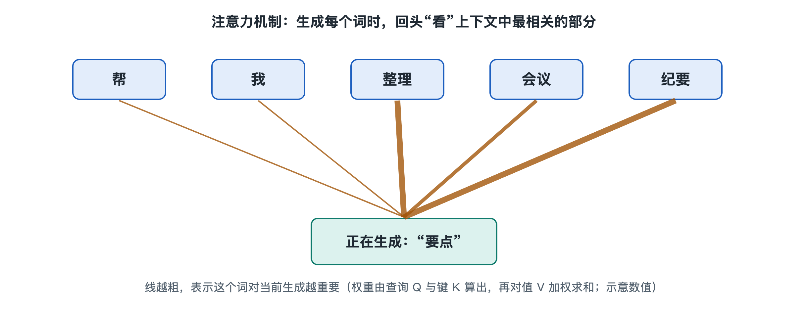

# 6.1 Transformer 与注意力机制：模型如何“看”上下文

打开手机里的 AI 助手，输入这样一句话：“我把手机放进包里，然后把它挂在门后。”再追问一句：“‘它’指的是什么？”多数大模型会回答“包”。这个判断看似平常，背后却要求系统同时“看”到句子里的好几个词，并掂量它们之间的关系：手机能不能挂在门后？包能不能？谁更合理？完成这件事的核心部件，就是本节要讲的 Transformer（中文常译为“变换器”，业内多直接用英文）和其中的注意力机制（Attention）。在本书写作时，主流的大语言模型几乎都以 Transformer 为基本骨架。

## 6.1.1 从“逐字传话”到“一眼全看”

在 Transformer 出现之前，处理语言的主力是循环神经网络（Recurrent Neural Network，RNN）。它像传话游戏：一个词一个词地读，把读过的内容压缩进一个“记忆状态”，再传给下一步。句子一长，开头的信息在一次次传递中逐渐模糊；而且必须按顺序一步步算，很难发挥 GPU 同时处理大量计算的长处（参见第二章 2.3 节）。

2017 年，Google 的研究者在论文《Attention Is All You Need》中提出 Transformer。它的思路不同：不再逐字传话，而是让句子里的每个词都能直接查看其他所有词，自己决定该重点关注谁。这样做带来两个好处：

| 对比项 | 循环神经网络（RNN） | Transformer |
|---|---|---|
| 读取方式 | 按顺序逐词处理 | 所有词同时参与计算 |
| 远距离信息 | 经多步传递后易衰减 | 任意两个词之间一步直达 |
| 并行程度 | 低，难以充分利用 GPU | 高，适合大规模矩阵运算 |

正是“并行”这一点，让模型能借助万卡集群扩大到今天的规模。

## 6.1.2 注意力：一场“查询—匹配—汇总”的检索

注意力机制可以类比为在图书馆找资料。每个词进入模型后，会被转换成一串数字（向量，第八章 8.4 节会细讲），再由它派生出三个角色：

- **查询（Query，Q）**：我想找什么样的信息？
- **键（Key，K）**：我身上贴着什么样的标签？
- **值（Value，V）**：如果你选中我，我能提供什么内容？

回到开头的例子。当模型处理“它”时，“它”的查询会与句子里每个词的键逐一比对，算出一个匹配分数。“包”与“挂在门后”的语境匹配度高，分数就高；“手机”“然后”分数较低。这些分数经过一个叫 Softmax 的函数，变成总和为 1 的权重，好比把 100% 的注意力分配出去。最后，按权重把各个词的值加权求和，得到“它”在这个语境下的新表示——其中“包”的成分最多。

整个过程用数学语言写出来，就是几次矩阵乘法加一次归一化。这也解释了第八章要说的那句话：“一切都是矩阵乘法”。

## 6.1.3 多头、多层与位置：让“看”更立体

一次注意力只能捕捉一种关系，而语言里的关系是多样的：语法上的主谓、指代上的“它是谁”、语义上的近义与对比。于是 Transformer 采用**多头注意力**（Multi-Head Attention）：同时安排多组 Q、K、V，各自独立计算，像几位读者从不同角度读同一句话，再把结论拼起来。

一个完整的 Transformer 层通常包含两部分：

1. **注意力子层**：负责词与词之间的“交流”；
2. **前馈网络子层**（Feed-Forward Network，FFN）：负责每个词各自“消化”信息。

此外还有残差连接和层归一化等辅助结构，用来让很深的网络能稳定训练。大模型就是把这样的层堆叠几十层乃至上百层，越往上，表示越抽象。

还有一个细节：注意力本身不关心词的先后顺序，“狗咬人”和“人咬狗”在它看来词是一样的。因此模型需要加入**位置编码**（Positional Encoding），给每个词标上“座位号”。不同模型采用的位置编码方法不同，例如不少开源大模型使用一种叫旋转位置编码（RoPE）的方案，但这并非所有系统通用。

## 6.1.4 只看过去：生成式模型的“遮挡”规则

聊天机器人生成回答时，是一个令牌（token，第五章 5.3 节介绍过）接一个令牌往外写的。写第 10 个令牌时，第 11 个还不存在，模型不能“偷看未来”。所以生成式大模型使用**因果注意力**（Causal Attention）：每个位置只能关注它自己和之前的位置，后面的位置被遮挡。原始 Transformer 包含编码器和解码器两部分，而目前多数对话大模型采用“仅解码器”结构，正是建立在这种只看过去的规则上。

## 6.1.5 代价：上下文越长，计算越重

“一眼全看”也有代价。如果上下文有 n 个令牌，每个令牌都要和其他所有令牌比一遍，计算量和存储需求大致随 n 的平方增长。上下文从一千扩到十万，比对次数增加的是一万倍量级。这就是为什么长上下文是工程难题，也催生了各种优化技术：有的减少不必要的比对，有的优化数据在高带宽内存与计算单元之间的搬运方式（第七章 7.2 节）。同时，生成过程中已算过的键和值可以存下来复用，这就是 6.3 节将详细介绍的 KV 缓存。

需要提醒的是，注意力权重高并不等于模型“理解”了含义，它只是统计学习得到的关联强度。模型在指代判断上也会出错，尤其在语境含糊时。

## 6.1.6 小结

Transformer 把“理解上下文”变成了一套可以大规模并行计算的流程：每个词通过查询、键、值去检索其他词，多头从不同角度并行观察，多层逐步抽象，因果遮挡保证按顺序生成。它决定了模型怎样“看”，接下来的问题是：模型里的这些 Q、K、V 转换参数从何而来？答案在训练机制里，这是 6.2 节的内容。
