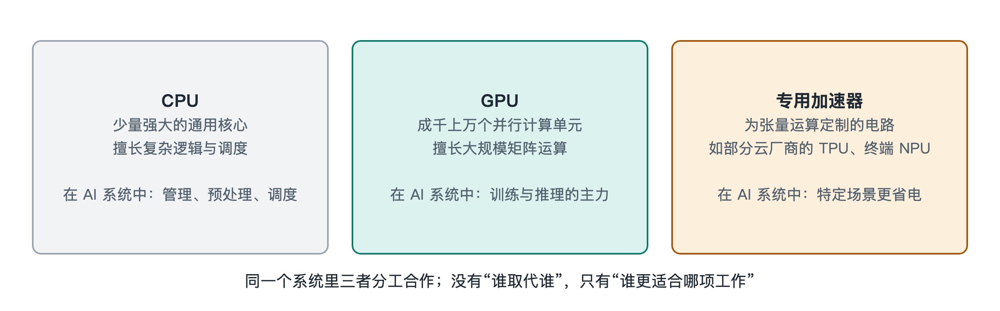

# 7.1 AI 芯片与加速器：GPU、TPU 与专用 NPU

拿起你的手机，打开相册，搜索“猫”或“海边”，几秒钟内，几千张照片里相关的那些就被挑了出来。这件事不需要联网也能完成。它靠的是手机主芯片里一块专门做 AI 计算的小单元。再看新闻里的数据中心照片，一排排机柜里插满了 GPU 加速卡，它们在训练和运行大模型。手机里的小单元和数据中心里的大卡，都叫“AI 芯片”。它们差别很大，要解决的却是同一个问题：怎样又快又省电地做海量的矩阵乘法。

## 7.1.1 为什么 CPU 不够用

先看我们熟悉的中央处理器（CPU，Central Processing Unit）。CPU 像一位全能的总经理，擅长处理复杂多变的任务：判断、跳转、调度、响应你的每一次点击。为了把这些事做好，CPU 把大量晶体管花在了控制逻辑、分支预测和大容量缓存上，真正用来做算术的部分只占一小块。

前几章讲过，神经网络的计算几乎全是矩阵乘法和加法，规则简单，数量却极其庞大。这类工作需要的不是一位聪明的总经理，而是成千上万名同时开工、动作整齐的计算工人。AI 芯片的共同设计思路就是：**少花晶体管在“决策”上，多花在“计算”和“搬数据”上。**

## 7.1.2 GPU：从画游戏画面到算神经网络

图形处理器（GPU，Graphics Processing Unit）原本是为电子游戏设计的。屏幕上几百万个像素，每个像素的颜色都要按相同的公式计算，天然适合并行。于是 GPU 内部有成千上万个较简单的计算核心，同时处理大批相似的运算。

2000 年代后期，英伟达（NVIDIA）推出 CUDA 编程平台，让 GPU 可以用来做通用计算。2012 年前后，研究者用 GPU 训练图像识别神经网络取得突破，GPU 从此成为深度学习的主力硬件。后来，英伟达在数据中心 GPU 中加入了专门做小块矩阵乘加运算的单元，称为张量核心（Tensor Core），第四章已经提到过。AMD 等公司也推出了数据中心 GPU，并配有自己的软件平台。

GPU 的优势在于**通用而灵活**：新的模型结构出现，工程师通常能较快地在 GPU 上写出实现，配套软件和开发者社区也最成熟。代价是它保留了不少通用电路，功耗和价格都高。写作时，一块顶级数据中心 GPU 的功耗在公开资料中常见为数百瓦到上千瓦的量级。

## 7.1.3 TPU 与各类 ASIC：为矩阵乘法量身定做

另一条路线是专用集成电路（ASIC，Application-Specific Integrated Circuit），即为某一类任务专门设计的芯片。最有名的例子是谷歌（Google）的张量处理器（TPU，Tensor Processing Unit）。按谷歌公开的资料，TPU 最初在 2015 年前后投入其数据中心使用，主要服务于谷歌自家的搜索、翻译等业务，后来也通过谷歌云对外提供。

TPU 的核心是一种叫**脉动阵列**（Systolic Array）的结构。可以把它想象成一个方阵工厂：数据像流水一样从一侧流入，每经过一个计算单元，就做一次乘法并把结果累加下去，再传给下一个单元。数据在阵列里“边走边算”，不必反复回到内存去取，搬运次数大大减少，这正是省电提速的关键。

除谷歌外，亚马逊、微软、Meta 等云和互联网公司都公开过自研 AI 芯片，国内也有华为昇腾、寒武纪等厂商的产品。具体型号更新很快，以写作时各家官方资料为准。这类芯片通常针对特定公司的业务和软件栈优化，效率可能更高，但通用性和生态不如 GPU。

## 7.1.4 NPU：装进手机和电脑里的 AI 单元

回到开头的手机相册。手机里的 AI 单元一般叫神经网络处理器（NPU，Neural Processing Unit），不同厂商叫法不同，苹果称之为“神经网络引擎”（Neural Engine），高通、联发科、华为等也在各自的手机芯片中集成了类似单元。写作时，不少新款笔记本电脑处理器也开始集成 NPU。

NPU 一般不是一颗独立芯片，而是手机主芯片（系统级芯片，SoC，System on Chip）里的一个模块，和 CPU、GPU、图像处理单元挤在同一块硅片上。它的设计目标与数据中心芯片明显不同：**不追求最大算力，追求每瓦电能做最多的事。**手机电池只有几千毫安时，散热只能靠机身，NPU 往往大量使用低精度整数运算（第 7.4 节会讲到的量化），用来完成人脸解锁、拍照降噪、语音唤醒、实时翻译以及运行小型语言模型等任务。

## 7.1.5 一张表看清三类芯片

| 对比项 | GPU | TPU 等 ASIC | 端侧 NPU |
|---|---|---|---|
| 典型位置 | 数据中心、工作站、游戏电脑 | 云服务商数据中心 | 手机、笔记本、汽车、摄像头 |
| 设计取向 | 通用并行，兼顾灵活 | 为矩阵运算深度定制 | 极致能效，低功耗 |
| 主要任务 | 训练与推理都能做 | 大规模训练与推理 | 本地推理 |
| 优势 | 生态成熟，适应新模型快 | 特定负载下效率高 | 省电、低延迟、数据不出设备 |
| 局限 | 功耗和成本高 | 通用性与软件生态受限 | 算力和内存有限，跑不动大模型 |

需要提醒的是，三者的边界正在变模糊：GPU 越来越“专用”，加入更多张量单元；ASIC 也在增强可编程性。判断一块芯片好不好，不能只看宣传中的峰值算力（常以 TOPS 或 TFLOPS 表示，即每秒万亿次运算或每秒万亿次浮点运算），还要看它支持哪些数值精度、内存带宽多大、软件能否把算力真正用起来。

## 7.1.6 小结：算力的瓶颈往往不在算

三类芯片走了不同的路，但有一个共同的发现：对今天的大模型来说，计算单元常常在“等数据”。算得再快，数据送不过来也是白搭。这就是为什么 AI 芯片的竞争越来越多地转向内存与封装。下一节，我们就来看紧贴在 GPU 旁边的那几摞高带宽内存，以及把它们和芯片“粘”在一起的先进封装技术。
