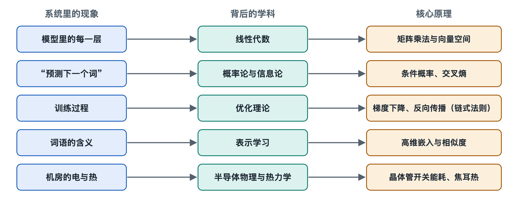

# 8.1 线性代数：一切都是矩阵乘法

打开手机相册，你会看到一张张照片。放大到极致，每张照片都是一格格像素，每个像素由红、绿、蓝三个数字描述亮度。一张照片在计算机眼里就是一张排得整整齐齐的数字表格。你向 AI 提问的那句话，经过分词和查表，也会变成一排排数字。前几章讲过的 GPU、张量核心和高带宽内存，归根到底都在处理这些数字表格。本节回答一个看似简单的问题：为什么几乎所有人工智能计算，最后都能写成矩阵乘法？

## 8.1.1 从一个数到一张表：标量、向量、矩阵与张量

线性代数（Linear Algebra）研究的是“成批的数字”怎样排列、怎样变换。它有几个基本对象，可以用身边的东西来对照：

| 名称 | 中文解释 | 生活类比 | 在 AI 系统中的例子 |
|---|---|---|---|
| 标量（Scalar） | 单独一个数 | 今天的气温 | 学习率、一个损失值 |
| 向量（Vector） | 一排数 | 一个人的身高、体重、年龄 | 一个词的嵌入表示 |
| 矩阵（Matrix） | 行列排列的数表 | 全班成绩单 | 一层神经网络的权重 |
| 张量（Tensor） | 多维的数组 | 一摞成绩单（多个班、多门课） | 一批图像、一批句子的中间结果 |

“张量”这个词在第七章出现过，深度学习框架的名字里也常带着它。它并不神秘，就是把向量、矩阵推广到更多维度的数字容器。一批 32 张彩色图片，可以看成“图片编号 × 高 × 宽 × 颜色通道”的四维张量。

## 8.1.2 矩阵乘法到底在做什么

矩阵乘法的规则可以用“打分”来理解。假设一家奶茶店要给顾客推荐饮品，每位顾客有三个口味偏好：甜度、奶味、果味；每款饮品也有这三项特征。把顾客的偏好向量和饮品的特征向量逐项相乘再相加，就得到一个“匹配分”。这个“逐项相乘再求和”的操作叫点积（Dot Product）。

现在有 100 位顾客、20 款饮品，要算出所有组合的匹配分。把顾客偏好排成一个 100 行 3 列的矩阵，把饮品特征排成 3 行 20 列的矩阵，两者相乘，就得到 100 行 20 列的分数表。**矩阵乘法就是大批量、整齐划一的点积。**

从另一个角度看，一个矩阵还可以理解为一台“变换机器”：输入一个向量，输出另一个向量。它可以把向量拉长、压扁、旋转，或者从一个维度的空间映射到另一个维度的空间。神经网络里的一层，本质上就是让输入向量通过这样一台机器。

## 8.1.3 神经网络里的矩阵：从一层到一个大模型

一层最基本的神经网络做三件事：

1. 输入向量乘以权重矩阵（矩阵乘法）；
2. 加上一个偏置向量（加法）；
3. 通过一个非线性的激活函数（例如把负数变成零）。

第二章说的“参数”，绝大部分就是这些权重矩阵里的数字。所谓模型有“数十亿参数”，意思是这些矩阵里的数字加起来有数十亿个；权重文件之所以动辄几个到几百个 GB，也是因为它要存下这些数表。

再看第六章讲过的 Transformer。注意力机制里，每个令牌的向量分别乘以三个矩阵，得到查询（Query）、键（Key）、值（Value）三组向量；查询和键做点积得到“谁该关注谁”的分数表；分数再去加权组合值向量。随后的前馈网络又是两次大矩阵乘法。把一个大模型拆到最底层，它的计算量主要落在矩阵乘法上，公开的技术分析中常见的说法是占到总计算量的绝大部分。

那激活函数为什么不可少？因为若干个线性变换叠在一起，结果仍然只是一个线性变换，相当于只有一层。正是夹在矩阵乘法之间的非线性函数，让多层网络能够表达弯曲、复杂的关系。可以这样记：**矩阵乘法负责“大规模组合信息”，非线性负责“让组合变得有表达力”。**

## 8.1.4 为什么硬件都在为矩阵乘法而造

回到第四章和第七章的硬件。矩阵乘法有两个对硬件非常友好的特点：

- **高度并行**：分数表里每一格的计算互不依赖，可以同时算。100 × 20 的表有 2000 格，就可以分给 2000 个计算单元一起做。
- **数据可复用**：同一行顾客偏好要和每款饮品相乘，读进来一次就能用很多次，减少了从内存搬运数据的次数。

这正是 GPU 擅长的事情：成千上万个简单核心同时做乘加。英伟达 GPU 中的张量核心（Tensor Core）、谷歌 TPU 中的脉动阵列（Systolic Array），都是专门为“小块矩阵乘加”设计的电路，只是不同公司的具体实现各不相同。衡量 AI 芯片算力常用的单位 FLOPS（每秒浮点运算次数），主要统计的也就是这类乘法和加法。

还有一个容易被忽视的事实：矩阵越大，计算量增长得比数据量更快。两个 n×n 矩阵相乘，数据量大约随 n² 增长，计算量却大约随 n³ 增长。这意味着大矩阵能让计算单元“吃饱”，而小矩阵常常卡在搬数据上。推理时把多个用户请求凑成一批来算（第六章的批处理），一个重要原因就是把许多小的向量运算拼成大的矩阵乘法。

## 8.1.5 小结：用矩阵的眼光看系统

线性代数为人工智能系统提供了一种通用语言：文字、图像、声音都被表示成向量和张量，模型的知识存放在权重矩阵里，推理和训练的主要工作是矩阵乘法，芯片和集群的设计围绕着如何更快、更省电地完成矩阵乘法展开。下次看到“某芯片算力达到多少 PFLOPS”的新闻，你可以把它翻译成：它每秒能做多少次矩阵里的乘加。

不过，矩阵乘法只告诉我们“怎么算”，没有告诉我们“算出来的数字代表什么”。模型输出的一排数字，为什么能变成“下一个词”的选择？这需要另一门数学——概率与信息论，也就是下一节的主题。
