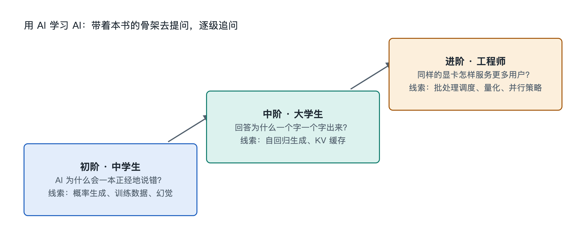

# 9.3 三阶提问阶梯：从中学生到工程师

同样是问 AI 一个问题，不同的人得到的收获可能差得很远。一位初二学生问“ChatGPT 为什么会说话”，得到一段通俗解释，满意地合上了手机。一位计算机专业的大三学生问同一件事，追问到注意力机制的矩阵运算。一位做推理服务的工程师则会问：“在当前显存下，KV 缓存占多少，批处理大小该怎么设？”三个人用的可能是同一个 AI 助手，差别在提问的层级。

本节把前面八章的认知骨架，整理成一套可以反复使用的“三阶提问阶梯”。读者可以从自己所在的台阶出发，一级一级往上走。

## 9.3.1 第一阶：看懂“是什么”——面向好奇的初学者

第一阶的目标是建立正确的图景，不追求细节。适合中学生、普通读者，以及想看懂新闻的管理者。这一阶的问题通常围绕“对象、结构、功能”三层，对应本书第一到第三章。

好的第一阶问题有三个特点：

- **锚定实物**：从手边看得见的东西问起，比如“我手机上的语音助手，回答是在手机里算的，还是在远方的服务器里算的？”
- **要求类比**：明确请 AI “用生活中的例子解释”，再追问“这个类比在哪里不准确”。后一句很重要，它能防止把类比当成事实。
- **划定边界**：问“这件事 AI 系统目前做不到什么”，避免形成夸大的印象。

示例提问：

> 我是一名初中生。请用不超过 300 字解释“大模型”是什么，用一个生活类比，并告诉我这个类比有哪些不准确的地方。

第一阶的常见误区是停在“听懂了”的感觉上。检验办法很简单：合上屏幕，能不能用自己的话向家人讲清楚。讲不清，就再问一轮。

## 9.3.2 第二阶：弄清“怎么连、怎么动”——面向入门学习者

第二阶对应第四到第六章的“连接、流动、机制”。提问者开始关心各部分之间的关系和过程，适合大学生、电子与计算机专业入门者，以及需要做技术判断的职场人士。

这一阶的提问方式要从“是什么”转向“经过哪些步骤”“A 和 B 怎样相互影响”：

| 第一阶问法 | 第二阶问法 |
|---|---|
| GPU 是什么？ | 一次对话请求从手机发出后，依次经过哪些系统组件才到达 GPU？ |
| 什么是训练？ | 一个训练批次在前向传播和反向传播中，数据和梯度分别怎样流动？ |
| AI 为什么耗电？ | 数据中心的电能从电网到芯片，再变成热量被带走，中间有哪些环节？ |

第二阶还要学会**追问因果和权衡**。例如：“上下文窗口变长，为什么推理会变慢、变贵？”这个问题会把令牌流、注意力计算量和显存占用串在一起。能提出这类问题，说明读者已经开始用系统视角思考，而不只是记住名词。

这一阶也要开始**交叉核对**。AI 给出的流程描述可能混淆不同公司的做法，比如把某一家厂商的互连技术说成行业通用。可以追问一句：“这是所有系统都这样，还是特定厂商或特定类型系统的做法？”并对照官方文档或教材确认。

## 9.3.3 第三阶：追问“为什么、代价多少、怎么改”——面向工程实践者

第三阶对应第七、八章的“关键技术”和“原理”，面向工程师、研究生和需要做实际决策的人。这一阶的问题带有约束条件，答案往往需要计算、实验或权衡，而不是一段解释。

第三阶问题通常包含四个要素：

1. **明确条件**：硬件规格、模型规模的数量级、精度格式、并发量等。
2. **要求推导**：请 AI 写出估算过程，而不只给结论。比如“按每个参数占两个字节估算，一个百亿参数级别的模型权重大约占多少显存？请列出算式。”
3. **追溯原理**：问“这个现象背后的数学或物理原因是什么”，比如量化为什么会损失精度、矩阵乘法为什么适合并行硬件。
4. **设计验证**：请 AI 给出能在自己电脑上复现的小实验，再用上一节运行本地小模型的方法亲手验证。

示例提问：

> 我有一张显存为 24GB 级别的消费级显卡，想在本地运行一个开源语言模型。请分别估算 16 位、8 位、4 位量化下能容纳的模型参数规模，写出计算过程，说明还需要为 KV 缓存预留哪些空间，并提醒我哪些估算可能不准确。

到了这一阶，AI 的角色从“讲解员”变成“讨论伙伴”。它给出的数字必须被当作待验证的假设，而不是定论。工程上的真相最终来自测量。

## 9.3.4 在阶梯上移动：一套通用的追问模板

三阶之间不是割裂的。一个好问题往往可以沿阶梯纵向展开。以“KV 缓存”为例：

- 第一阶：KV 缓存用一句话说是什么？像生活中的什么？
- 第二阶：它在一次对话的令牌流里何时生成、何时被读取？为什么能省计算？
- 第三阶：它的显存占用和哪些因素成正比？长对话时有哪些工程手段控制它？

不论处在哪一阶，下面四句追问都值得随身携带：

- “请指出你这个回答中最不确定的部分。”
- “这是公认结论，还是某家公司或某篇论文的做法？”
- “我应该去哪类资料核实这一点？”
- “请把这个概念放回本书的九层骨架：它属于对象、结构、功能、连接、流动、机制、技术还是原理？”

最后一句尤其有用。它让每次零散的提问都回到同一张认知地图上，知识才会积累成体系，而不是一堆碎片。

## 9.3.5 小结

提问能力本身就是理解力的外在表现。第一阶求“看懂”，第二阶求“看通”，第三阶求“算清、做出”。从中学生到工程师，差别不在于用了哪个 AI 工具，而在于能否提出带边界、带条件、可验证的问题。书给出骨架，实物提供锚点，AI 负责展开，而决定展开方向的，始终是提问的人。下一节将回顾本章骨架，并给出最后一组实物探索任务。
