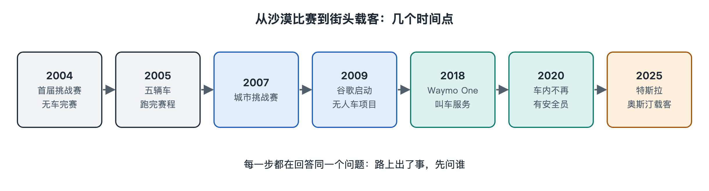

# 1.1 从无人车比赛到出租车

一辆出租车停在路边，车门打开，驾驶座空着。乘客看见的是一项出行服务：上车、抵达目的地、付费。把时间拨回二十多年前，无人车首先要证明的事情小得多——它能不能自己走到终点。

## 1.1.1 2004年：终点没有等到车

2004年3月13日，美国国防部高级研究计划局（DARPA）在沙漠里举办第一届“无人车挑战赛”。赛道从加利福尼亚州巴斯托附近通向内华达州普里姆，全程约142英里，约合229公里。参赛车辆要按给定路线自行行驶，先到终点的队伍可获得100万美元奖金。

结果，奖金没有发出去。15辆进入正式比赛的车，没有一辆跑完全程。跑得最远的卡内基梅隆大学“Sandstorm”只走了约7.4英里。DARPA公开的赛事记录至今保留着这个数字。把它放在整条赛道旁边看，连十分之一都不到。

这场比赛还有一段容易被忘记的背景。美国国会曾在2001财年国防授权法案中提出目标：到2015年，美军三分之一的作战地面车辆应当具备无人化能力。DARPA据此设置公开挑战，用奖金吸引大学和民间团队参加。最初的题目来自军事需求，比赛中的失败却让更多人看见了一个普遍难题：只要前方有路，车能不能不靠人一路走下去？公开比赛把这个问题变成了可观察的结果——每辆车停在了哪里，任何人都能比较。

不过，沙漠赛道与城市街道相差很远。比赛组织者给出路线并安排场地，参赛者追求的是一次完赛。出租车要面对每天不断变化的道路，还得接到人，把人送到地方。

## 1.1.2 2005年：五辆车抵达终点

一年多后，变化来得很快。2005年10月，DARPA再次举行挑战赛，路线约132英里。23辆车进入决赛，五辆跑完全程。斯坦福大学的“Stanley”以约6小时54分钟的成绩获得第一名，赢得200万美元奖金。上一届无人抵达，这一届有了五辆完赛车，赛事记录给出了清楚的进步。

“跑完”仍有它的边界。沙漠道路会有弯道、坡地和障碍，但车不用在学校门口等人过马路，也不用判断一辆靠边的汽车是否马上开门。比赛检验的是：给车一个终点，它能否在这样的场地里连续自行前进。这项能力后来会成为城市行驶的一部分，单靠它却还不能载客。

从2004年的7.4英里到2005年的全程完赛，无人车获得的也不只是一张成绩单。挑战赛把原本分散在学校、实验室和企业中的人聚到同一个公开题目下。很多后来进入自动驾驶行业的研究者，都曾参加这些赛事。DARPA在回顾挑战赛历史时，也把推动相关人才与研究汇集，列为赛事留下的影响。

## 1.1.3 2007年：把其他车也放进题目里

2007年，DARPA举行“城市挑战赛”。地点在加利福尼亚州维克托维尔的一处旧空军基地。车仍在比赛场地内行驶，任务却换了样子：它们要沿道路行进，经过路口，遵守交通规则，还要应对其他正在行驶的车辆。参赛者面对的不再只是“路在哪里”，还包括“路上有谁”。

卡内基梅隆大学团队的“Boss”获得第一名，斯坦福大学的“Junior”获得第二名。DARPA公布的结果显示，有六辆车完成了比赛。成绩证明，无人车可以在安排好的城市式道路场景中，与其他车辆一同完成行驶任务。场地依然受到控制；真实街道没有一场比赛的起点、终点和统一安排的参与者。

三届比赛连起来看，题目一步步变大：先看车能否走下去，再看它能否走完全程，最后把路口和其他车放进来。人们今天在无人出租车上看到的驾驶座空位，当年还不是比赛的重点。车里坐不坐乘客、到哪里接人、一天跑多少趟，都是赛场之外的新题目。

## 1.1.4 从参赛车辆到可以叫的车

比赛结束后，无人车逐渐离开专设场地，在公共道路上长期测试。美国谷歌的自动驾驶汽车项目始于2009年；该项目后来发展为Waymo。Waymo在2018年开始提供叫车服务，至2020年又公布了车内没有安全员的载客行程。美国特斯拉则在2025年于得克萨斯州奥斯汀启动小范围Robotaxi载客服务。这些年份标记的是不同阶段，不能把一次比赛完赛、一次道路测试和一次出租车行程算成同一件事。

出租车给无人车换了一把尺子。比赛有确定的开始和结束，观众关心谁先抵达；乘客会在不同时间出门，要求车辆来接，驶过日常道路，再把自己送到目的地。车还会继续迎接下一张订单。同样是一辆没有人握方向盘的车，放在这两种场合里，它承担的事情已大不相同。

沿着公开记录回望，起点也因此显得格外清楚：2004年，跑得最远的车停在沙漠赛道第7.4英里处；今天，乘客已经能够在一些城市叫到驾驶座空着的汽车。那段距离跨过了赛道、公共道路和出租车服务。至于空着的驾驶座原本属于谁、现在由谁接下那份工作，单看车辆有没有抵达终点，已经回答不了。

**资料出处：**美国国防部高级研究计划局（DARPA）关于2004年、2005年“Grand Challenge”及2007年“Urban Challenge”的赛事记录与历史介绍；美国《2001财年国防授权法案》第220节；Waymo官方历史资料；特斯拉2025年奥斯汀Robotaxi服务公开信息。
