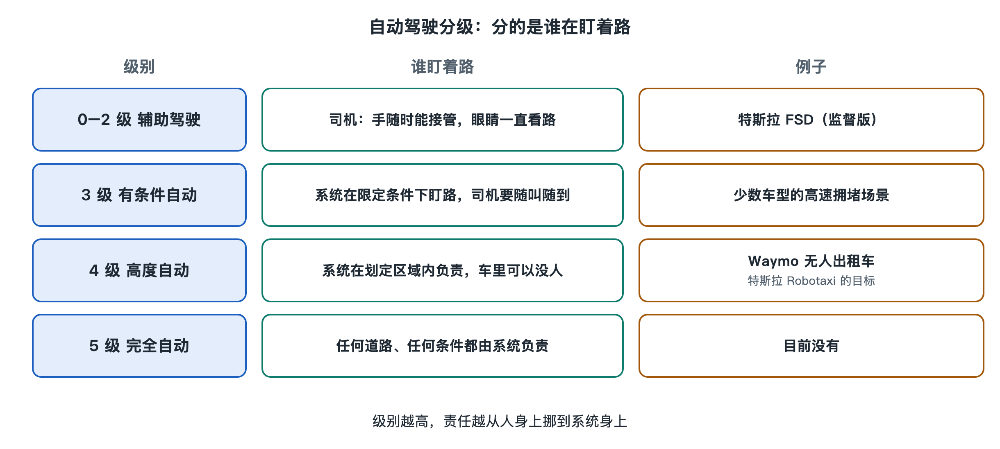

# 1.2 方向盘后面空了，谁负责看路

车驶进一条居民街。后排乘客看见方向盘自己转动，车在路口停稳，又等一辆自行车过去。此时只看方向盘，很容易觉得车已经“自己会开”。可要判断它究竟承担了多少驾驶任务，还得看另一件事：路上突然出现险情时，谁必须一直盯着，并准备接手？

## 1.2.1 分级表量的是什么

人们常说的 L2、L3、L4，来自国际汽车工程师学会发布的 **SAE J3016 自动驾驶分级**。这份标准在 2014 年首次发布，后来多次修订。一个容易被忽略的细节是：它分级的对象主要是*驾驶功能*，并非给整辆车贴上一张永久有效的等级标签。同一辆车启用不同功能，或者在不同条件下使用同一功能，人的任务可能不同。（来源：SAE International，*SAE J3016*，2021 年修订版；美国国家公路交通安全管理局，*Automated Vehicles for Safety*。）

这把尺子最关键的一道刻度，在 L2 和 L3 之间。使用 **L2 驾驶辅助**时，系统可以同时控制方向和车速，但驾驶者仍须持续观察道路、监督系统，随时干预。车能替人做不少动作，盯路的工作却还在人身上。

到了 **L3 有条件自动驾驶**，系统在规定条件下承担驾驶任务；条件快要不满足时，它可以要求人接管。人不必像使用 L2 时那样持续监督每个动作，但必须能够按要求重新接手。**L4 高度自动驾驶**再往前一步：在规定的运行范围内，即使车内的人不接管，系统也要自行处理驾驶任务，包括无法继续时采取适当的应对措施。**L5 完全自动驾驶**则不以这类限定范围为前提。这里的 L4 范围可以是一片城区、某些道路或某种天气；“无人”不等于任何地方都能去。

这张表没有按方向盘转得多顺、变道多像老司机来排位。它问的是系统允许人在多大程度上把注意力从驾驶任务上移开。路口停得漂亮，不能让 L2 自动升成 L4；车顶装了多少设备，也不能单独决定等级。

## 1.2.2 同一家公司的两种车

美国特斯拉向私家车提供的 **FSD（监督版）**，英文名称是 *Full Self-Driving (Supervised)*。名称中的“监督版”不能略掉。特斯拉用户手册要求驾驶者保持注意，观察道路，并随时准备干预；启用功能后，驾驶任务的监督者仍坐在驾驶座上。按 SAE 的分法，这是 L2 驾驶辅助。（来源：特斯拉美国版《车主手册》“Full Self-Driving (Supervised)”章节，车型与软件版本不同，具体文字应以对应手册为准。）

特斯拉 2025 年 6 月在奥斯汀开出的 Robotaxi，驾驶座空着，副驾驶座坐着监督员（见 0.1 和 4.2）。

车主与乘客各自约定了什么，4.3 再细看。这里只问等级：仅凭驾驶座无人，也不能从照片上判定一项服务必然符合 L4。还需要知道系统被允许在哪些条件下运行，超出条件时如何处置，以及副驾驶监督员被安排承担什么任务、拥有怎样的介入权限。座位提供了判断线索，却不能替代完整的运行说明。奥斯汀监督员与系统、乘客之间的约定，留到 4.2 节细看。

## 1.2.3 车里连员工也没有

另一种情形发生在美国亚利桑那州凤凰城。2020 年 10 月，Waymo 宣布向公众开放车内没有安全员的无人驾驶付费行程。报道这一消息的美联社也确认，乘客乘坐的车辆里没有负责接管驾驶的员工。（来源：Waymo 官方博客，2020 年 10 月 8 日；美联社，2020 年 10 月 8 日相关报道。）它仍在划定的服务区域内行驶，不负责把乘客带去任何道路、任何天气条件下的目的地。

这里的区别可以从乘客的位置看出来。车里没有一位被要求随时接管的司机，系统在允许的区域内就必须承担驾驶任务；行程遇到障碍、无法照常前进时，也不能把方向盘突然交给后排乘客。这正是理解 L4 的入口：范围可以有限，在这个范围内，驾驶责任却不能靠一位始终待命的人来补上。至于系统怎样处理自己解决不了的情况，是一趟行程中的另一个环节。

分级说的是驾驶任务由谁承担，不是事后事故责任已经由哪一方承担。保险公司、运营企业、车辆制造商和车内人员之间的责任，还要看具体事实与适用规则。日常讨论里一句“这车是自动驾驶”，常把这两层意思混在一起；SAE 表格先帮人分清眼前这一层：此刻，谁有义务看着路。

一辆车驶过路口，方向盘的动作或许完全一样。驾驶座上坐着必须监督的人、副驾驶座上坐着监督员，和车里只有乘客，是三种不同的安排。看清人的位置，再看清他们被要求做什么，“无人驾驶”四个字才有了可以核对的含义。
