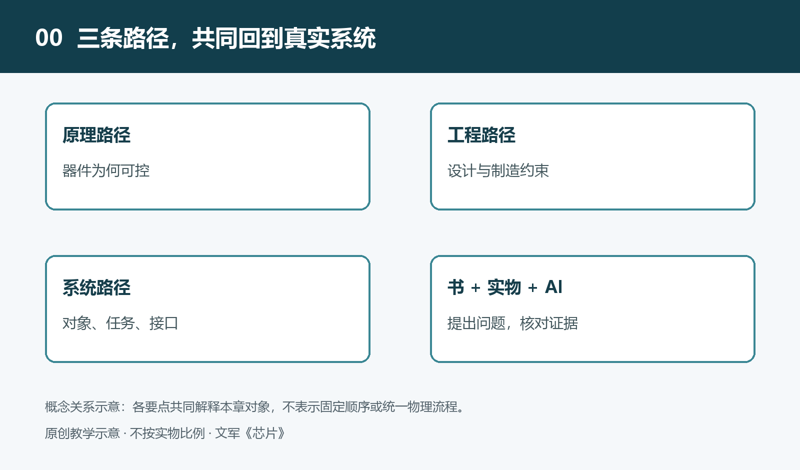

# 0.1 全书的位置：八系列62册规划中的《芯片》

拿起手机拍照，屏幕很快出现一幅图像。这个动作看似简单，却需要感知光线、转换信号、处理数据、保存图像和供应电能等多种工作。芯片就在这些环节中，但它们并不都在“计算”，也不都叫中央处理器。理解芯片，首先要知道它在设备中承担什么任务，又与哪些部件共同完成任务。

本书是文军《AI时代系统知识基础读物》第二系列“芯片与电子系统”中的一册，全套编号为09。它不是从晶体管公式一路推演到整台计算机，而是从真实电子设备出发，逐步走向内部结构、工作机制和基础原理，再把这些认识带回系统。

## 0.1.1 在八系列地图中定位

这套读物规划为八个系列，共62册：个人数字与计算系统8册，芯片与电子系统8册，人工智能与软件系统8册，通信与信息基础设施7册，智能机器与制造系统8册，能源与交通系统8册，现代城市与基础设施系统7册，现代社会运行系统8册。这是一张编写规划图，不表示全套已经完成出版。

八个系列按照理解对象划分，又通过真实系统彼此连接。一部手机既是个人数字设备，也包含芯片、软件和通信模块；一台工业机器人既需要机械结构，也依赖传感、控制、计算与供电。系列划分的目的，是让每册有清楚的讨论中心，而不是把现实世界切成互不相干的知识格子。

《芯片》位于这些联系的一个重要交点。软件指令需要电路执行，通信数据需要电路收发，传感器的微弱信号需要处理，电池的能量也需要经过管理和转换。芯片把信息处理与物理世界连接起来，但它始终只是系统的一部分，不能脱离电路板、供电、散热和软件独立解释全部设备行为。

## 0.1.2 本书要建立怎样的认识

听到“芯片”时，你可能先想到CPU。CPU承担通用指令处理的重要任务，却不能代表全部芯片。存储芯片负责保存和提供数据；模拟与混合信号芯片处理连续变化的电信号，并连接数字系统；电源管理与功率芯片控制电能的供应和转换。它们的评价标准各有侧重，不能都用运算速度衡量。

以一个用于教学的数字温度显示装置为例：感温部分提供与温度有关的信号，转换电路把信号变成可处理的数据，控制器安排读取和显示，供电电路维持各部分工作。实际产品可能把其中几项功能集成在同一芯片里，也可能采用多个器件。这个例子提示我们：先辨认任务，再辨认实现任务的芯片，比只记名称更有用。

因此，本书既关注“里面有什么”，也追问“为什么这样连接”。一颗芯片能否发挥作用，不仅取决于内部电路，还取决于接口是否相容、数据能否及时到达、电源是否稳定以及热量能否散出。所谓性能，也必须放到具体任务和工作条件中判断。

## 0.1.3 从系统走向微观，再回到系统

正文用九个层次组织内容：认识对象、看懂结构、理解功能、建立关系、掌握流动、理解机制、关键技术、原理溯源和AI协同扩展。这是本书采用的教学框架，不是人人必须遵守的学习顺序。

阅读时，你会从封装与引脚走向晶体管和互连，从一次数据传递走向时序与信号，从设备发热走向能量损耗，再理解设计、制造、封装和测试如何共同决定芯片能否交付使用。CPU、GPU、SoC与MCU会在这些联系中出现，但本书不会替代各类计算系统的专门讨论。

读完本书，重要的不是记住多少型号，而是面对一台设备时，能够辨认芯片角色，追问连接条件，并区分已经知道的事实与尚待查证的推测。有了这张地图，便可以选择合适的入口，继续深入芯片的微观世界。
