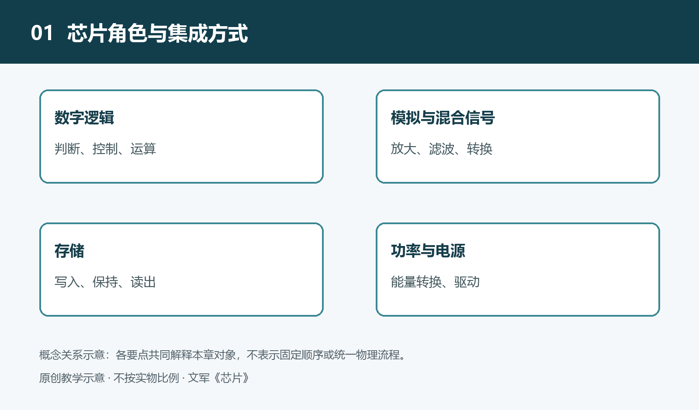

# 1.1 从一台电子设备出发：寻找芯片承担的任务

本书讨论的对象包括集成电路，以及与其共同完成供电和驱动任务的功率半导体器件。需要区分制造在晶圆上的裸片、封装后的器件和器件内部的功能电路；一个封装可以包含一块或多块裸片。下文按数字逻辑、模拟与混合信号、存储、功率划分主要任务，这是允许交叉的教学分组，不是互斥的器件分类。CPU、GPU、MCU偏重处理角色，SoC强调系统功能的集成方式，不能把这些名称放在同一尺度上简单排列。功率MOSFET、IGBT或二极管可以是分立器件，驱动及电源管理芯片则可能包含集成控制电路，讨论它们不表示其内部结构相同。

按下无线音箱的电源键，提示灯亮起；手机连接后，音乐从扬声器传出；电量不足时，设备又提醒充电。这些动作看起来连贯自然，内部却包含性质不同的任务：识别按键、接收无线信号、处理音频、保存设置，以及把电池中的能量送到需要的地方。理解芯片，可以先不问“里面用了多先进的处理器”，而问：“这些任务分别由谁承担？”

这里以一台带电池的无线音箱为教学场景，不指向某个具体型号。不同产品可能采用不同方案，但从任务寻找芯片角色的方法，可以用于耳机、电视、洗衣机和许多其他电子设备。

## 1.1.1 从看得见的动作拆出任务

先看开机。用户按键之后，设备需要判断这是不是一次有效操作，再进入相应工作状态。电源必须按要求建立，控制电路才能可靠运行。提示灯亮起，只是内部一系列条件得到满足后呈现给用户的结果，并不意味着所有芯片都在同一时刻开始工作。

再看播放音乐。无线信号到达天线后，需要经过接收与处理，才能得到可供后续使用的数据。音频数据还要被解释和处理，最终形成推动扬声器的电信号。天线并不是“收进来就能直接发声”，处理器也不是仅凭计算就能推动扬声器。

最后看关机与再次开机。如果设备能够记住音量或连接信息，就需要某种断电后仍能保留数据的存储方式。而播放过程中暂时使用的数据，可能只需留在工作时可用的存储空间中。表面上同是“记住”，背后的要求已经不同。

这样拆分后，一个完整体验便显出几类基本任务：处理信息、保存信息、连接外部信号、控制电能。它们是寻找芯片的线索，而不是按外壳大小或价格排列出来的等级。

## 1.1.2 沿着信息路径寻找角色

在上述场景中，数字逻辑电路负责按照规则处理离散编码的信息。例如，判断按键对应什么操作，管理连接状态，或处理音频数据。承担这些工作的，可能是专门的处理电路，也可能是集成多种功能的芯片。此时重要的不是先记住缩写，而是知道它接收什么、处理什么、输出什么。

存储电路为这些处理提供数据和状态。程序需要有地方保存，运行中的数据需要有地方暂存，用户设置也可能需要长期保留。存储既可能位于独立芯片中，也可能集成在其他芯片内部。因此，在电路板上没有找到单独的存储芯片，并不能据此断定设备“不需要存储”。

通向扬声器的路径则提醒我们，数字信息必须与真实电信号建立联系。模拟电路处理连续变化的电压或电流；混合信号电路把模拟与数字功能结合起来。音频系统中常见的数模转换，就是把数字编码转换成相应模拟信号的环节。转换后的信号通常还需要放大，才能满足后续负载的要求。

无线接收同样涉及真实世界中的电磁信号，不能只用“计算”概括。射频电路处理适合无线收发的高频信号，再与后续电路配合。具体产品怎样划分这些功能，需要查资料确认，不能仅凭“无线音箱”这一名称推断内部必然有哪几颗芯片。

## 1.1.3 沿着能量路径再找一次

如果只追踪音乐数据，就会漏掉设备能够工作的另一半条件：供电。电池提供的电压会随状态变化，而不同电路可能要求不同的供电条件。电源管理电路负责其中的转换、分配或控制，让各部分在规定条件下工作。

充电也不是把外部电源直接接到电池上。充电管理需要根据电池类型及工作条件控制充电过程，并与相应保护措施配合。这里的芯片主要是在管理能量，而不是解释歌曲内容。它们即使不参与音频算法，也直接影响设备能否安全、稳定地使用。

扬声器驱动又把两条路径联系起来：音频信号规定振动应怎样变化，电源提供实现这种变化所需的能量。信号不能代替供电，供电也不能代替正确的信号。因而，一台设备的表现不能只归功于某一颗“主芯片”，还取决于各环节是否匹配。

## 1.1.4 任务清单不等于芯片数量

上述分类描述的是角色，不是固定的零件清单。一颗芯片可能同时包含数字处理、存储、模拟接口和电源相关功能；一项任务也可能由多颗芯片共同完成。功能集成程度不同，电路板上的芯片数量便可能不同，不能据此直接判断产品优劣。

还要区分芯片与其他部件。天线、扬声器、电池、电阻和电容都是系统的重要组成部分，却不能统称为芯片。芯片也并非孤立完成任务：它需要外部连接、合适的供电以及其他器件配合。观察对象应是“芯片所在的系统”，而不只是几块黑色外壳。

实际学习时，可以从设备说明书和公开技术资料入手，先列出可观察的动作，再为每个动作写下可能需要的处理、存储、信号和供电任务。这些推测应标为待核实线索，不必为了寻找芯片而带电拆机。随后取得可靠资料，再修正任务与器件之间的对应关系。

从一台设备出发，我们首先得到的不是芯片型号表，而是一张有因果联系的任务清单。接下来认识不同类别的芯片，就是进一步看清：它们各自擅长处理什么，又为什么需要彼此协作。
