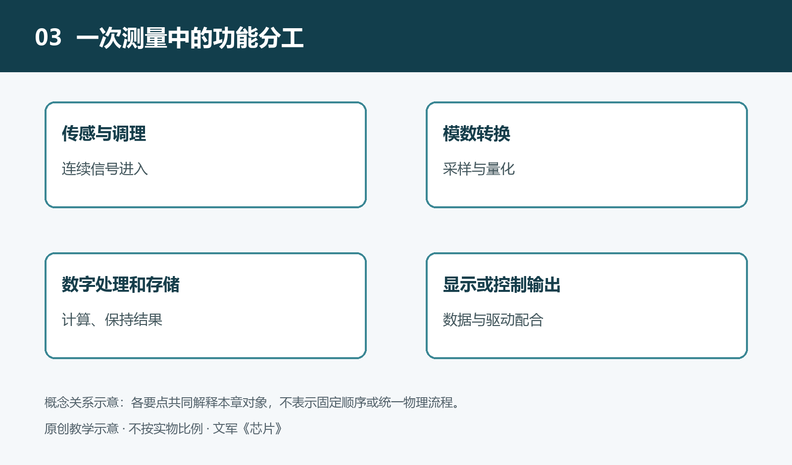

# 3.1 从需求到功能：把设备任务分配给不同芯片

按下电子温控器的按钮，屏幕上的目标温度改变，设备随后决定是否启动加热。对使用者而言，这是一个完整动作；对设计者而言，它包含按键检测、温度测量、数值比较、显示更新和负载控制等任务。理解芯片怎样完成功能，首先要学会拆开这个动作：设备需要做什么，哪些条件必须满足，各项任务又交给谁。

前两章介绍了芯片的角色与内部结构。本章换一个方向，从设备需求出发，看这些结构如何被组织成可使用的功能。这里的关键不是给每项任务寻找一颗独立芯片，而是确定分工，以及分工之间必须交换的信息。

## 3.1.1 把使用愿望改写成可检查的要求

“温度控制得好”是一种使用愿望，却还不是足够明确的工程要求。设计者需要继续追问：测量什么位置的温度？允许多大误差？多久更新一次？传感器异常时怎么办？停电后是否保留设定？这些答案会影响功能划分，也会改变芯片的选择。

以下以一台电子温控器为教学假设，不对应某个具体产品。假定它需要读取温度、接受用户设定、显示当前状态，并控制一个加热负载，同时在异常情况下停止加热。由此可以列出几类功能：感知环境、处理输入、执行判断、保存参数、呈现结果、控制电能，以及为各部分供电。

需求还应包含工作边界。例如，低压控制电路不能直接承受加热负载一侧的高电压；测温结果也只有在规定范围和误差条件下才有意义。功能要求说明“要做成什么”，边界条件说明“在什么情况下必须做成”。缺少后者，即使演示时能够运行，也不能说明方案适合实际使用。

## 3.1.2 先分功能，再决定芯片边界

温度传感器首先把温度变化转化为可读取的电信号。如果它输出模拟电压，后面可能需要滤波、放大和模数转换；如果它已经提供数字读数，这些环节中的一部分便可能集成在传感器内部。系统需要“获得温度数值”，但实现这一功能的芯片边界并不固定。

控制部分可以由微控制器，也就是MCU承担。它读取测量值和用户设定，按照程序作出判断，再发出控制命令。简单温控任务通常不需要桌面计算机式的处理能力；重要的是输入输出是否合适、响应是否及时，以及异常时能否进入规定状态。若任务十分简单，也可能采用专用控制电路，而不是通用处理器。

保存设定值的功能可以利用MCU内部的非易失性存储，也可以交给外部存储芯片。显示功能同样可能由MCU直接配合简单显示器完成，也可能需要专门的显示驱动芯片。由此可见，“一种功能对应一颗芯片”只是便于入门的想象，真实设计往往是多种功能共用一颗芯片，或一项功能由多颗芯片合作完成。

这种划分还需要区分芯片与其他部件。温控器的完整功能离不开传感探头、按键、显示器和加热元件，芯片并不包办所有物理作用。分析系统时，不能因为关注芯片，就把与它连接的对象省略掉。

## 3.1.3 区分作出决定与完成动作

MCU输出“停止加热”的命令，并不意味着它能直接切断任意加热电流。逻辑输出承担的是控制信息，功率器件承担的是电能通断，两者面对的电压、电流和散热条件不同。中间还可能需要驱动电路，把控制信号变成适合功率器件的驱动条件；某些系统还需要隔离。

电源管理电路则把输入电能转换为各部分可用的供电。它不是算法之外可有可无的附件：供电不足或波动过大，测量、判断和显示都可能失去正常工作的基础。因而，一份完整的功能分配应同时写清信息任务与供电任务，而不是只画出处理器和传感器。

异常保护也不能只写成一句“由软件处理”。例如，传感器断线时如何识别，程序失常时输出会保持什么状态，是否需要独立的过温保护，都应落实到明确的电路或程序责任。独立保护并非所有设备都采用相同形式，其配置要服从风险分析和适用要求；但不能把未经论证的软件判断当作全部安全保障。

## 3.1.4 用输入、输出和条件核对分工

检查功能分配时，可以对每个模块提出同一组问题：它接收什么，输出什么，依赖什么条件，失败后影响什么。以测温模块为例，输入是温度对应的物理作用，输出是电压或数字读数；依赖条件包括供电、测量范围和必要的校准。控制模块需要的不只是一个数字，还需要知道这个数字是否有效、是否已经过时。

接着可以沿一次操作核对：用户改变设定后，谁识别按键，谁更新设定值，谁刷新显示，谁根据新设定改变控制输出？再沿异常情况核对：测量失效时，谁发现问题，谁停止加热，谁向用户提示？这两条检查路径有助于发现遗漏，也能暴露“两个模块都以为对方负责”的责任空白。

最后才是比较集成方式。采用集成度较高的芯片，可能减少外部器件和连接；采用分立的功能芯片，可能便于独立选择测量精度、驱动能力或保护方式。哪一种更合适，取决于需求、成本、开发条件和验证结果，不能仅凭芯片数量判断优劣。

从需求到功能分配，就是把一个整体动作改写成一组有边界、可检查的责任。先明确任务，再选择承担任务的芯片，才能进一步讨论运算、存储、信号转换与供电各自怎样实现，而不把系统能力误认为某颗处理器的单独能力。
