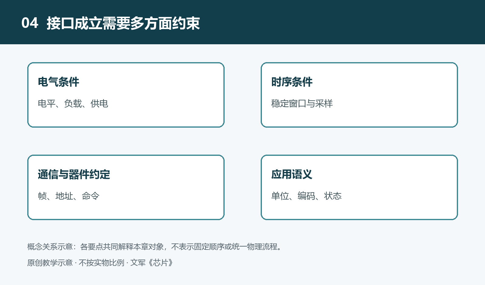

# 4.1 接口的含义：连接不仅是把导线接在一起

本章用电气条件、时序条件、通信约定和软件语义作为分析视角，并非提出严格的标准分层。总线传输规则回答位怎样组织和搬运，器件访问约定回答命令与寄存器怎样使用，应用语义回答数值在任务中代表什么。一个正式接口规范可能同时规定多个方面，不能仅凭“协议”二字判断其覆盖范围。

给一台设备接上传感器，导线已经插牢，屏幕却没有显示读数。问题可能不是“没接上”，而是双方对连接的理解不同：一个输出的电压超出另一个允许的范围，接收方在错误的时刻读取数据，或者程序把温度数值当成了别的含义。导线建立了物理通路，却不会自动建立合作关系。

芯片的接口，就是它与外部交换信号、传递能量或接受控制时所遵循的一组条件与约定。引脚是接口的物理入口，但接口并不等于引脚。要判断两颗芯片能否协同，既要看“接在哪里”，也要看“传递什么、何时传递、怎样解释”。

## 4.1.1 从连接位置到合作规则

设想一个教学场景：一块控制板读取数字温度传感器，并在温度过高时启动风扇。传感器、控制芯片和风扇驱动芯片之间都有连接，但这些连接承担的任务不同。传感器向控制芯片报告测量结果，控制芯片向驱动芯片发出控制信号，驱动芯片再调节送往风扇的电能。

如果只画几条无说明的连线，这个系统看起来很简单，却掩盖了关键问题。传感器是否需要先收到测量命令？结果何时准备好？控制信号是表示启动、停止，还是要求某个转速？风扇所需的电流又由谁提供？这些问题都属于接口分析，而不是连线完成之后才考虑的细节。

接口可以理解为部件之间的合作契约。这份契约一部分体现在器件结构中，一部分写在芯片资料里，还有一部分由系统设计和软件共同规定。芯片不会理解设计者的意图，只会对实际到达端口的电压、电流及其变化作出响应。

## 4.1.2 四层条件共同决定能否协同

第一层是电气条件，即信号和供电在物理上是否相容。发送端认定的高电平，必须落入接收端能够可靠识别的范围；输出端还要有能力带动所连接的负载。电源、地和信号参考关系同样重要。两个端口即使都标着“数据”，也不能据此直接相连。某些端口只能接受低电压，错误连接可能不仅导致读数异常，还会损坏器件。

第二层是时序条件，即信号在什么时间有效，接收动作在什么时候发生。数据从输出端变化到沿连线传播，再到接收端能够稳定判断，都需要时间。如果接收得过早，读到的可能还是旧状态，或者正处于变化中的状态。双方能够识别相同电平，并不意味着能以任意速度交换数据。

第三层是通信约定，通常称为协议。它规定一次交换如何开始和结束，怎样区分地址、命令和数据，以及必要时如何回应。可以把它想成有规则的轮流交谈：谁先发言、谁来回答、回答针对哪一个问题，都需要约定。串行或并行描述的是信息传输的组织方式，仅凭这一点，还不能确定完整的通信规则。

第四层是软件语义，也就是这些数据和命令究竟表示什么。接收方可能完整收到了两个字节，却仍然算错温度，因为它弄错了数值的正负表示、字节先后顺序，或者每个计数对应的温度变化。通信成功只说明数据按约定送达，不等于应用已经正确理解数据。

这四层是帮助分析接口的视角，不是互相隔绝的四个盒子。例如，软件设置通信速度，会改变时序要求；接口选择的工作模式，也可能影响端口的电气行为。系统设计必须把它们放在一起核对。

## 4.1.3 方向、角色与工作状态

阅读接口资料时，还要问清信号方向。“输入”和“输出”通常以当前芯片为参照：对传感器而言的数据输出，可能正是控制芯片的数据输入。有些引脚能够双向使用，但双向并不表示双方可以随时同时驱动同一条线。谁拥有发送权，何时释放连线，需要相应机制安排，否则可能出现输出冲突。

接口角色也不总是固定的。有的连接由一个控制方发起交换，另一个按要求回应；有的连接允许多个部件共享通路。因此，一条线上有几颗芯片、怎样选中目标、未被选中的芯片应处于什么状态，都需要明确。仅根据引脚数量相同或接口名称相近，不能判断两颗芯片可以替换。

正常运行之外，上电、复位和掉电期间的状态也很重要。例如，控制芯片尚未完成启动时，驱动芯片的控制输入是否已有确定状态？若没有，风扇或其他负载可能出现非预期动作。这里的重点不是要求所有芯片同时启动，而是让启动顺序和默认状态符合系统需要。

## 4.1.4 用接口问题检查系统关系

回到温度控制风扇的例子，可以给每条连接补上几项说明：两端分别是谁，信号往哪个方向走，采用什么电气条件和通信方式，数据表示什么，以及异常时如何处理。这比只标注“传感器接控制器”更接近可检查的系统描述。

如果读数不更新，也应沿着这些条件逐层缩小范围，而不是立刻认定芯片损坏。供电是否正常，器件是否退出复位，通信是否得到回应，软件是否读取了正确位置，都是不同的问题。实际检查应优先使用公开资料和设备允许的正常操作，不以带电拆机来验证猜测。

接口把各自完成任务的芯片组织成系统。它既规定允许发生什么，也限制不能怎样连接。理解接口，就是把“导线已经接通”进一步变成“双方能够在规定条件下可靠合作”。接下来，需要先从最基础的电压、电流与负载关系，理解这种合作的物理边界。
