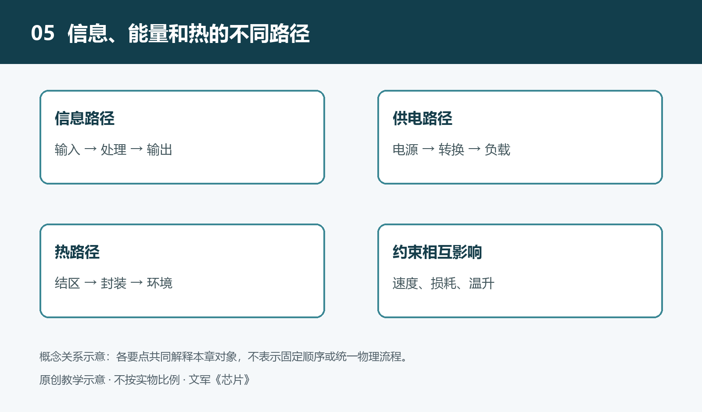

# 5.1 一次输入到一次输出：沿信息路径理解系统

在电子温控器上调低目标温度，屏幕上的数字随之改变，但风扇未必立即转动。一次看似简单的操作，包含了输入识别、状态保存、条件判断和输出更新。要理解这些环节，不能只看电路板上有哪些芯片，还要追问：这次操作带来的信息，经过了哪里，又在何处改变了形式和含义？

本节以一台假设的低压温控装置为例。它具有按键、温度传感器、微控制器、显示器和风扇驱动电路，用于说明常见的信息路径，不代表某款产品的实际结构。

## 5.1.1 从输入变化到可用数据

先看温度这一路输入。环境温度本身不是微控制器可以直接读取的数字。假设装置使用模拟温度传感器，它先把温度变化转换为电压变化；信号再经过适当调理，进入模数转换器。调理可能包括调整信号范围、抑制部分干扰，使输入适合后续转换。

模数转换器在选定时刻对输入采样，并把采样结果量化为数字编码。这里发生了两种不同的变化：采样使观察时间离散化，量化使幅值表示离散化。因此，微控制器获得的不是连续温度本身，而是一串与采样时刻对应的数值。输入范围、转换误差和传感器特性，共同限制了这些数值能够表达什么。

数字编码还需要解释。同一个编码，在不同传感器或参考电压条件下，可能对应不同温度。软件依据规定的换算关系，将原始读数转换为温度数据；必要时还使用校准参数。由此可见，“收到数字”与“理解物理量”是两步：前者解决表示问题，后者建立数值与实际对象之间的联系。

若改用数字温度传感器，模数转换等环节可能已经集成在传感器内部。电路板上的路径看起来缩短了，信息转换却没有凭空消失，只是移入了另一个芯片。

## 5.1.2 让不同输入在状态中相遇

按键提供的是另一种信息。用户按下按键，首先改变的是电路连接状态，进而形成输入引脚上的电平变化。机械触点在动作时可能短暂反复接通和断开，软件或硬件通常需要消除这种抖动，才能把一组变化识别为一次有效操作，而不是多次按键。

识别之后，微控制器更新保存目标温度的变量。这个变量属于系统状态：即使用户已经松开按键，它仍影响后续行为。与此同时，温度采样按照自己的节奏继续进行。两路信息不必同时到达，却可以在存储的数据中相遇，成为一次判断的依据。

假设控制规则是：温度高于某个上限时开启风扇，低于另一个较低的下限时关闭风扇。上下限之间留出间隔，可以避免读数在单一门限附近轻微波动时，风扇频繁启停。此时，输出既取决于当前温度和用户设定，也取决于风扇原来的开关状态。信息路径因而不是一条只向前流动的直线，还包含对过去状态的读取和更新。

这里尤其要留意数据的新旧。如果屏幕显示的是刚更新的目标温度，而控制判断使用的仍是上一次温度采样，两者并不矛盾。判断是否合理，需要知道各项数据何时产生、何时更新，不能仅凭“它们都在同一颗芯片里”就认为它们代表同一时刻。

## 5.1.3 输出是信息作用于外部的接口

判断结果也不会直接变成风扇转动。微控制器先形成控制命令，再通过输出引脚送往驱动电路。驱动电路依据这个信号控制供给风扇的电能。控制信号携带“开还是关”等信息，风扇运行所需的主要能量则来自电源，不能把两条路径混为一谈。

显示输出走的是另一个分支。微控制器把目标温度、测量温度或工作状态组织为显示数据，经接口发送给显示电路，再由显示器形成可见图像。同一次按键可以很快改变屏幕内容，却暂时不改变风扇状态，因为两个输出回应的是不同条件。系统并非只有一个统一的“输出时刻”。

风扇开启后，又可能改变被测环境的温度，使后续采样发生变化。这就构成了反馈：输出作用于外部对象，外部对象的新状态重新成为输入。不过，发出开启命令并不等于已经证明风扇正常转动。若要确认实际转速，还需要转速反馈等额外信息；仅凭控制引脚的状态不能作出这一结论。

## 5.1.4 沿路径提问，而不是只认器件

追踪信息时，可以把每个环节看成一次交接：交出的是什么表示，接收方如何解释，数据暂存在哪里，又由什么事件触发下一步。这样既能跨越芯片边界，也能进入一颗芯片内部，区分外设、存储和处理之间的流动。

这种方法还能帮助定位问题。若目标温度显示正常而风扇没有响应，应分别检查控制条件是否满足、命令是否形成、驱动是否执行，而不是立即认定微控制器损坏。若显示温度异常，则要沿测量路径检查传感、转换、传输和数值解释。每个观察只能支持有限结论，不能替代整条路径的核对。

从一次输入走到一次输出，真正需要追踪的是信息的表示、时间和作用对象。掌握这条线索之后，便可以继续追问：信息在各环节之间搬运时，为什么有时很快，有时却需要等待？
