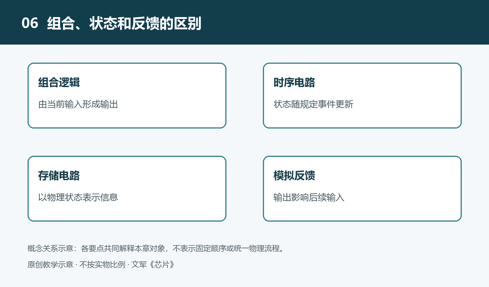

# 6.1 晶体管的控制作用：用电信号改变导电状态

手机调低屏幕亮度，传感器送来微弱信号，处理器更新一次计算结果，这些看似不同的动作，都可能用到晶体管的控制作用。它并不理解亮度、温度或数字，而是响应端口上的电压或电流，使另一条路径的导电情况发生变化。电路把这种变化组织起来，才得到开关、放大与控制等功能。

理解晶体管，可以先抓住一个问题：控制端的电信号，怎样改变受控路径中的电流？本节以芯片中广泛使用的金属—氧化物—半导体场效应晶体管，即MOSFET为主线，说明这种控制关系，而不把所有晶体管都视为同一种器件。

## 6.1.1 控制端与导电路径

MOSFET通常有栅极、源极、漏极和体端。栅极是主要控制端，源极与漏极之间是受控的导电路径；体端也会影响器件特性，在许多简化电路图中，它按规定连接而不单独画出。各端之间的电压共同决定晶体管的工作状态，不能只看某个端子相对于地的电压。

以一种常见的增强型n沟道MOSFET为例，栅极与半导体之间隔着很薄的绝缘层。改变栅极相对于源极的电压，可以通过电场改变栅极下方的载流子分布。在适当条件下，这里形成能够导电的沟道，使源极和漏极之间更容易通过电流。

这里的关键不是控制信号“推开了一扇机械门”，而是电场改变了导电条件。栅极没有像普通导线那样直接接通沟道，却能影响沟道中的电荷。至于电场为何能改变载流子的分布，需要进一步考察半导体内部的物理过程；此处先把控制关系与端口行为联系起来。

## 6.1.2 “打开”不是无条件导通

设想一个教学电路：低压电源、指示灯及限流元件串联，最后通过一个n沟道MOSFET接到地，源极接地，栅极接收控制信号。在满足器件额定条件的前提下，提高栅源电压，可以让晶体管更容易导电，指示灯便可能亮起。这是理解控制关系的假设场景，并非某个产品的实测结果。

即使如此，也不能简单地说“栅极电压高，电流就一定大”。电流还取决于电源、负载、漏源电压以及器件温度等条件。若负载已经限制了电流，继续提高栅源电压，电流也不会无限增加。晶体管调节的是路径的导电能力，不是独立规定整条回路中必须流过多少电流。

器件资料中的“阈值电压”，描述沟道开始明显形成时的一项条件，通常对应规定的较小测试电流。它不是“达到这个电压就完全打开”的保证。若希望晶体管作为低损耗开关使用，还需查明在实际栅源电压下的导通电阻及其适用条件，不能只凭阈值判断控制信号是否足够。

## 6.1.3 同一器件为何能开关，也能放大

数字电路通常希望晶体管在“较难导电”与“较容易导电”的状态之间切换，使输出落入可可靠识别的电压范围。这里的开、关都是工程近似：关断时可能有漏电，导通时仍有电阻和压降，状态转换也需要时间。数字电路的明确判断，建立在这些不完美的物理行为之上。

模拟电路则常把晶体管安排在一个合适的工作点附近。所谓工作点，是没有待处理的小信号变化时，电路预先建立的电压、电流状态。在一定范围内，栅源电压的小变化能够引起漏极电流的相应变化，再由其他元件把电流变化转换为输出电压变化，从而实现放大。

放大并不意味着信号凭空创造了能量。较大的输出变化所需能量主要来自电源，输入信号起调节作用。工作点若选择不当，或者输入变化超出允许范围，输出就可能失真。因此，“能放大”不只是晶体管本身的属性，还依赖供电、负载与周围电路的共同安排。

## 6.1.4 栅极绝缘，为何仍要消耗能量

由于栅极与沟道之间有绝缘层，MOSFET通常不靠持续的直流栅电流来控制导电，这使它适合构成大规模集成电路。但“栅极绝缘”不等于“控制它完全不耗能”。栅极与周围结构之间存在电容，改变栅极电压，就需要向这些电容充入电荷或移走电荷。

因此，控制端必须有能力在规定时间内完成充放电。驱动能力不足时，栅极电压变化较慢，晶体管便可能在中间状态停留更久，影响速度，并可能增加损耗。实际器件还存在漏电，电压过高也可能损伤绝缘层。控制端看似只接收一个信号，背后仍有电荷移动、时间约束与安全边界。

## 6.1.5 从器件控制走向电路行为

MOSFET还包括p沟道等类型，其控制电压的极性和连接方式有所不同；双极型晶体管则具有不同的结构与控制特性。不能把一种器件的使用规则直接套到所有晶体管上。

不过，理解它们时可以保留同一条线索：先辨认控制端与受控路径，再明确电压、电流和负载条件，最后判断导电变化如何形成所需输出。晶体管不会孤立地完成设备任务，真正有用的是它与其他器件之间的配合。下一步要理解的，正是电路怎样把这些连续变化约束成稳定、可重复的逻辑判断。
