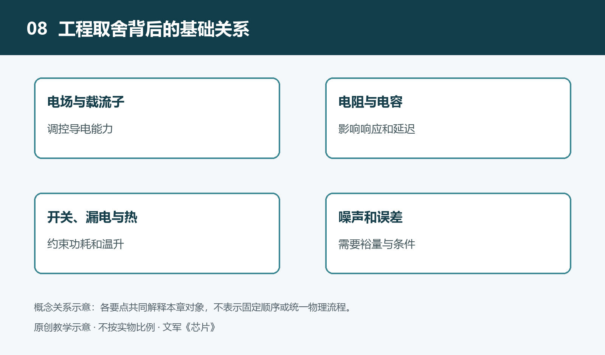

# 8.1 半导体与载流子：导电能力为什么可以调控

手机中的处理器需要快速改变电路状态，温度传感器需要把冷热变化变成电信号，电源芯片则要控制电能输送。这些任务虽然不同，却都依赖一个共同基础：材料的导电能力可以按需要调节。半导体的价值，不只是导电能力处在金属与绝缘材料之间，更在于人们能够通过材料成分、电场、光照和温度等条件，有规律地改变它的电学行为。

要理解这种可控性，需要先认识电流的承担者，以及它们在材料中能够怎样运动。

## 8.1.1 电流需要能够移动的电荷

电流是电荷的定向运动。在金属导线中，部分电子能够在材料内部运动；施加电场后，它们在原有无规则运动的基础上产生平均定向运动，形成电流。材料中有电荷，并不意味着它就善于导电。构成原子的电子如果受到很强的束缚，不能方便地参与长距离移动，对导电的贡献就很有限。

能够参与电荷输运的粒子或有效运动对象，称为载流子。判断材料是否容易导电，至少要问两个问题：可用的载流子有多少，它们在电场下移动得是否容易。后一个特点通常用“迁移率”描述，即在一定电场下，载流子产生平均定向运动的能力。载流子多但移动困难，或移动容易但数量很少，都可能限制导电能力。

这里的运动也不是电子沿一条空旷通道直奔终点。晶格的热振动、杂质和缺陷都会影响运动。因此，材料的导电性既与电子状态有关，也与晶体结构和工作条件有关。

## 8.1.2 能带决定电子能否参与导电

硅原子组成晶体时，相邻原子通过共价键结合，可以先把它理解为原子之间共享电子而形成的稳定联系。不过，要解释整个晶体的导电行为，仅用一个个孤立原子的图像还不够，需要引入“能带”。

能带是晶体中电子允许占据的一组能量状态。与导电关系最密切的，是价带和导带。价带中的电子主要参与成键；电子进入导带后，能够较容易地响应电场，参与导电。两者之间存在没有可用电子能态的能量区间，称为带隙。带隙不是材料内部的一道空间缝隙，而是电子能量上的间隔。

对于足够纯净的半导体，在一定温度下，一部分电子可以获得热能，从价带跃迁到导带。电子原先所在的位置则留下一个空缺。这个过程同时产生导带电子和价带空穴。绝缘材料的带隙通常较大，在普通条件下较难产生足够多的可移动载流子；半导体则为调节载流子的数量提供了更方便的条件。不过，材料之间不能只凭一个带隙数值判断全部工程性能。

## 8.1.3 空穴不是凭空出现的正粒子

空穴可以理解为价带中缺少一个电子的状态。附近电子填入这个空位后，又在原处留下空位；连续发生这样的过程，空位就表现出移动。分析电流时，可以把它作为带正电的载流子处理。

这并不意味着硅晶体里出现了可以自由奔跑的正离子。空穴是大量电子共同运动的一种有效描述，却不是随意编造的记账符号：它具有可测量的输运行为，也是理解半导体器件不可缺少的概念。

在电场作用下，电子与空穴的平均定向运动方向相反，但由于电荷符号也相反，两者都可以对同一方向的常规电流作出贡献。常规电流方向按正电荷运动方向规定，因此不能把电子移动方向直接当作电流方向。

电子与空穴还可能发生复合，使一对可移动载流子消失，并向周围释放能量。载流子的产生、运动和复合共同影响材料中的电流，而不是只要产生电子，它就永远留在导带中。

## 8.1.4 掺杂改变载流子的来源

只靠纯净硅在热作用下产生的载流子，难以满足各种电路的需要。制造中可以有控制地引入少量特定杂质原子，这称为掺杂。这里的“杂质”不是无意混入的污染物，而是用于建立所需电学性质的材料成分。

例如，磷原子取代硅晶格中的部分硅原子后，其电子结构使一个电子较容易获得能量、参与导电。这样的杂质称为施主，由它形成的材料通常以电子为多数载流子，称为n型半导体。硼等受主杂质则容易接受价带电子，留下可参与导电的空穴，形成以空穴为多数载流子的p型半导体。

n型不是整块材料带负电，p型也不是整块材料带正电。在通常的均匀材料内部，可移动载流子的电荷与固定在晶格中的带电杂质中心大体平衡，材料整体仍接近电中性。字母所区分的是主要参与导电的载流子类型，而不是材料整体的电荷符号。

掺杂也不是越多越好。它能增加载流子数量，却可能增强对载流子运动的散射，改变迁移率及其他器件性质。因此，工程上需要控制掺杂的种类、浓度和空间分布，而不只是追求更强的导电性。

## 8.1.5 从材料可调走向电路可控

掺杂主要在制造阶段建立材料的基本性质；电场则能在器件工作时改变局部载流子的分布。光照也可以在适当条件下产生电子与空穴，这是许多光电探测器工作的基础。温度变化同时影响载流子数量和运动过程，因此不能简单断言所有半导体在任何条件下都是“越热越导电”。

由此看，半导体不是天然完成计算的神奇材料，而是提供了可被设计利用的电荷系统。把不同区域组织起来，再用电场约束载流子的分布与运动，才可能得到开关、放大或检测作用。下一步需要理解的，正是这些局部电场如何形成，以及它们怎样控制电流。
