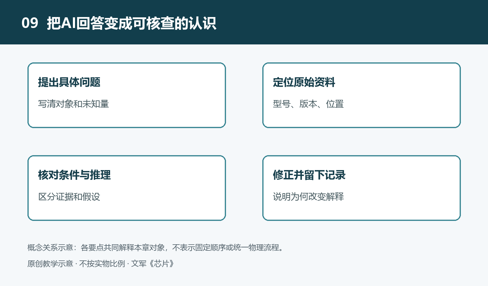

# 9.1 从观察到问题：让AI帮助组织芯片学习线索

使用手机拍摄视频时，机身可能逐渐变热；便携音箱电量不足时，可能自动关机。这些现象容易引出一个问题：“是哪颗芯片造成的？”但设备表现通常不是单个器件的独立结果。任务安排、供电状态、软件策略和散热条件，都可能参与其中。学习的第一步，不是让AI猜出一个芯片型号，而是把观察整理成能够继续查证的问题。

## 9.1.1 先把现象与解释分开

假设我们观察一台便携音箱：正常播放一段时间后，外壳某处温度有所上升。这是教学情境，并非实测记录。“摸起来比刚开机时暖”属于感受性观察；“功率放大芯片效率太低”则已经是解释。两者之间还缺少证据：热量来自哪里，经过什么路径传到外壳，当时的音量、电源状态和环境温度如何？

向AI提问时，应先保留这种区别。可以描述：“设备在电池供电、固定音量播放时，外壳一侧逐渐变暖，尚未测量温度，也不知道内部布局。请区分已知现象、待确认条件和可能原因，不要据此判断具体型号。”这样的输入并不复杂，却能限制回答越过证据边界。

观察记录也不必追求一次齐全。先写下设备名称、操作过程、现象出现的条件，以及自己没有掌握的信息即可。没有测量就不写精确温度，没有资料就不认定内部结构。缺失项不是学习的失败，而是下一步问题的来源。

## 9.1.2 让AI整理任务，而不是抢答型号

面对陌生设备，AI较有价值的作用之一，是把零散现象转成任务清单。以音箱为例，声音播放涉及音频信息的接收与处理、电信号的转换与放大，以及电池供电的管理。可以请AI按这些任务列出可能涉及的芯片角色，并说明每一项为什么与观察有关。

这里的“角色”比“型号”更适合作为起点。数字处理部分可能执行解码或音量控制，转换电路可能把数字音频变成模拟信号，功率放大部分向扬声器提供驱动，电源管理部分协调供电。实际产品可能将若干功能集成在同一芯片中，也可能分开实现。任务清单因此只是查找方向，不是对内部配置的确认。

进一步可以要求AI为每条线索附上一项待查材料。例如，要判断某个器件是否承担功率放大任务，应寻找产品资料、器件型号及其功能说明，而不是只依据封装大小。这样，AI给出的每一种可能性都对应一个核查入口，不会停留在术语罗列上。

## 9.1.3 把大问题拆成能够回答的小问题

“为什么音箱会发热”范围很大，可以沿不同路径继续拆分。信息路径上，可以问音量调节发生在数字处理环节还是模拟环节；能量路径上，可以问电池输出经过哪些转换后送往放大电路；热路径上，可以问热源与外壳之间有哪些传热结构。这些问题彼此相关，却需要不同证据。

好的拆分还要区分“原理上可能”与“这台设备确实如此”。“提高输出功率通常会怎样影响损耗”是原理问题，可以借助电路知识讨论；“这台音箱变暖是否由某颗芯片引起”是对象判断，需要该设备的资料或适当测量。AI能够解释前者，并不意味着它已经证明后者。

问题也应明确比较条件。与其问“音量大是不是更费电”，不如问：“在同一设备、同一段音频和相近电池状态下，调高音量可能改变哪些环节的耗电？哪些关系不能仅凭音量刻度确定？”限定条件能够减少含混回答，也提醒读者：界面上的一个刻度，不一定直接对应某个固定的电功率。

## 9.1.4 给学习线索排出次序

如果AI列出了很多方向，也不意味着问题越多就一定学得越清楚。可以请它把线索分为三类：当前观察直接支持的问题、需要公开资料才能推进的问题，以及暂时缺少验证条件的猜想。先处理前两类，把第三类保留为候选解释。

例如，确认设备是否支持边充电边播放，可以从使用说明入手；确认某颗芯片的功能，需要可靠的器件识别和资料；判断内部某处的实际温度，则不能用外壳触感代替。这种排序依据的是证据是否容易获得、问题是否影响后续理解，而不是哪个术语听起来更先进。

每次交流最好只推进少量关键问题。可以要求AI：“先选出最影响判断的三个未知条件，并解释为什么应优先确认。”这比要求它一次给出完整内部方案更有用。若新资料与原先猜想矛盾，应修改清单，而不是让AI为最初的答案不断补充理由。

## 9.1.5 让每条线索都有下一步

一条可用的学习线索，应包含观察、问题和核查动作。例如：“外壳在播放后变暖；哪些功能环节可能产生热量；先查设备的供电方式与公开功能资料。”核查动作应与条件相称：普通学习者可以正常操作设备、阅读说明和查阅公开资料，不应为了验证猜想而带电拆机、接触高压或短接未知引脚。

当AI回答“无法仅凭现象确定”时，学习并没有中断。重要的是进一步说明还缺什么证据，以及获得证据后能排除哪些解释。从观察出发，用任务组织线索，再把线索变成可核查的问题，AI才能成为学习的助手，而不是替未知事实填空的工具。
