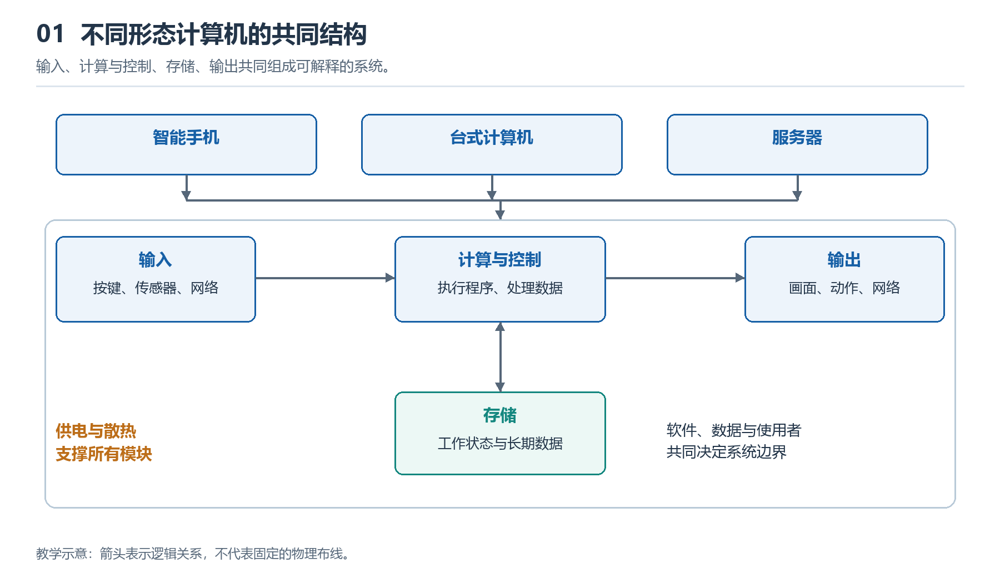

# 1.1 计算机不只是一台主机：形态、场景与共同特征

提到“计算机”，很多人首先想到桌面上的主机箱、显示器、键盘和鼠标。这种形象没有错，却只代表计算机的一种形态。今天，笔记本电脑、智能手机、平板电脑、服务器、游戏主机、路由器、汽车控制器和工业设备，都可能包含完整或相对独立的计算系统。它们外观不同、用途各异，但都在以某种方式接收信息、执行规则、保存状态，并把结果提供给人或其他设备。

因此，认识现代计算机的第一步，不是背诵某个机箱里装有什么零件，而是学会跨越外形寻找共同结构。

{width=95%}

不同外形不改变共同的系统任务；供电与散热支撑各个模块。

## 1.1.1 从“像电脑的设备”走向“具有计算能力的对象”

台式机最容易观察：主机承担主要计算，显示器输出画面，键盘和鼠标接受操作。笔记本把这些部件压缩到一个可折叠机身中，并增加电池，使系统能够移动运行。智能手机进一步改变了交互方式：触摸屏同时承担输入和输出，摄像头、麦克风、定位与运动传感器把现实世界转换成数据，无线通信模块则把本机连接到更大的网络。

服务器可能没有长期连接的屏幕和键盘，却能同时响应大量远程请求；智能电视看似是家用电器，内部仍需处理视频、运行应用并连接网络；汽车中的控制器通常隐藏在车体内，负责读取传感器、执行控制程序并驱动执行机构。还有一些计算机并不以独立产品出现，而是嵌入打印机、相机、空调、机械臂或医疗仪器中，专门完成有限而明确的任务。

这说明，“有没有传统主机箱”不是判断计算机的可靠标准。外壳只是工程实现，场景决定形态：移动设备强调体积、能耗和电池续航，服务器强调持续运行、并发处理和可维护性，嵌入式系统则常把成本、实时响应和可靠性放在更重要的位置。

## 1.1.2 不同形态背后的共同任务

尽管现代计算机千差万别，它们通常都包含以下几类活动：

| 共同任务 | 含义 | 常见实例 |
| --- | --- | --- |
| 输入 | 从人、环境或其他系统取得信息 | 键盘按键、触摸、摄像头图像、网络数据 |
| 处理 | 按程序和规则转换信息 | 计算、比较、解码、识别、排序 |
| 存储 | 暂存运行状态或长期保存内容 | 内存中的程序状态、固态硬盘中的文件 |
| 输出 | 把结果交给人或外部设备 | 屏幕画面、声音、电机动作、网络响应 |
| 控制 | 协调步骤、判断条件并安排任务 | 操作系统调度、设备控制器发出命令 |
| 互连 | 让模块或不同设备交换信息 | 主板连接、USB、无线网络、数据中心网络 |

这些任务不一定由六个彼此独立的零件完成。例如，触摸屏既是输入设备也是输出设备；处理器既执行运算，也参与控制；内存与存储设备都保存数据，但保存时长、速度和使用方式不同。分类的意义不是把实物硬塞进固定格子，而是帮助我们理解一次计算活动需要哪些能力。

计算机还必须获得能量，并在允许的温度和时序条件下工作。手机依赖电池，台式机依赖电源，服务器机架可能使用冗余供电；处理过程中产生的热量又必须被导走。因此，供电、时钟和散热虽然不直接等同于“计算”，却是计算能够稳定发生的物理基础。

## 1.1.3 共同特征：程序、状态与可重复的规则

只有电子元件并不足以构成可用的计算机。计算系统的关键特征，是它能够依据一组可表达的规则处理信息。规则可以来自应用程序、操作系统、固件，也可以固化在专用控制逻辑中。输入发生变化，系统内部状态随之变化，输出也可能改变；在条件相同的情况下，规则应当产生可解释、可重复的行为。

例如，用手机拍照时，传感器把光转换成电信号，相关电路将信号数字化，处理器依据程序完成校正、压缩和存储，屏幕再显示结果。表面上只是按下快门，背后却同时发生输入、处理、控制、存储和输出。服务器响应网页请求、汽车控制器调节某个执行机构，也可以用同样的框架观察，只是数据来源、处理规则和输出对象不同。

需要注意的是，计算机不等于“拥有人工智能的设备”。普通计算、控制逻辑和人工智能模型都可以在计算机上运行，但人工智能只是可能采用的一类方法或工作负载。判断一个对象是否属于计算系统，应看它是否具备信息处理的结构与规则，而不是看宣传名称中有没有“智能”二字。

## 1.1.4 从形态识别转向系统观察

面对一个陌生设备，可以先提出四个问题：它从哪里获得输入？由什么部分处理和保存信息？结果输出到哪里？各部分靠什么能量和连接协同？这些问题比“它像不像传统电脑”更有解释力。

现代计算机不是某一种固定外形，而是一类能够在能量与物理约束下，按照程序或控制规则处理信息的系统。台式机、手机、服务器和嵌入式控制器只是这种系统针对不同场景形成的具体形态。建立这一认识后，我们才能在下一步从外到内观察设备，把可见的外壳、端口、屏幕和输入输出部件，与内部承担的系统任务对应起来。
