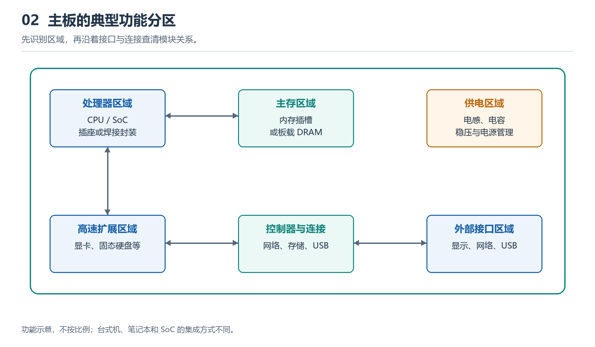

# 2.1 主板为什么是系统骨架：布局、层次与信号通道

打开台式机机箱，最醒目的往往不是某一颗芯片，而是承载大量部件的主板。处理器、内存、固态硬盘、扩展卡和外部接口都以不同方式连接到它。笔记本、服务器和微型计算机的主板形态差异很大，但承担的基本任务相近：固定关键模块，分配电能，组织通信路径，并让各部分在共同规则下协同工作。因此，把主板称为计算机的“系统骨架”，重点不在它是一块面积较大的板，而在于它把分散的功能模块组织成了一个可运行的整体。

{width=95%}

图中表示功能区域，不可凭图中位置判断真实主板上的器件型号。应结合标识、丝印与平台资料核对。

## 2.1.1 从实物布局开始观察

观察一块断电且已采取防静电措施的主板，可以先寻找几个面积较大、形态明显的区域：处理器插座或焊接处理器附近通常有密集的供电器件和散热结构；内存插槽一般靠近处理器，以缩短信号路径；扩展插槽为显卡、网卡等设备提供连接位置；存储接口、外部端口和主电源接口则分布在便于走线和安装的边缘区域。

这种布局不是随意拼放。设计者需要同时考虑信号完整性、供电能力、散热条件、机械强度、布线空间和制造成本。例如，高速内存连接对线路长度、走向和相互匹配较为敏感，所以内存通常不会被任意放到远离处理器的位置。发热明显的处理器及其供电区域需要给散热器和气流留出空间。面向机箱外部的接口则必须与外壳开孔相配合。

不过，位置只能提供线索，不能单独证明功能。相似外形的接口可能采用不同协议，同一类主板在不同代际中也可能改变布局。可靠识别应结合丝印、连接器形态、设备手册和系统信息，而不是仅凭“看起来像”。

## 2.1.2 主板是多层结构，而不是平面导线板

肉眼看到的是主板表面，真正的连接网络却大量隐藏在内部。现代主板通常由多层绝缘材料与铜箔线路压合而成。表层用于安装元器件和布置部分线路，内部各层可以承担电源分配、接地参考或信号传输等任务。贯穿或连接特定层的导通结构，使不同位置、不同层面的线路能够相连。

可以把它想象成一座立体交通枢纽：表面道路只是可见部分，内部还存在隧道、匝道和专用通道。但这个类比有边界——电信号并不是沿线路缓慢行驶的车辆。高速数字通信涉及电压变化、电磁传播、阻抗、反射与干扰，线路的宽度、间距、参考平面和转弯方式都会影响结果。因此，主板上的“连通”不只是两点之间存在铜线，还要求信号在规定时序和电气条件下可靠到达。

多层结构也解释了一个常见现象：从正面看不到处理器与内存之间的完整走线，并不表示它们没有直接通信路径。许多关键线路位于板内，普通观察只能帮助我们建立区域关系，无法还原全部电路设计。

## 2.1.3 三种骨架作用：承载、供给与连接

主板作为系统骨架，可以从三个层面理解。

| 层面 | 主板承担的任务 | 可观察线索 |
|---|---|---|
| 机械承载 | 固定芯片、插槽、接口和扩展模块，维持位置关系 | 螺丝孔、插槽、焊点、加固结构 |
| 电能供给 | 接收电源输入，经过分配与转换，为不同模块提供所需电压 | 电源接口、电感、电容、供电区域、散热片 |
| 信息连接 | 提供数据、地址、控制和时钟等信号的传输路径 | 插槽、接口、板上走线、控制芯片 |

这三种作用彼此依赖。只有机械固定而没有供电，模块无法工作；有供电而没有通信规则，各器件只是分别通电；具备信号连接却忽略散热和结构强度，系统也难以稳定运行。主板的价值正是在物理层面同时协调这些条件。

主板也并非所有通信的唯一中转者。某些功能已集成到处理器内部，部分设备可能通过专用链路彼此连接；不同平台的控制功能分布也不相同。因此，“骨架”不应误解为“所有数据都必须经过主板上的某一颗中心芯片”。更准确地说，主板提供了承载这些直接或间接连接的物理基础，并规定了哪些模块能够在何处、以何种接口加入系统。

## 2.1.4 信号通道为何决定系统关系

把显卡插入扩展插槽、把内存条插入内存插槽，并不只是完成了机械安装。插槽内部的触点分别承担供电、接地和多类信号连接，背后的线路还必须通向相应的控制端。处理器与内存之间需要适合内存访问的通道，扩展设备需要符合其协议的高速链路，键盘、存储设备和显示设备也各有不同连接方式。

这些通道共同决定模块之间的关系：谁能直接通信，谁需要经过控制器，哪条路径强调低延迟，哪条路径更重视兼容性或扩展性。主板布局因而是一张被物理实现的系统关系图。看到处理器插座旁的内存插槽，可以提出“为何距离较近”；看到多个长度不同的扩展插槽，可以继续追问“它们连接到哪里、可用通道如何分配”。实物观察由此从识别部件进入理解机制。

同一插槽的物理尺寸也不必然等于固定性能。可用通道数量、协议代际、处理器与固件配置都可能影响实际工作方式。具体参数应以该主板、处理器和设备的技术资料为准，不宜从外观直接推断。

## 2.1.5 从主板建立系统地图

面对一块陌生主板，可以先做一项低风险观察：保持设备断电，不拆除不熟悉的散热或供电部件；拍摄全貌，标出处理器区、内存区、扩展区、存储连接区、电源输入区和外部接口区；再用箭头表示可能的供电与通信关系。此时不必追求识别每个小元件，重点是回答三个问题：模块固定在哪里，电能大致从哪里进入，关键信号可能在谁与谁之间传递。

还可以让AI协助检查观察框架，但应提供主板型号、清晰照片和已核实资料，并要求它区分“可从图像确认”“依据布局推测”和“必须查阅手册”三类结论。例如：

> 你是一名计算机硬件讲解员。请根据我提供的主板型号、正反面照片和官方手册，按“区域—可见对象—主要功能—连接对象—证据来源—不确定项”制作观察表。不要仅凭外观断定协议版本或通道数量；涉及具体参数时引用手册位置，并列出仍需人工核验的内容。

主板把计算、存储、扩展、供电和输入输出组织到同一物理平台上，因此是理解计算机结构的最佳入口。掌握其布局、层次与信号通道后，下一步便可以沿着这张“物理系统地图”，进一步识别板上的芯片、插槽与接口，理解每个关键区域承担的具体任务。
