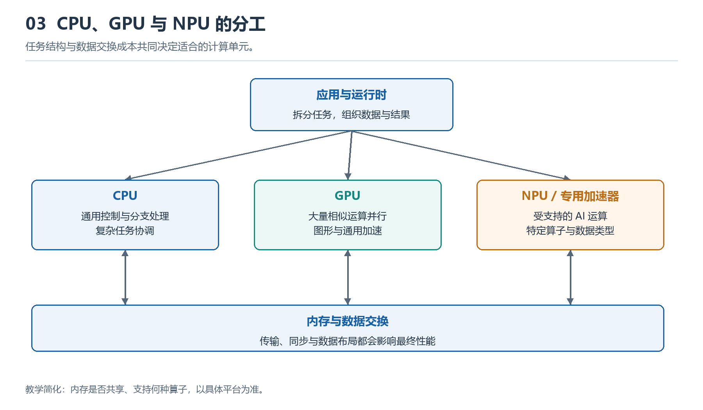

# 3.1 CPU的基本结构：核心、指令与通用控制

打开台式机机箱时，CPU通常藏在主板中央附近的散热器之下；在笔记本电脑和手机中，它往往直接焊接在主板上，并被导热结构覆盖。我们看见的金属顶盖或封装外壳，并不是执行计算的全部实体。真正工作的硅片位于封装内部，通过供电触点和高速信号连接与内存、存储设备及其他处理器协作。

CPU即中央处理器。它的核心职责不是包办所有计算，而是按照程序给出的指令组织通用计算：读取数据、进行算术或逻辑运算、判断条件、改变执行次序，并协调数据在寄存器、缓存、主存和外部设备之间移动。“中央”强调其控制地位，“通用”则表示它能通过不同程序处理多种任务，而不是只为一种固定运算而设计。

{width=95%}

CPU 负责通用控制，GPU 适合大量相似运算，NPU 等加速器处理受支持的专用工作负载。数据搬运与同步同样影响性能。

## 3.1.1 从封装进入核心

一颗现代CPU内部通常包含一个或多个处理核心，以及核心之间共享的缓存、互连和外部接口。这里的“核心”可以理解为一套相对完整的指令执行单元。多核处理器能够让多个执行过程并行推进，但核心数量并不直接等于任意程序都能按相同比例提速；软件是否能拆分任务、各核心是否争用缓存和内存，都会影响实际效果。

观察CPU时，可以先区分三个层次：

| 层次 | 可观察对象 | 主要作用 |
|---|---|---|
| 封装 | 顶盖、基板、触点或焊球 | 保护芯片，传递电能、信号与热量 |
| 芯片级结构 | 多个核心、共享缓存、片上互连、内存或I/O接口 | 连接各功能模块并与系统其他部分通信 |
| 核心内部 | 寄存器、控制单元、执行单元、局部缓存 | 解释并执行指令 |

这种分层很重要：用户购买的是一个封装器件，操作系统看到的是若干可调度的处理单元，而程序最终依赖的是核心内部持续发生的状态变化。不同层次对“CPU是什么”会给出不同但并不矛盾的答案。

## 3.1.2 指令：处理器能够理解的基本动作

程序在源代码中可能写着“计算总价”“比较两个字符串”或“打开一张图片”，CPU并不直接理解这些自然语言意图。源代码经过编译或解释，最终形成处理器可执行的机器指令序列。每条指令通常描述一种有限的动作，例如把数据装入寄存器、执行加法、比较两个值，或在满足条件时跳转到另一位置。

CPU支持哪些指令，以及指令如何编码、使用哪些寄存器，属于指令集体系结构的一部分。它构成软件与硬件之间的一份约定：软件按照约定生成指令，处理器按照约定解释其含义。采用同一指令集的处理器，内部实现可以很不相同，却仍可运行面向该指令集生成的软件；反过来，指令集不同的软件通常需要重新编译、转换或借助兼容层运行。

因此，指令不是一个微型应用功能，而是更基础的操作积木。播放视频、编辑文档或运行人工智能模型，都要分解为大量数据搬运、整数或浮点运算、条件判断和控制转移。CPU的通用性，正来自这些基本动作可被程序组合成复杂行为。

## 3.1.3 寄存器：核心内部的即时工作位置

寄存器是核心内部可被指令直接使用的小型高速存储位置。它们数量有限，却处于计算最靠近执行单元的地方。待运算的数据、地址、中间结果和控制状态，常需要先进入寄存器。

例如，计算两个数之和时，可以把两个操作数放入寄存器，由算术逻辑单元完成加法，再把结果写回某个寄存器。之后，结果可能继续参与运算，也可能被写入缓存或主存。这里应避免把寄存器想象成普通内存的缩小版：不同寄存器可能承担不同角色，某些用于通用数据，某些记录下一条指令的位置，还有一些保存条件、异常或运行状态。

寄存器容量很小，因此CPU不能把大量程序数据全部保存在寄存器中。它必须不断与缓存和主存交换数据，这也为后续理解存储层次埋下伏笔。

## 3.1.4 执行单元：真正改变数据的部件

核心内部并非只有一个笼统的“计算器”。执行单元会按任务类型分工：算术逻辑单元处理整数加减、位运算和比较；浮点或向量单元处理相应形式的数值运算；访存单元负责生成地址并组织读写。具体划分因处理器设计而异，不能把某一种框图当作所有CPU的固定模板。

执行单元也不是看到程序后自行决定做什么。指令先被读取和解释，再被安排到适合的部件。为了提高利用率，现代CPU可能让多条彼此不冲突的指令在不同阶段同时推进，甚至在保持程序可见结果正确的前提下调整内部执行次序。这些机制增加了效率，也让“CPU一次只做一件事”的说法显得过于简单。

## 3.1.5 控制单元：让动作按程序形成秩序

如果执行单元像工坊中的加工设备，控制相关结构就像调度与规则系统。它们根据当前指令和处理器状态，决定需要读取哪些数据、调用哪些部件、把结果送往何处，以及下一步执行哪条指令。

顺序执行时，指令位置通常向前推进；遇到条件判断、循环或函数调用时，执行位置可能改变；遇到中断或异常时，处理器还可能暂停当前流程，转去执行相应处理程序。这里的“控制”并不是CPU任意支配整个计算机，而是在指令集、权限和系统状态限定下推动程序执行。

操作系统进一步利用这种控制能力进行任务切换与资源保护。当多个程序看似同时运行时，操作系统调度器可以把任务分配给不同核心，各核心也可能在不同任务之间快速切换。切换时，关键寄存器和执行状态需要保存并恢复，使每个程序都能从自己的上下文继续。这说明CPU的通用控制既来自硬件结构，也依赖操作系统的组织。

## 3.1.6 缓存与片上互连：核心并不孤立

核心若每次都直接等待主存，许多执行部件会因数据未到而停顿。因此，CPU内部通常设置多级缓存，保存近期或可能再次使用的指令与数据。靠近核心的缓存通常更快但容量较小；更高层级的缓存可能由多个核心共享。缓存不是独立于CPU的附属仓库，而是连接执行速度与主存访问速度的重要结构。

多核心、缓存、内存控制器及其他片上模块之间，还需要通过内部互连传递请求、数据和状态。于是，一条看似简单的加法指令，也可能经历取到指令、找到操作数、进入执行单元、写回结果等多个环节。CPU的能力不只取决于某个核心的算术速度，还取决于数据能否及时抵达、各模块能否协调工作。

## 3.1.7 用一个简单任务建立结构感

假设程序要判断库存数量是否足以完成订单。CPU可能先从缓存或主存读取库存值和订购量，把它们放入寄存器；比较单元产生条件结果；控制结构根据结果选择不同的后续指令；若库存充足，再计算剩余数量并写回内存。这个过程涉及指令、寄存器、执行单元、控制单元和存储系统，而不是由某个“CPU功能块”一步完成。

这也给出了识别CPU的基本方法：先从实物上找到封装与散热结构，再在系统图中区分核心、缓存和接口，最后沿一条指令追问“数据在哪里、谁执行动作、谁决定下一步”。完成这三层观察，就能把CPU从一个黑色方块还原为受指令驱动、由多个模块协作的通用控制与计算系统。

本节建立了CPU的静态结构地图，但还没有展开指令在这些结构之间如何逐步流动。下一节将沿取指、译码、运算与提交的路径，追踪一条指令从编码到结果生效的过程。
