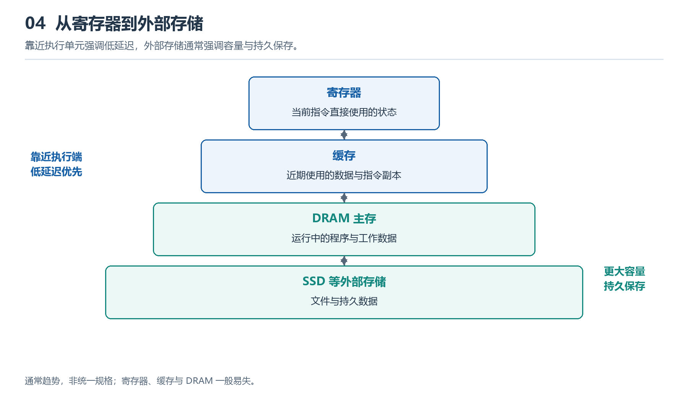

# 4.1 为什么需要存储层次：容量、速度、成本与持久性

如果把计算机想象成一间厨房，处理器就是正在灶台前忙碌的厨师，数据和指令则是食材与菜谱。厨师手边的小碟子拿取最快，却放不了多少东西；操作台能铺开更多材料，但伸手和转身仍要花时间；冰箱容量更大，取用更慢；仓库可以长期保存大量物品，可每次搬运都要经过更长的路径。计算机的存储系统也采用类似安排：不是寻找一种“什么都最好”的存储器，而是让多种特性不同的设备分工合作，形成由近及远、由快到慢的层次。

{width=95%}

少量高速空间服务近期需求，大容量空间承担长期保存。双向箭头表示数据可在层次间移动，不表示每次访问都经过全部层级。

这种层次首先源于四个彼此牵制的目标：容量、速度、成本与持久性。容量决定能容纳多少程序、文档、照片和中间结果；速度决定处理器等待数据的时间；成本既包括每单位容量的制造代价，也包括芯片面积、能耗、散热和系统复杂度；持久性则说明断电之后信息能否继续存在。理想的存储器应该无限大、瞬间响应、几乎免费，而且永不丢失，但现实中的材料、制造工艺和电路设计无法同时满足这些愿望。

通常，越靠近处理器的存储越强调速度。它必须在处理器快速执行指令时及时提供操作数，并迅速接收计算结果。为了缩短访问路径和响应时间，这类存储采用高性能电路，占用宝贵的芯片面积，容量因而较小，单位容量也更昂贵。更远一些的主存能够放下正在运行的操作系统、应用和数据，容量明显增加，却无法在每次访问上都与处理器同步。再往外的持久存储负责保存尚未运行的程序和需要长期保留的文件。它容量大、断电后不丢失信息，但访问延迟更高，也不适合直接承担处理器每一步计算所需的频繁读写。

持久性尤其容易被误解。人们常说“文件在电脑里”，仿佛所有数据都安稳地待在同一个地方。实际上，打开一张照片时，原始文件可能保存在固态硬盘中，相关内容随后被读入内存，处理器近期需要的部分又会进入更靠近它的高速存储。编辑过程中，新像素、撤销记录和界面状态可能同时散布在多个层次。只有应用执行保存、系统完成必要的数据传送后，修改才会成为持久存储中的版本。若突然断电，内存中的临时状态通常会消失，而已经可靠写入持久介质的数据才有机会保留下来。由此可见，“能快速使用”和“能长期保存”是两个不同的问题。

既然处理器附近的存储最快，为什么不把它做得足够大？原因不只是价格。高速电路越多，占用的芯片面积越大，布线越复杂，功耗和热量也越难控制；距离增加还会让信号传播与协调变慢。反过来，如果所有内容都只放在大容量持久存储中，处理器就会像一位每切一片菜都要跑去仓库取刀的厨师，大量时间耗在等待和搬运上。层次结构的核心价值，正是在可承受的成本内，让处理器在大多数时候看到一个“好像既快又大”的存储系统。

这套办法能够奏效，依赖程序访问数据时普遍存在的局部性。时间局部性是指刚刚使用过的信息往往很快还会再次使用。例如阅读电子书时，当前页面会被反复绘制；编辑一句话时，光标附近的字符会连续参与显示、拼写检查和撤销记录。空间局部性是指访问某个位置后，附近位置也很可能接着被访问。就像查阅纸质词典中的一个词时，常会顺便看同一页的释义和相邻词条；播放影片时，系统也通常按顺序读取接下来的一段数据。程序的循环、顺序指令和数组遍历都呈现类似规律。

因此，系统不必把全部数据都放在最快的位置，只需把“眼下最可能用到”的一小部分移近处理器。好比书桌上只摆当前课程的教材，书架收纳常用书，储物间保存很少翻阅的资料。需要新内容时，系统从较低层取来一块数据；若上层空间不足，就选择某些暂时不活跃的内容移出或覆盖。命中时，处理器能在近处迅速取得数据；未命中时，则必须向更远的层次请求，并承担等待与传输的代价。硬件和操作系统共同完成许多这样的调度，应用程序也会通过数据布局、读取顺序和批量处理影响实际效果。

数据移动本身并非免费。除了等待时间，它还会占用连接不同部件的传输通道，消耗电能，并可能与其他任务争夺资源。搬家时，物品在新旧住所之间的运输往往比在房间里重新摆放更费力；同样，计算机有时并不是“算得慢”，而是花了大量时间把数据送到能计算的地方。一个算法即使运算步骤不多，如果频繁跳到相隔很远的位置读取零散数据，也可能难以充分利用近处的高速存储。相反，按连续顺序处理一批相关数据，往往更符合空间局部性，也能减少重复搬运。

不同层次还需要明确分工。处理器近旁的存储追求极短的访问时间，保存立即参与执行的少量信息；主存提供运行时的主要工作空间，在容量和速度之间折中；持久存储则承担程序、文件和长期数据的保存，并在需要时把内容送入内存。数据常从外向内逐级靠近处理器，计算结果又沿相反方向返回，最终在需要长期保留时写入持久介质。用户看到的是一次打开、编辑和保存，系统内部却是一连串复制、缓存、替换与同步。

理解存储层次，不应只背诵“越近越快、越远越大”。更重要的是认识四项权衡：更大的容量让系统容纳更多内容，更高的速度减少等待，更低的成本使设备可实际制造和普及，而持久性保证信息跨越断电与重启继续存在。任何单一技术都只能在这些目标之间取得某种平衡，层次结构则利用局部性，把不同技术组合成一个整体。

接下来，我们可以沿着这条由近到远的路径观察具体成员：直接服务于指令执行的寄存器，保存近期热点数据的高速缓存，构成主要工作区的 DRAM，以及承担大容量持久保存的 NAND 闪存。它们并不是彼此替代的竞争者，而是共同组成现代计算机的数据接力系统。
