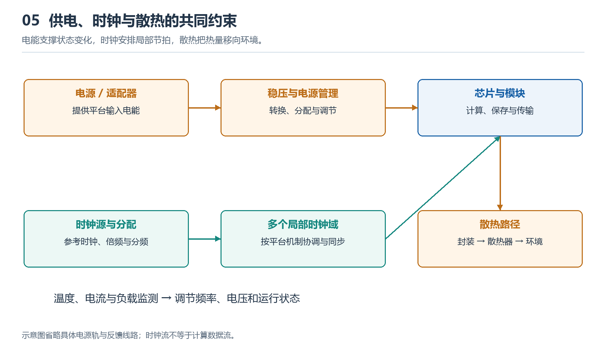

# 5.1 电能从哪里来：电源、接口与主板供电路径

观察台式机背面，可以看到电源线接入机箱；观察笔记本，电能可能来自电源适配器，也可能来自内部电池。沿着这些线索向内追踪，会发现计算机没有一条“插上就直达芯片”的简单电路。从外部电源到处理器、内存和存储设备，电能需要经过转换、分配与保护，才能成为各模块可以使用的供电。

理解这条路径，是认识计算机物理基础的第一步：数据说明系统处理什么，电能则使这些处理活动得以发生。

{width=95%}

供电解决电路获得什么能量，时钟帮助安排何时接收状态，散热决定热量如何离开器件。三者共同限制可持续性能。

## 5.1.1 从插座到设备：先得到可用的直流电

市电插座提供交流电，而计算机内部的主要电子电路使用直流供电。两者之间需要电源转换装置。

台式机通常把这一装置安装在机箱内部，称为电源供应器，常简称“电源”。它将输入的交流电转换为设备需要的直流输出，并承担一定的稳压、隔离和保护功能。笔记本通常由外部适配器完成交流到直流的转换，再由机内电路继续分配和转换。适配器上的输入、输出标识，就是观察这一步转换的直接证据。

电池则提供另一种入口。笔记本使用电池运行时，不必先从市电获得能量，但电池输出仍需经过管理和转换，才能满足内部电路的要求。接上适配器后，供电与充电如何协调，由具体设备的电源管理设计决定，不能简单理解为“电先经过电池，再流向整机”。

还要区分电源功率与实际耗电。电源铭牌上的额定输出功率表示其规定条件下的供电能力，并不表示计算机始终消耗这么多功率。实际取电取决于设备负载、工作状态和转换损耗；插座侧测得的输入功率，也不等于所有芯片功耗的简单相加。

## 5.1.2 电源线进入机箱后，为什么会分成多路

打开已经断电、适合拆装的台式机侧板，常能看到电源引出的多组线缆。有的接向主板，有的接向显卡，还有的接向存储设备。这些分支反映了不同模块的位置、用电需求和连接方式。

| 可观察对象 | 常见供电作用 | 理解时的边界 |
|---|---|---|
| 主板主供电接口 | 为主板及相关电路提供输入电源 | 不代表所有部件都只从这里取电 |
| 处理器附近的辅助供电接口 | 向处理器相关供电电路输送电能 | 接口附近仍有后续电压转换环节 |
| 显卡供电连接 | 为需要额外供电的显卡提供输入 | 部分显卡可只通过扩展插槽取电 |
| 存储设备供电连接 | 为部分硬盘、固态硬盘等供电 | 也有设备直接从主板插槽取电 |
| 风扇与外设供电连接 | 为风扇或外部设备提供电能 | 接口还可能承载控制或数据信号 |

这张表描述的是常见关系，并非所有计算机的固定布局。笔记本、小型主机和高度集成的设备，往往把这些路径集中在电路板内部，外观上看不到对应的独立线缆。

连接器也不能仅凭“插得进去”判断兼容。外形相近的接口，可能具有不同的引脚定义；模块化电源在电源本体一端的线缆定义，也不能假定跨型号通用。实物观察应以设备标识和对应说明书为依据。

## 5.1.3 主板既连接信号，也分配电能

前面把主板看作系统骨架，现在可以为这幅图增加一层：主板还是供电网络的重要载体。

电能从连接器进入后，会经过导体、保护与控制器件，到达不同用电区域。主板内部有多层铜结构，其中一些用于传输信号，一些形成电源和地的分配网络。电流不仅需要流向负载，还需要返回电源，形成闭合回路；“地”因此也是供电与信号分析中的重要参照，不能理解为所有电流最终消失的地方。

主板收到的输入电压，通常不能直接用于每一种芯片。处理器、内存及其他电路有各自的供电要求，因此主板上还分布着局部电压转换电路。处理器插座附近成排的电感、电容等器件，就是寻找这些电路的可见线索。它们共同参与供电，不能把其中某一个元器件单独当作完整的稳压装置。

以一台常见台式机为例，可以把处理器的供电路径概括为：

**市电 → 电源供应器 → 处理器辅助供电线缆 → 主板局部供电电路 → 处理器封装 → 芯片内部电路。**

这是一张功能路径图，省略了具体设计中的开关、检测与保护环节。它揭示的关键关系是：电能要经过多个层级，才能抵达真正执行计算的电路。

## 5.1.4 为什么关机后还可能有电

“关机”是系统状态，不一定等于切断全部供电。某些计算机在正常关机后，仍保留待机供电，用于响应电源键、支持特定唤醒功能，或为部分接口供电。机箱上的电源键通常向控制电路发出请求，再由控制电路协调主要供电的启停。

因此，屏幕熄灭、风扇停止，并不能证明内部所有位置都已失电。观察或拆装前，应按设备说明断开外部供电；带内置电池的设备还需遵循其维护要求。电源供应器内部可能保留危险电压，不应为了观察转换过程而自行拆开。

完成本节的实物观察，不需要接触带电电路。只需辨认电能入口、记录可见供电连接，再把它们画成“来源—转换—分配—负载”的路径，就能建立第一张供电地图。沿着这张地图继续追问：为什么同一台计算机内部需要不同电压，负载变化时又如何保持稳定？这就进入了电压转换与稳压的问题。
