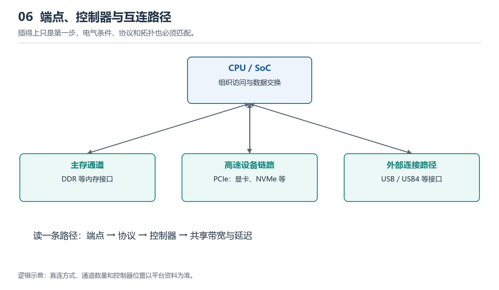

# 6.1 为什么需要总线与协议：连接不等于能够通信

观察一块主板，可以看到处理器插座、内存插槽、扩展插槽，以及通向机箱外部的各种接口。它们之间有铜线、焊点和连接器，似乎只要把设备插进去，数据就能自然流动。但物理连接只是通信的起点：接收方还必须知道何时读取信号、怎样区分不同信息，以及收到错误数据后如何处理。

理解系统互连，首先要分清三个问题：**信号能否到达、信息如何表达、双方如何协作。** 总线与协议，就是围绕这些问题建立的连接结构和通信规则。

{width=95%}

沿端点、控制器和共享路径阅读，才能解释兼容性、带宽竞争和延迟。相同外形接口不一定支持相同功能。

## 6.1.1 从一根连接线看通信的条件

设想两个电路之间只有一根信号线，另有共同的电气参考。发送方改变线上的电压，接收方检测变化。这已经具备传递信息的可能，却还没有形成完整的通信机制。

双方首先要约定：什么范围的电压表示逻辑状态，信号在什么时刻有效，一段状态持续多久。如果发送方已经切换到下一位，接收方却仍按上一位的时间读取，即使导线完好，也可能得到错误结果。

接着还要约定信息的组织方式。一串二进制位，可能代表数值、地址，也可能代表“开始读取”这样的命令。它本身不会告诉接收方自己的含义，需要位置、顺序或附加标记来说明。

最后，系统还必须处理现实条件：接收方暂时忙碌怎么办？多个请求同时到达，先处理哪个？传输受到干扰，怎样发现问题？这些问题说明，通信需要的不只是导电通路，还需要电气、时间和行为上的共同约定。

## 6.1.2 总线组织连接，协议规定协作

在计算机中，“总线”常用来指模块之间传递信息的公共通路及相关连接机制。传统总线往往让多个设备共享一组线路；现代系统则大量采用点对点链路，并通过交换结构连接多个设备。因此，看到“总线”一词，不应一概想象成所有设备共用的一束导线。

“协议”是参与通信的各方共同遵守的规则，包括信息格式、交互顺序、状态变化和异常处理。总线与协议并非完全分离：一种具体互连技术，通常会同时规定连接方式和通信规则。

可以把一次设备访问拆成几个层面：

| 层面 | 需要解决的问题 | 典型内容 |
|---|---|---|
| 物理与电气 | 信号怎样可靠到达 | 连接器、线路、电压要求 |
| 信号与时序 | 何时读取，怎样识别数据 | 编码、采样、同步 |
| 传输组织 | 怎样交付一段信息 | 分组、流量控制、差错检测 |
| 操作语义 | 收到信息后做什么 | 读取、写入、返回状态 |

这张表是一种分析工具，并不意味着每种互连标准都按四个独立层次实现。它帮助我们把“插得上”与“能工作”之间的条件逐一展开。

## 6.1.3 地址、数据与控制如何配合

理解总线时，经常会遇到地址、数据和控制三个概念。

地址用于指出访问目标，例如某个存储位置或设备寄存器；数据是需要传送的内容；控制信息说明要进行什么操作，例如读取还是写入。设备寄存器可以先理解为设备向软件开放的一组状态和控制位置。

以读取设备状态为例，请求方需要指定目标位置，表达读取意图；接收方识别请求后，返回状态内容。返回结果还必须能够与相应请求对应，否则多个访问交错进行时，系统就可能混淆结果。

这些是逻辑上的分工，不一定对应三组独立导线。有些互连使用分开的线路，有些在同一组线路上分时传递不同信息，还有些把地址、控制和数据组织成分组。**功能分类不能直接当作实物布线图。**

这也解释了为什么仅凭主板上一束线路的外观，很难判断其中哪些正在传地址、哪些正在传数据：实际含义取决于接口规范和当时的通信状态。

## 6.1.4 为什么接通以后仍可能不能使用

以外接存储设备为例，从插入端口到能够打开文件，中间存在一条协作链。

连接首先要满足机械和电气条件。随后，连接双方需要依照适用标准建立通信，识别设备并完成必要配置。操作系统再通过相应驱动访问设备，存储软件解释其中的数据结构，应用程序才有机会读取文件。

这条链上的不同环节可能产生相似的外在现象。例如，“设备没有出现”可能涉及供电、线缆、连接建立或设备识别；“设备已经出现但打不开文件”，则可能涉及分区、文件系统或访问权限。现象相近，并不说明故障位于同一层。

因此，连接器外形相同，不能单独证明双方支持相同功能。端口、线缆、设备和软件支持共同决定最终能力，判断时需要查看各自规格。

## 6.1.5 用一条链路建立互连地图

现在可以回到实物，选择一条明确的连接，例如处理器到主存，依次记录：两端是谁、经过哪些连接结构、传递什么信息、遵循什么规则。暂时无法确认的项目应标为未知，再用设备手册或标准资料补齐。

也可以向 AI 提出：

> 请作为计算机系统教师，以“处理器访问主存”为对象，分别解释物理连接、时序、地址、数据和控制的作用。用一次简化读取过程串联它们，区分概念模型与具体实现；涉及代际参数时，请给出可核验的标准来源，并标明不确定之处。

掌握这套观察方法后，PCIe、DDR和USB4就不再只是接口名称。它们是在不同连接对象和任务约束下形成的互连方案；理解它们，要从“连接了谁”继续追问“双方怎样完成一次可靠协作”。
